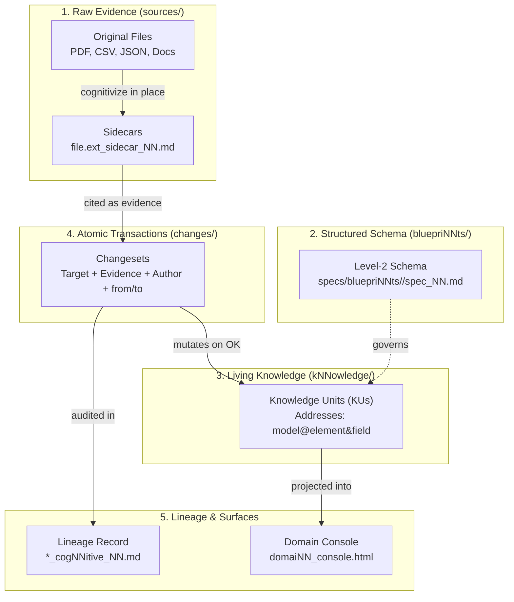
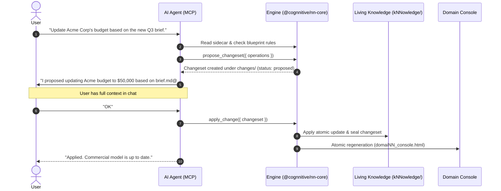

# The mental model: from raw source to audited knowledge

cogNNitive is not a database, not a static site generator, and not an opaque AI memory store.
It is an **auditable knowledge ecosystem built entirely on plain text files** (Markdown with YAML frontmatter), versioned in Git, and designed so that humans and AI agents share the exact same mental model without drift or hallucination.

This page explains how cogNNitive works under the hood, clarifies common misconceptions, and walks through a complete end-to-end lifecycle.

---

## The problem

Knowledge workflows usually suffer from one of two extremes:

1. **Unstructured chaos:** Notes and documents are dumped into folders. AI assistants edit files directly, overwriting paragraphs and hallucinating claims without citing where the data came from.
2. **Proprietary black boxes:** Data is locked inside database engines or vector embeddings where humans cannot review the raw facts or inspect Git diffs.

cogNNitive solves this by enforcing three foundational rules:
* **The original evidence is immutable:** Raw files are never modified.
* **The knowledge unit is clean:** A model contains structured facts, not inline citation clutter.
* **The change is the only provenance:** Every mutation is an atomic, auditable transaction backed by explicit evidence.

---

## The five architectural pillars

### 1. Raw Sources and the Sidecar bridge

A **Source** (`sources/import/`) is any raw file brought from the outside world: a customer contract PDF, an exported sales CSV, an API JSON payload, or interview transcripts.

* **Rule of thumb:** A raw file is **never converted, renamed, or modified**.
* **The Sidecar bridge:** To make arbitrary formats citable by AI and tools, running `cognitivize` creates a companion file right next to the original:
  `<filename>.<ext>_sidecar_NN.md`
* The sidecar stores physical metadata (SHA-256 hash, byte size, timestamp) and a normalized Markdown text representation for binary formats. Agents and validators read the sidecar; your original file stays byte-for-byte untouched.

### 2. Can a Model be a CSV or JSON?

A common point of confusion is whether a knowledge model can be stored as a CSV or JSON file:

* **No. A model (`kNNowledge`) is always a structured Markdown document (`_NN.md`) with YAML frontmatter.**
  It represents a typed conceptual graph (concepts, elements, relationships, and matrices) defined by a Level-2 **blueprint** (`bluepriNNt`).
* **Where CSV and JSON belong:**
  * As **Sources** (`sources/import/`): Raw tabular or structured evidence.
  * As **Artifacts** (`artifacts/`): Curated tabular exports produced from the knowledge graph.

### 3. Knowledge Units (KU): Semantic Addressing

Instead of relying on fragile line numbers (`#L42-L50`) that break whenever text is edited, cogNNitive addresses every piece of information semantically as an atomic **Knowledge Unit (KU)**:

| Scope | Syntax | Example |
| :--- | :--- | :--- |
| **Domain** | `domaiNN_NN.md` | `domaiNN_NN.md` |
| **Document** | `<modelId>` | `kNNowledge/business` |
| **Concept section** | `<model>@concept:<slug>` | `business@concept:objectives` |
| **Element** | `<model>@<element>` | `business@q3-revenue-target` |
| **Field value** | `<model>@<element>&<field>` | `business@q3-revenue-target&amount` |
| **Matrix cell** | `<model>@<matrix>&<row>&<col>` | `business@swot-matrix&strength-1&opportunity-2` |

Raw sources are cited with the same precision:
* **Markdown:** `sources/import/brief.md@## Target Audience`
* **CSV row/cell:** `sources/import/prices.csv@SKU-101&price_usd`
* **JSON pointer:** `sources/import/payload.json@/company/billing/tax_id`

---

## The change is the only provenance

In earlier versions of knowledge systems, each data field carried a companion citation tag directly inside the model file. This caused excessive churn and merge conflicts on every update.

In cogNNitive:
1. **The Knowledge Unit is provenance-free:** The model file contains only the current validated state.
2. **Provenance is derived from the Changeset log:** 
   When an agent or human updates a field, they create a **Changeset** (`changes/`). Each operation records:
   * `target`: The exact Knowledge Unit (`business@q3-revenue-target&amount`).
   * `from → to`: Previous value and new value.
   * `author`: Agent or human identifier.
   * `applied_at`: ISO UTC timestamp.
   * `evidence`: Mandatory source citations backing the change (`sources:: [prices.csv@SKU-101&price_usd]`).
3. **Audit on demand:** When viewing a field in the domain console or via CLI, the system derives its entire timeline by querying the chronological chain of changes pointing to that KU target.

---

## The conversational loop: agility meets safety

A common question is: *“Do I have to open the console and inspect visual diffs for every single update?”*

**No.** The workflow balances conversational velocity with formal auditability:

1. **Dialogue & Proposal:** You discuss requirements naturally with your AI assistant. The assistant formulates a structured `propose_changeset` with verified evidence.
2. **Chat approval:** If you already discussed the context in chat, you simply reply **`OK`**. You do not need to switch windows or leave your terminal/chat.
3. **The safety net:** If a change is complex, touching dozens of elements across multiple models, the Domain Console (`domaiNN_console.html`) is right there, allowing you to review visual diffs and relational impact graphs before approving.

---

## Watch Folders and External Ingestion

When external files arrive from scanners, shared Dropbox drives, or downloads, cogNNitive handles them through **Watch Roots** declared in `domaiNN_NN.md`:

* **No CPU-heavy background daemons:** Ingestion scans are triggered on session boot or on-demand via `--scan-external`.
* **The decision digest:** The scanner classifies files into `NEW`, `EVOLVED_DYNAMIC`, `STATIC_ALERT`, or `DISCONNECTED`.
* **Explicit consent:** You review the digest and decide per item: `import`, `postpone`, or `ignore`. Imported files are copied to `sources/import/` with write-once timestamping and cognitivized immediately.

---

## Summary of principles

| Concept | What it is | What it is NOT |
| :--- | :--- | :--- |
| **`sources/`** | Raw external evidence (PDF, CSV, JSON, images). | Modifiable working drafts. |
| **`_sidecar_NN.md`** | Co-located metadata and normalized text representation. | A separate database or mirror tree. |
| **`kNNowledge/`** | Validated Markdown data model governed by a blueprint. | A raw dump or flat CSV table. |
| **`changes/`** | Sealed, append-only transaction log and provenance source. | Ephemeral scratch notes. |
| **`domaiNN_console.html`** | Offline, self-contained interactive web review UI. | A mandatory roadblock for every chat operation. |

## See also

- [The knowledge lifecycle](knowledge-lifecycle.md) — the operational pipeline from import to export.
- [Sources, citations and lineage](sources-citations-lineage.md) — deep dive into citation grammars.
- [Review changesets](../how-to/review-changesets.md) — step-by-step changeset approval guide.
- [Use the domain console](../how-to/domain-console.md) — exploring knowledge offline in your browser.
