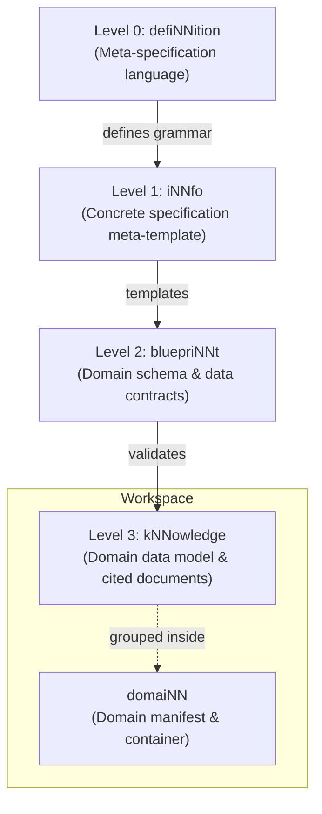

# cogNNitive Documentation — Master

> Concatenation of every page in the `docs/documentation` Docsify suite
> (`domain/site_docs_site_NN.md`), in sidebar order. The individual pages are
> the source of truth; this file is a single-file snapshot for offline reading
> and full-text search.

> Pages: 5.

## Contents

- [Create your first domaiNN](#create-your-first-domainn) — tutorial
- [Validate your domaiNN](#validate-your-domainn) — guide
- [The Levels of cogNNitive](#the-levels-of-cognnitive) — concept
- [MCP Tools Reference](#mcp-tools-reference) — reference
- [Vocabulary: Canonical Terms](#vocabulary-canonical-terms) — reference

---

<!-- begin: content/first-domain.md -->

# Create your first domaiNN

> [!NOTE]
> This tutorial takes about 5 minutes. You will learn the happy path from installing the tools to creating a validated domaiNN.

## 1. Prerequisites

Before starting, ensure you have an AI coding agent with MCP support (such as Antigravity, Claude Code, or Cursor).

## 2. Install the Ecosystem

Paste this single instruction to your agent:

```text
I want to use https://cognnitive.com/use
```

The agent registers the `nn-mcp` tools and downloads the essential skills.

## 3. Initialize your Workspace

Run the `init_domain` tool through your agent:

```bash
# The agent executes:
nn-mcp init_domain --name my-project
```

This creates the standard folder hierarchy:

- `domaiNN_NN.md` (the domain manifest)
- `kNNowledge/` (where your domain documents will live)
- `sources/` (where raw inputs and normalized sources are tracked)
- `specs/` (bluepriNNts and validation rules)

## 4. Add your First Source

Drop any meeting notes or spec document into `sources/import/meeting.md`, then ask your agent:

> "Cognitivize `sources/import/meeting.md`"

The agent generates a sidecar file (`meeting.md_sidecar_NN.md`) with SHA-256 hashes, making every heading a citable unit with zero modification to your original document.

<!-- end: content/first-domain.md -->

---

<!-- begin: content/validate-domain.md -->

# Validate your domaiNN

Validation in cogNNitive is deterministic: the core engine (`@cognnitive/nn-core`) evaluates structural integrity, schema compliance, and citation freshness.

## Validation Tools Overview

| Tool | Scope | When to use |
|---|---|---|
| `validate_knowledge` | Single `.md` file | Run after editing any kNNowledge document |
| `check_domain` | Entire domaiNN | Run before commits or PRs to verify global lineage |
| `check_citations` | Citations & sidecars | Run when source documents have been updated |

## Common Validation Errors and Fixes

- **`DANGLING_CITATION`**:
  - *Cause*: A heading in a source document was renamed or removed.
  - *Fix*: Update the `sources:: [...]` bracket in your document to the new heading identifier, or restore the heading in the source.
- **`SCHEMA_VIOLATION`**:
  - *Cause*: A required field defined in the bluepriNNt is missing or has an invalid type.
  - *Fix*: Check the bluepriNNt specification under `specs/bluepriNNts/<name>/spec_NN.md` and add the missing property.
- **`LINEAGE_DRIFT`**:
  - *Cause*: A file was added or deleted manually without synchronizing the manifest.
  - *Fix*: Ask your agent to run `sync_lineage` to refresh the manifest automatically.

<!-- end: content/validate-domain.md -->

---

<!-- begin: content/levels.md -->

# The Levels of cogNNitive

cogNNitive organizes information into four strictly typed abstraction layers, from foundational meta-specifications down to real-world domain data.



## Level Breakdown

### Level 0: defiNNition
The bedrock grammar. It specifies how comments, headings, property blocks (`key:: value`), and brackets are parsed across all tools.

### Level 1: iNNfo
The meta-blueprint standard. It defines how schemas, field types, enums, and inheritance work.

### Level 2: bluepriNNt
Schemas tailored to specific business domains (e.g. `business`, `code-architecture`, `meetings`, `site`). A bluepriNNt dictates which entities exist and which fields are required.

### Level 3: kNNowledge
The actual documents you write and query every day. Each kNNowledge document references a Level 2 bluepriNNt in its frontmatter (`parent_spec`), declaring conformance.

<!-- end: content/levels.md -->

---

<!-- begin: content/mcp-tools.md -->

# MCP Tools Reference

The `nn-mcp` server exposes standard tools directly to your AI coding agents.

## Core Inspection Tools

| Tool Name | Parameters | Returns | Description |
|---|---|---|---|
| `validate_knowledge` | `path: string` | Diagnostics report | Validates a single Level 3 kNNowledge file against its parent bluepriNNt. |
| `check_domain` | `domain_dir?: string` | Health summary | Audits the entire workspace, reporting schema errors and dangling citations. |
| `cognitivize` | `path: string` | Sidecar path | Creates a deterministic SHA-256 sidecar for an import file without altering the source. |
| `init_domain` | `name: string` | Workspace status | Scaffolds a new domaiNN directory layout with standard manifests. |

## Quick Command Examples

```json
{
  "name": "validate_knowledge",
  "arguments": {
    "path": "kNNowledge/architecture_NN.md"
  }
}
```

<!-- end: content/mcp-tools.md -->

---

<!-- begin: content/vocabulary.md -->

# Vocabulary: Canonical Terms

The cogNNitive ecosystem pins a canonical vocabulary so every editor label, doc, and
skill refers to the same concept by the same name. The authoritative source is the
machine-readable dictionary at
[`iNNfo/specs/vocabulary.json`](https://github.com/cogNNitive/cogNNitive-web/blob/main/iNNfo/specs/vocabulary.json);
this page is the human-readable rendering of it.

## Level Hierarchy & Canonical Terms

| Level | Canonical Term | Deprecated / Former Aliases | Sense |
|---|---|---|---|
| Level 0 | **defiNNition** | `defiNNe` | Level-0 meta-specification language (formerly defiNNe) |
| Level 1 | **iNNfo** | *(none)* | Level-1 concrete specification meta-template defining root primitives (Concept Definition, Field Definition, Matrix Definition) |
| Ecosystem / Role | **tag** | *(none)* | A value of the `tags` Field, an ordinary multi-valued select Field; there is no reserved `tags` property and no Marker primitive |
| Level 1 | **meta-bluepriNNt** | `meta-template` | Level-1 specification describing the structure of bluepriNNts |
| Level 2 | **bluepriNNt** | `app`, `template` | Level-2 domain schema specification file (formerly Template / App; e.g. business_V_0-2-0_NN.md) |
| Level 3 | **kNNowledge** | `model` | Level-3 domain data model (formerly Model). Uncountable noun. The version lives in the `knowledge_version` frontmatter, never in the filename (`_V_` names are retired). |
| Level 3 | **domaiNN** | `workspace` | Container of kNNowledge, bluepriNNts, sources, procedures and related assets (formerly Workspace). A domaiNN is itself a kNNowledge document. |
| Ecosystem / Role | **ageNNt** | `actioNN` | Skill ecosystem, execution engine, and dynamic AI persona framework for cogNNitive |
| Ecosystem / Role | **referenced skill** | `external skill` | A third-party agent skill a bluepriNNt declares in its frontmatter `skills:` array, pinned to a commit + sha256 digest with an SPDX license, and fetched from its upstream repo at install time (never vendored, never fetched at runtime). Its guarantee is bounded to reproducible + unmodified-since-pin + license-declared; the maintainer does not vouch for the author. Distinct from an embedded skill, which is vendored and curated. |
| Level 3 | **sidecar** | *(none)* | Co-located <file>.<ext>_sidecar_NN.md document that carries a file's hash, size, metadata and, for binary files, a normalized body. A concept, not a new level: a kNNowledge-level document that is never a model and is never mirrored into a separate `sources/nn/` tree (that tree is retired). |
| Ecosystem / Role | **cognitivize** | *(none)* | Operation that creates or refreshes a sidecar in place, leaving the original file untouched. One innfo-core operation (cognitivize), surfaced through the nn-sources CLI (--cognitivize <file|dir>) and the innfo-mcp tool; raw imports land verbatim in sources/import/ and are cognitivized there. |
| Ecosystem / Role | **artifacts** | *(none)* | The single write destination for every producer output (consoles, reports, curated CSVs, briefs). Replaces the retired `export/` folder: one rename, no fallback. A non-_NN.md file is an artifact lineage node only if it is a timestamped write-once family member or declares upstream sources. |
| Ecosystem / Role | **write-once** | *(none)* | Producer rule: each output is a new family member named with a UTC suffix _YYYYMMDDTHHmmssZ (with -2, -3... same-second tie-breaks) placed before the extension; existing bytes are never overwritten, and latest-of-family is resolved by name. GC only proposes deletions and deletes only with explicit user consent. |
| Ecosystem / Role | **drift-gate** | *(none)* | Consistency check that the managed view sections of the persisted lineage record (*_cogNNitive_NN.md) equal a fresh core projection. Runs in nn-sources --lineage --check, scripts/verify.js, and the innfo-mcp check_workspace tool. |
| Ecosystem / Role | **assistant** | `coach`, `architecture coach` | Interactive architecture mentor and modeling guide persona in iNNfo |
| Ecosystem / Role | **console** | *(none)* | User-facing UI that shows and reviews a domaiNN: the domain console (`domaiNN_console.html`, one per domaiNN) whose specialized surfaces are views shown as tabs. Replaces the retired Vue "editor" and the retired hosted web app. |

## Level Terms Detail

### **defiNNition**

- **Sense**: Level-0 meta-specification language (formerly defiNNe)
- **Deprecated Aliases**: `defiNNe`
- **Excluded Senses** (not renamed): `ordinary-english-definition`

### **iNNfo**

- **Sense**: Level-1 concrete specification meta-template defining root primitives (Concept Definition, Field Definition, Matrix Definition)

### **tag**

- **Sense**: A value of the `tags` Field, an ordinary multi-valued select Field; there is no reserved `tags` property and no Marker primitive
- **Excluded Senses** (not renamed): `git-tag`, `release-tag`, `html-tag`

### **meta-bluepriNNt**

- **Sense**: Level-1 specification describing the structure of bluepriNNts
- **Deprecated Aliases**: `meta-template`

### **bluepriNNt**

- **Sense**: Level-2 domain schema specification file (formerly Template / App; e.g. business_V_0-2-0_NN.md)
- **Deprecated Aliases**: `app`, `template`
- **Excluded Senses** (not renamed): `vue-sfc-template`, `generic-english`

### **kNNowledge**

- **Sense**: Level-3 domain data model (formerly Model). Uncountable noun. The version lives in the `knowledge_version` frontmatter, never in the filename (`_V_` names are retired).
- **Deprecated Aliases**: `model`
- **Grammar Rule**: Uncountable noun. Written as `N kNNowledge documents`.
- **Distinct Senses**: "knowledge unit"
- **Excluded Senses** (not renamed): `llm-model`, `statistical-model`

### **domaiNN**

- **Sense**: Container of kNNowledge, bluepriNNts, sources, procedures and related assets (formerly Workspace). A domaiNN is itself a kNNowledge document.
- **Deprecated Aliases**: `workspace`
- **Container Nature**: A domaiNN is itself a kNNowledge document containing other documents.
- **Excluded Senses** (not renamed): `npm workspace`, `VS Code workspace`, `git worktree`, `IndexedDB workspace`, `subject-area domain`

### **ageNNt**

- **Sense**: Skill ecosystem, execution engine, and dynamic AI persona framework for cogNNitive
- **Deprecated Aliases**: `actioNN`
- **Excluded Senses** (not renamed): `generic-agent`, `subagent-runtime`

### **referenced skill**

- **Sense**: A third-party agent skill a bluepriNNt declares in its frontmatter `skills:` array, pinned to a commit + sha256 digest with an SPDX license, and fetched from its upstream repo at install time (never vendored, never fetched at runtime). Its guarantee is bounded to reproducible + unmodified-since-pin + license-declared; the maintainer does not vouch for the author. Distinct from an embedded skill, which is vendored and curated.
- **Deprecated Aliases**: `external skill`
- **Excluded Senses** (not renamed): `embedded skill`, `vendored skill`

### **sidecar**

- **Sense**: Co-located <file>.<ext>_sidecar_NN.md document that carries a file's hash, size, metadata and, for binary files, a normalized body. A concept, not a new level: a kNNowledge-level document that is never a model and is never mirrored into a separate `sources/nn/` tree (that tree is retired).
- **Excluded Senses** (not renamed): `motorcycle-sidecar`, `sidecar-container`

### **cognitivize**

- **Sense**: Operation that creates or refreshes a sidecar in place, leaving the original file untouched. One innfo-core operation (cognitivize), surfaced through the nn-sources CLI (--cognitivize <file|dir>) and the innfo-mcp tool; raw imports land verbatim in sources/import/ and are cognitivized there.

### **artifacts**

- **Sense**: The single write destination for every producer output (consoles, reports, curated CSVs, briefs). Replaces the retired `export/` folder: one rename, no fallback. A non-_NN.md file is an artifact lineage node only if it is a timestamped write-once family member or declares upstream sources.
- **Excluded Senses** (not renamed): `git-artifacts`, `build-artifacts`

### **write-once**

- **Sense**: Producer rule: each output is a new family member named with a UTC suffix _YYYYMMDDTHHmmssZ (with -2, -3... same-second tie-breaks) placed before the extension; existing bytes are never overwritten, and latest-of-family is resolved by name. GC only proposes deletions and deletes only with explicit user consent.
- **Excluded Senses** (not renamed): `write-once-memory`

### **drift-gate**

- **Sense**: Consistency check that the managed view sections of the persisted lineage record (*_cogNNitive_NN.md) equal a fresh core projection. Runs in nn-sources --lineage --check, scripts/verify.js, and the innfo-mcp check_workspace tool.

### **assistant**

- **Sense**: Interactive architecture mentor and modeling guide persona in iNNfo
- **Deprecated Aliases**: `coach`, `architecture coach`
- **Excluded Senses** (not renamed): `system-prompt-generic`

### **console**

- **Sense**: User-facing UI that shows and reviews a domaiNN: the domain console (`domaiNN_console.html`, one per domaiNN) whose specialized surfaces are views shown as tabs. Replaces the retired Vue "editor" and the retired hosted web app.
- **Excluded Senses** (not renamed): `terminal-console`, `browser-dev-console`, `game-console`

## Retired Identifiers (Documentation Only)

The following table lists retired identifiers and their canonical replacements.
This mapping is documentation-only; no runtime aliases exist.

| Old Identifier / Name | Canonical Replacement | Kind | Notes |
|---|---|---|---|
| `Marker Definition` | ``tags` Field value (flag) or a declared Field (valued)` | primitive | Retired in iNNfo V_0-5-0: a flag marker becomes a value of the tags Field, a valued marker becomes a normal Field; a document that still carries one fails with MARKERS_REMOVED |
| `item-markers matrix` | `declared Fields + concept-level values` | primitive | Retired in iNNfo V_0-5-0: removed with remove_matrix; cells become field values and concept rows become concept-level values |
| `set_marker` | `update_field / update_concept_field` | operation | Retired schema operation; apply_change now rejects it with UNKNOWN_OPERATION |
| `specs/templates/` | `specs/bluepriNNts/` | path | Relocated under iNNfo/specs/bluepriNNts/ and domain specs/bluepriNNts/ |
| `models/` | `kNNowledge/` | path | Domain models directory renamed to kNNowledge/ |
| `export/` | `artifacts/` | path | Producer output folder renamed once to artifacts/, with no fallback; runtime never resolves export/ |
| `sources/nn/` | `sources/import/ + co-located sidecars` | path | Retired mirror tree; raw files live in sources/import/ and are cognitivized in place |
| `sources/original/` | `sources/import/` | path | Retired legacy fallback; sources/import/ is the only canonical raw-import location |
| `sources/export/` | `artifacts/` | path | Retired promotion folder; an artifact reused as input is cognitivized where it lives |
| `sources/archive/` | `write-once families` | path | Retired; a changed source becomes a new suffixed family member, so no snapshot is needed. Any pre-existing content is inert |
| `<name>_V_<x-y-z>_<bp>_NN.md` | `knowledge_version frontmatter` | naming | kNNowledge names drop _V_; the version lives in the knowledge_version frontmatter key |
| `~/.agents/templates` | `~/.agents/bluepriNNts` | path | Global template storage location renamed to bluepriNNts |
| `model_version` | `knowledge_version` | key | Level-3 frontmatter version property |
| `template_version` | `blueprint_version` | key | Level-2 frontmatter version property |
| `template_name` | `blueprint_name` | key | Level-2 schema name property |
| `models_dir` | `knowledge_dir` | key | Domain layout configuration key |
| `templates_dir` | `blueprints_dir` | key | Domain layout configuration key |
| `target_template` | `target_blueprint` | key | Field definition property naming target blueprint |
| `type:: model` | `type:: knowledge` | keyword | Grammar keyword for submodel references |
| `workflow: model` | `workflow: knowledge` | key | Manifest workflow definition key |
| `workflow: template` | `workflow: blueprint` | key | Manifest workflow template parameter key |
| `INNFO_MODELS_DIR` | `INNFO_DOMAIN_DIR` | env_var | Domain root environment variable (no fallback) |
| `templates-v*` | `blueprints-v*` | tag_namespace | Tag namespace for blueprint releases |
| `workspace_NN.md` | `domaiNN_NN.md` | entrypoint | Domain container entrypoint document |
| `nn-workspace-git` | `nn-domain-git` | skill | Skill renamed to reflect domaiNN terminology |
| `capability_folders` | `capability_folders` | mapping | Openspec capability folders retain their existing kebab-case names per D13 |
| `13 legacy tool names` | `13 canonical blueprint/knowledge tool names` | mcp_tools | list_knowledge, read_knowledge, init_knowledge, validate_knowledge, validate_knowledge_url, get_blueprint, validate_blueprint, list_blueprints, hydrate_blueprint, list_blueprint_procedures, list_blueprint_skills, sync_domain_manifest, check_domain |
| `editor` | `console` | ui_term | Retired user-facing UI term: the Vue editor app is replaced by the domain console (see the console term). Not used in user-facing copy. |
| `hosted app` | `console` | ui_term | Retired user-facing UI term for the hosted web application; the domain console replaces it. Distinct from the "app" alias of bluepriNNt, which keeps its entry and is untouched. |
| `innfo-mcp` | `nn-mcp` | release_key | Distribution prefix rename. Existing `innfo-mcp-v*` git tags, published CDN files and stamped exports remain valid and are not renamed; only new releases use `nn-mcp-v*`. |
| `innfo-console` | `nn-console` | release_key | Distribution prefix rename. Existing `innfo-console-v*` git tags, published CDN files and stamped exports remain valid and are not renamed; only new releases use `nn-console-v*`. |
| `@cognnitive/innfo-core` | `@cognnitive/nn-core` | package | npm workspace package renamed to the nn- prefix; workspace-only, never published to the npm registry. |
| `@cognnitive/innfo-mcp` | `@cognnitive/nn-mcp` | package | npm workspace package renamed to the nn- prefix. |
| `@cognnitive/innfo-console` | `@cognnitive/nn-console` | package | npm workspace package renamed to the nn- prefix. |
| `iNNfo/packages/innfo-core` | `iNNfo/packages/nn-core` | path | Package directory renamed to the nn- prefix. |
| `iNNfo/packages/innfo-mcp` | `iNNfo/packages/nn-mcp` | path | Package directory renamed to the nn- prefix. |
| `innfo-mcp` | `nn-mcp` | mcp_server | The MCP `bin` name and the `Server({name})` identity. The old bundle `bin/innfo-mcp.bundle.js` is deleted; existing `innfo-mcp-v*` CDN files and stamped exports remain valid and resolvable. |
| `innfo-mcp_` | `nn-mcp_` | tool_prefix | The MCP tool prefix in skills and documentation. The client builds the prefix from the registered server name; tool names after the prefix are unchanged. |
| `@innfo-console-v` | `@nn-console-v` | console_pin | The console shell pin. Readers still accept `@innfo-console-v*` so already-stamped exports keep resolving; nothing emits it. |
| `innfo-` | `nn-` | prefix | Console assets, generated mirrors and wrapper scripts renamed to the nn- prefix. Existing published files under the old name are never moved or deleted, so old stamps and CDN URLs keep resolving. |

## Consumer Notes

- **Editor labels**: read `vocabulary.json` (read-only) to drive user-facing copy.
- **Skill copy**: references the same dictionary for consistency.
- **Agent Ubiquitous Language**: `AGENTS.md` points to this dictionary and vocabulary page.

<!-- end: content/vocabulary.md -->
