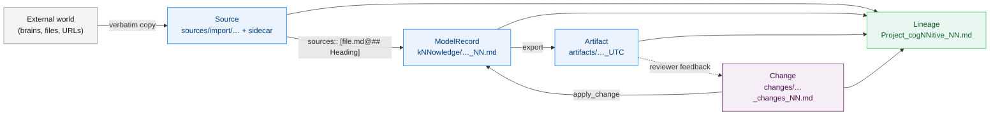
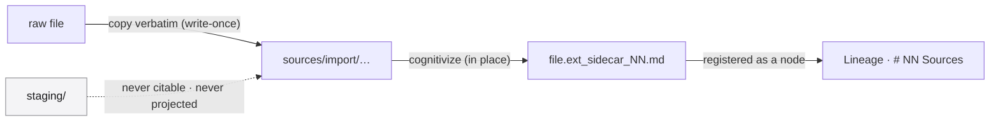
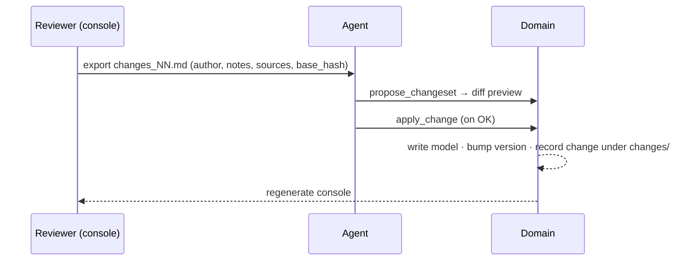
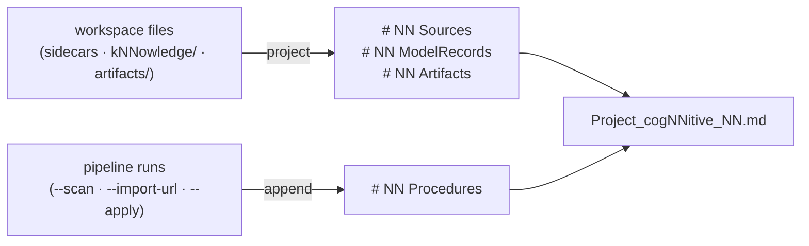
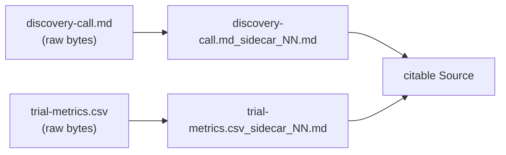
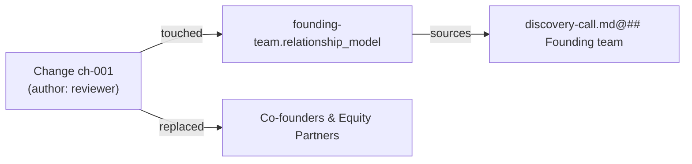

# iNNfo Technical Documentation — Master

> Concatenation of every documentation page in `docs/innfo/documentation/`,
> in sidebar order. The individual pages are the source of truth; this file is
> a single-file snapshot for offline reading and full-text search.

> Pages: 28.

## Contents

- [Home](#home) — 
- [nn-core](#nn-core) — Components
- [nn-mcp](#nn-mcp) — Components
- [OpenCode Agent (Legacy)](#opencode-agent-legacy) — Components
- [Vocabulary](#vocabulary) — Architecture
- [Ecosystem](#ecosystem) — Architecture
- [Specifications](#specifications) — Architecture
- [Discipline Overlaps](#discipline-overlaps) — Architecture
- [External Tooling & Integrations](#external-tooling-integrations) — Architecture
- [Why cogNNitive](#why-cognnitive) — Guides
- [Usage](#usage) — Guides
- [Relationships & Connections](#relationships-connections) — Guides
- [The Knowledge Lifecycle](#the-knowledge-lifecycle) — Guides
- [Sources, Citations & Lineage](#sources-citations-lineage) — Guides
- [Import Modes & Dynamic Sources](#import-modes-dynamic-sources) — Guides
- [Building a Domain from Scratch](#building-a-domain-from-scratch) — Guides
- [Lifecycle Walkthrough (Case Study)](#lifecycle-walkthrough-case-study) — Guides
- [Reviewer Guide](#reviewer-guide) — Guides
- [Tags & Open Taxonomy](#tags-open-taxonomy) — Guides
- [Collaboration with Git](#collaboration-with-git) — Guides
- [Domain Backup Strategies](#domain-backup-strategies) — Guides
- [Editing kNNowledge by Hand](#editing-knnowledge-by-hand) — Guides
- [Blueprints Overview](#blueprints-overview) — Blueprints
- [Video Script Blueprint](#video-script-blueprint) — Blueprints
- [Offline Consoles](#offline-consoles) — Runtime & Internals
- [Console Needs & Visuals](#console-needs-visuals) — Runtime & Internals
- [Console UI Kit](#console-ui-kit) — Runtime & Internals
- [Validator Behavior](#validator-behavior) — Runtime & Internals

---

<!-- begin: README.md -->

# iNNfo Documentation

Welcome to the iNNfo documentation. iNNfo is the specification and tooling layer (`@cognnitive/nn-core` and `@cognnitive/nn-mcp`) that powers the cogNNitive ecosystem.

## Quick Start

```bash
# Install dependencies
npm install

# Build nn-core and the MCP server
npm run build -w @cognnitive/nn-core
npm run build -w @cognnitive/nn-mcp
```

## Sections

### [Offline consoles](offline-consoles)
The **domain console** — one self-contained `domaiNN_console.html` per domaiNN, generated locally. It shows the domain's kNNowledge and reviews it through changesets.

### [nn-core](nn-core)
`@cognnitive/nn-core` is the framework-agnostic TypeScript library shared across the ecosystem: parser, type definitions, validators (`validateKnowledge`, `validateBlueprint`), mutation and changeset engine, lineage and cognitivize helpers, and the `FsDriver` interface.

### [nn-mcp](nn-mcp)
`@cognnitive/nn-mcp` is an MCP server that exposes iNNfo kNNowledge documents, bluepriNNts and operations to AI coding agents (Claude Code, OpenCode, and others) over stdio.

### [Ecosystem](ecosystem)
The four-level specification chain:

| Level | Name | Description |
|-------|------|-------------|
| 0 | **defiNNition** | Meta-specification: structure, SemVer, RFC 2119 |
| 1 | **iNNfo** (and meta-bluepriNNt) | Central spec — single-file `_NN.md` documents |
| 2 | **bluepriNNts** | business, procedures, organization, and more |
| 3 | **kNNowledge** | Concrete instances (Ghostbusters, Code Review Process, Engineering Team) |

### [Specifications](specifications)
Complete listing of all specs and kNNowledge samples at every level, with links to source files.

### [Open Knowledge Format (OKF) alignment](ecosystem?id=open-knowledge-format-alignment)
iNNfo takes conceptual inspiration from OKF v0.1 by Google Cloud Platform and is architecturally aligned with its ideas. cogNNitive is **not** natively OKF-compliant today; full OKF compatibility is planned through a dedicated export mechanism.

### [Usage](usage)
How to author kNNowledge documents, use bluepriNNts, and work with the ecosystem.

### [iNNfo Agent (OpenCode)](opencode-nn-agent)
Connect the iNNfo MCP agent to OpenCode Desktop for natural-language kNNowledge editing.

<!-- end: README.md -->

---

<!-- begin: nn-core.md -->

# @cognnitive/nn-core

Framework-agnostic TypeScript library shared across the cogNNitive ecosystem. Used by `nn-mcp` and the domain console tooling.

## Features

- **Parser** — unified frontmatter, concept, and matrix parsing for `_NN.md` iNNfo documents
- **Model** — type definitions for Concept, Element, Field, Matrix, and Relationship
- **Validator** — `validateKnowledge`, `validateBlueprint`, `validateFormatContent`, `validateFormatSyntax`, and `validateReferences`, validating kNNowledge documents against bluepriNNt schemas
- **Mutate & Changeset** — intent-level mutation operations and the sealed changeset apply/re-validate engine
- **Lineage & Cognitivize** — sidecar-backed source provenance and the lineage projection
- **Slug & Unit Address** — canonical slug derivation and the `unitAddress` / `parseUnitAddress` grammar
- **IO Drivers** — the `FsDriver` interface for reading and writing iNNfo documents
- **Resolver** — resolves the parent chain from level 3 (kNNowledge) up to level 0 (defiNNition), downloading specs as needed and caching them in the OS temp directory

## API

```typescript
import { parseFrontmatter, validateKnowledge } from '@cognnitive/nn-core'

// Parse YAML frontmatter from an iNNfo document
const fm = parseFrontmatter(content)
// Returns: { title, level, parent_spec, ... }

// Validate a parsed kNNowledge document against its resolved blueprint and spec chain
const result = validateKnowledge(knowledgeDoc, blueprintDoc, formatSpecDoc, options)
```

## Usage

```bash
# Build the library
npm run build -w @cognnitive/nn-core

# Run tests
npm run test -w @cognnitive/nn-core
```

<!-- end: nn-core.md -->

---

<!-- begin: nn-mcp.md -->

# nn-mcp

`@cognnitive/nn-mcp` is an MCP (Model Context Protocol) server that wraps `@cognnitive/nn-core` and exposes iNNfo kNNowledge documents over the stdio transport, so AI coding agents — Claude Code, OpenCode, and others — can read, validate, and edit iNNfo kNNowledge documents through structured tool calls instead of freeform file edits.

## Why an MCP server

- Validation stays **deterministic** — the `nn-core` validator decides validity, not the calling LLM.
- Specification and bluepriNNt content is never duplicated into agent rules or config — it is always resolved live via `get_spec` / `get_blueprint`.
- Spec and bluepriNNt resolution follows the document's `parent_spec` chain or an explicit URL — no hardcoded spec URLs.

## Tools

<!-- generated:mcp-tools (source: nn-mcp TOOL_REGISTRY; run node scripts/generate-docs-facts.mjs) -->
**22** tools

| Tool | Description |
|------|-------------|
| `list_knowledge` | Scan the knowledge directory and list all iNNfo knowledge documents |
| `read_knowledge` | Parse and return an iNNfo knowledge document's full structure by its id. For surgical work prefer bounded slices: pass concept (+ element) with max_lines (default 150); slices over the cap truncate with truncated=true unless override_reason records a manual override |
| `get_spec` | Resolve the iNNfo specification (level-1) from an explicit url or from a loaded knowledge document. Provide either url or knowledge_id — the URL is never taken from an internal constant |
| `get_blueprint` | Resolve an iNNfo blueprint (level-2) from an explicit url or from a loaded knowledge document. Provide either url or knowledge_id — blueprint names/URLs are never hardcoded |
| `validate_knowledge` | Validate an iNNfo knowledge document against its blueprint. Provide id (file on disk) or content (raw text). The blueprint is resolved from the knowledge parent_spec.url, or from an optional blueprint_url |
| `apply_change` | Apply an intent-level change or changeset to knowledge documents and re-validate. Supports two-phase execution (validate, then persist atomically) from changes/ documents or bare intent operations. Every operation that mutates a Level-3 kNNowledge model (including freeze_slugs and bump_version) is synthesized into a sealed, recorded changeset; only generate_index and the Level-2 bluepriNNt authoring operations (add_concept, add_field, bump_version on a bluepriNNt) write directly. After an applied or partially applied changeset the domain console is regenerated and opened in a browser tab (pass open: false to skip). The result carries console (the regeneration outcome) and next_steps: you MUST relay next_steps.notice to the user. |
| `regenerate_console` | Regenerate the domain console (or one model-scoped console) and open it in a browser tab. Idempotent: an up-to-date console is reported as unchanged. Also the retry path after an apply whose console regeneration failed. The result carries console and next_steps: you MUST relay next_steps.notice to the user. |
| `propose_changeset` | Write a sealed changeset with status proposed under changes/ from a structured list of operations, then regenerate and open the domain console so the user can review it. It never applies the changeset. You derive the operations (update_field, add_element, remove_element, rename_element, rename_concept, update_matrix_cell, update_concept_text, remove_matrix, add_matrix, comment, add_model, freeze_slugs, bump_version); the tool does not interpret conversations. Validation runs before any write: an unknown model, an add_model on an existing model, or an operation missing required keys returns errors and writes nothing. The result carries changeset, console and next_steps: you MUST relay next_steps.notice to the user. When the user replies OK, call apply_change with next_steps.approve.changeset. |
| `init_domain` | Create an empty, conformant domaiNN container in a new directory: the canonical folders (kNNowledge/, sources/import/, sources/conversations/, conversations/, artifacts/, procedures/, staging/, changes/), a .gitattributes with * -text and a domaiNN_NN.md manifest listing no models. Refuses a directory that exists and is not empty. It is not a changeset; add models afterwards with an add_model changeset (propose_changeset) or init_knowledge. Migration recipe: init_domain for a NEW domain, import the old domain as a source (migrate-domain.js --import-as-source), derive add_model/add_element changes that cite it through sources::, propose_changeset, review, apply_change. |
| `validate_knowledge_url` | Validate an iNNfo knowledge document fetched from a URL without writing to disk. Accepts a knowledge URL and optional blueprint_url. Returns validation results. |
| `validate_blueprint` | Validate a Level 2 blueprint against its Level 1 parent spec with frontmatter level-2 auto-detection and parent resolution failure diagnostics |
| `init_knowledge` | Create a new level-3 knowledge document. Create-only: it is a wrapper over a one-change add_model changeset (written to changes/ and applied), so the creation is recorded as a change. It scaffolds canonical YAML frontmatter and a starter body (one section per Concept, no index block: taxonomy lives in the blueprint) from the resolved blueprint schema; an unresolvable blueprint fails and writes nothing. The model id is `<name>_<blueprint>` and carries no version (the version lives in knowledge_version): the server canonicalizes the id you pass (drops any `_V_x-y-z` token, appends `_<blueprint>` when missing) and returns the canonical id. An existing id fails with MODEL_EXISTS and the file is untouched (it never repairs or rewrites a document). Returns filePath, content and changeset on success (none of them on failure), plus console and next_steps: you MUST relay next_steps.notice to the user. |
| `list_blueprints` | List all available Level 2 spec blueprints across local domain, global environment, and installed skills |
| `hydrate_blueprint` | Hydrate (copy) a Level 2 spec blueprint from global or skill store into active domain blueprints directory |
| `sync_domain_manifest` | Reconcile the domain manifest ## NN Knowledge entries against discovered Level-3 knowledge files: additively appends new entries, archives entries whose file disappeared, and reactivates tool-owned entries whose file returned. Never touches hand-authored entries lacking the <!-- nn:auto --> ownership marker. Defaults to a dry run. |
| `check_domain` | Run one consolidated domain integrity pass over every Level-3 knowledge document: validate each against its blueprint and traceability, self-heal missing blueprint packages/specs (write-once hydration), classify each pinned blueprint version against the published catalog, compare the managed sections of the lineage record with a fresh projection (error LINEAGE_DRIFT in the lineage field of the report; read-only), and return one report with a per-knowledge status and a domain aggregate. Non-blocking and informational — validation failures never fail the tool. |
| `query_units` | Run a read-only content query over one workspace file and return matching knowledge-unit URIs: "path?filter=value[&filter...][&projection]". Filters use exact match (trimmed, case-insensitive); a trailing bare segment projects one column/field over the matches. Capped at 100 results with truncated=true. Pass max_values_chars to cap projected value characters for slice-only surgical reads. Never writes files. |
| `cognitivize` | Create or refresh the sidecar (`<file>_sidecar_NN.md`) of one raw file in place, so it can be cited. Markdown, CSV, and JSON files are handled directly; binary formats (PDF, DOCX, XLSX, images) are converted when the environment has converter adapters available. Paths outside the workspace, sidecars, and NN documents are rejected. |
| `sync_lineage` | Recompute the lineage projection from the workspace filesystem and regenerate the canonical lineage record (`<project>_cogNNitive_NN.md`) without requiring the CLI. Re-synchronizes # NN Sources, # NN ModelRecords, and # NN Artifacts sections. |
| `resolve_sources` | Read-only: resolve an element's citation-typed field(s) to their underlying file, anchor, and content. Returns one entry per citation reference: {path, anchor, exists, field, origin, author?, excerpt?, sha256?, version?, error?}. `origin` classifies who produced the cited content ("agent" \| "human" \| "document"), resolved from the `author::` of the `## NN Change:` block the citation anchors to. Omit fieldName to resolve across every citation-typed field on the element (name-based sources/source plus any schema-declared type:: citation field). Never writes files. |
| `list_blueprint_procedures` | List all procedures defined in a blueprint and its transitively included blueprints up to depth 10 |
| `list_blueprint_skills` | List all agent skills defined in a blueprint and its transitively included blueprints up to depth 10. Skills shipped inside a package under skills/<name>/SKILL.md are returned with embedded: true and a resolved absolute path. |
<!-- /generated:mcp-tools -->

### `apply_change` operations

`apply_change` has two modes:

1. **Changeset application** — pass `changeset` (or `changeset_path`), a path to a `changes/*_changes_NN.md` document, to apply a proposed changeset.
2. **Bare mutation** — pass `id` (or `knowledge_id`), an `op` and operation-specific `args`:

- `add_concept` / `add_field` (Level-2 bluepriNNt authoring only; refused on a Level-3 model with `SCHEMA_OP_ON_LEVEL3`)
- `add_element`
- `update_field`
- `update_concept_field`
- `remove_element`
- `rename_concept`
- `rename_element`
- `add_matrix` / `remove_matrix`
- `generate_index`
- `bump_version`
- `freeze_slugs`

`set_marker` no longer exists: markers were removed in `iNNfo_V_0-5-0` (`MARKERS_REMOVED`), and the operation fails with `UNKNOWN_OPERATION`.

Each call re-validates the document and returns either the updated document or the validation errors that blocked the change. Operations that mutate a Level-3 kNNowledge document are recorded as a sealed changeset under `changes/`.

### Canonical unit addresses

Console badges, draft pips and review actions share one address grammar, built and
parsed by `nn-core`'s `unitAddress` / `parseUnitAddress`:

- `<modelId>@<element-slug>` — element
- `<modelId>@<element-slug>&<field>` — element value
- `<modelId>@concept:<concept-slug>` — concept section (and `&<field>` for a value)
- `<modelId>@<matrix-slug>&<row>&<col>` — matrix cell
- `specs/<family>@concept:<slug>` / `specs/<family>@matrix:<slug>` — definitions
- `domaiNN_NN.md` — domain; a bare model id — document; a path with extension — Source

Element, value and matrix-cell addresses stay byte-equal to a changeset `target::`,
so `update_matrix_cell` still resolves cells by row/column slug. Citation parsing
(`parseCitation`, `resolveUnitPath`) is deliberately unchanged.

## Architecture

```
AI coding agent (Claude Code, OpenCode, ...) → nn-mcp (MCP server, stdio) → @cognnitive/nn-core
                                                        ↓
                                    Public iNNfo spec/bluepriNNt URLs (single source of truth)
```

## Running

```bash
# Build the server
npm run build -w @cognnitive/nn-mcp

# The server communicates over stdio — register it with your MCP-compatible agent/client
```

By default the server uses the domaiNN found from the current working directory (repo root detection); override the domain root with the `INNFO_DOMAIN_DIR` environment variable. The server binary is `nn-mcp`.

See [OpenCode iNNfo Agent](opencode-nn-agent) for a full walkthrough of connecting nn-mcp to OpenCode Desktop.

<!-- end: nn-mcp.md -->

---

<!-- begin: opencode-nn-agent.md -->

# OpenCode Desktop iNNfo Agent (Legacy)

> **This agent definition has been superseded by the [agent skills bundle](/use).**
>
> Instead of maintaining agent rules in this repo, install the full skills suite — it includes the `nn-innfo` skill plus the router, `nn-sources` (which superseded the former `trannsform`), workflow orchestrator, and more.

The agent definition files (`.opencode/agents/innfo.md`, `.opencode/rules/innfo.md`) have been removed from this repo. The MCP server registration remains for local development of `nn-core` and `nn-mcp`.

## For AI interaction with iNNfo kNNowledge documents

See [bootstrap](/use) — install the agent skills bundle and the skills auto-load when you edit `_NN.md` files in OpenCode Desktop.

## For local development of iNNfo

The MCP server is still available locally for testing:

```bash
npm run build -w @cognnitive/nn-mcp
```

This registers `nn-mcp` in OpenCode Desktop via `opencode.json`. No agent-level rules are needed — the installed skills provide those.

<!-- end: opencode-nn-agent.md -->

---

<!-- begin: vocabulary.md -->

# Vocabulary: Canonical Terms

The cogNNitive ecosystem pins a canonical vocabulary so every editor label, doc, and
skill refers to the same concept by the same name. The authoritative source is the
machine-readable dictionary at
[`iNNfo/specs/vocabulary.json`](https://github.com/cogNNitive/cogNNitive-web/blob/main/iNNfo/specs/vocabulary.json);
this page is the human-readable rendering of it.

## Level Hierarchy & Canonical Terms

| Level | Canonical Term | Deprecated / Former Aliases | Sense |
|---|---|---|---|
| Level 0 | **defiNNition** | `defiNNe` | Level-0 meta-specification language (formerly defiNNe) |
| Level 1 | **iNNfo** | *(none)* | Level-1 concrete specification meta-template defining root primitives (Concept Definition, Field Definition, Matrix Definition) |
| Ecosystem / Role | **tag** | *(none)* | A value of the `tags` Field, an ordinary multi-valued select Field; there is no reserved `tags` property and no Marker primitive |
| Level 1 | **meta-bluepriNNt** | `meta-template` | Level-1 specification describing the structure of bluepriNNts |
| Level 2 | **bluepriNNt** | `app`, `template` | Level-2 domain schema specification file (formerly Template / App; e.g. specs/bluepriNNts/business/spec_NN.md) |
| Level 3 | **kNNowledge** | `model` | Level-3 domain data model (formerly Model). Uncountable noun. The version lives in the `knowledge_version` frontmatter, never in the filename (`_V_` names are retired). |
| Level 3 | **domaiNN** | `workspace` | Container of kNNowledge, bluepriNNts, sources, procedures and related assets (formerly Workspace). A domaiNN is itself a kNNowledge document. |
| Ecosystem / Role | **ageNNt** | `actioNN` | Skill ecosystem, execution engine, and dynamic AI persona framework for cogNNitive |
| Ecosystem / Role | **referenced skill** | `external skill` | A third-party agent skill a bluepriNNt declares in its frontmatter `skills:` array, pinned to a commit + sha256 digest with an SPDX license, and fetched from its upstream repo at install time (never vendored, never fetched at runtime). Its guarantee is bounded to reproducible + unmodified-since-pin + license-declared; the maintainer does not vouch for the author. Distinct from an embedded skill, which is vendored and curated. |
| Level 3 | **sidecar** | *(none)* | Co-located <file>.<ext>_sidecar_NN.md document that carries a file's hash, size, metadata and, for binary files, a normalized body. A concept, not a new level: a kNNowledge-level document that is never a model and is never mirrored into a separate `sources/nn/` tree (that tree is retired). |
| Ecosystem / Role | **cognitivize** | *(none)* | Operation that creates or refreshes a sidecar in place, leaving the original file untouched. One @cognnitive/nn-core operation (cognitivize), surfaced through the nn-sources CLI (--cognitivize <file|dir>) and the nn-mcp tool; raw imports land verbatim in sources/import/ and are cognitivized there. |
| Ecosystem / Role | **artifacts** | *(none)* | The single write destination for every producer output (consoles, reports, curated CSVs, briefs). Replaces the retired `export/` folder: one rename, no fallback. A non-_NN.md file is an artifact lineage node only if it is a timestamped write-once family member or declares upstream sources. |
| Ecosystem / Role | **write-once** | *(none)* | Producer rule: each output is a new family member named with a UTC suffix _YYYYMMDDTHHmmssZ (with -2, -3... same-second tie-breaks) placed before the extension; existing bytes are never overwritten, and latest-of-family is resolved by name. GC only proposes deletions and deletes only with explicit user consent. |
| Ecosystem / Role | **drift-gate** | *(none)* | Consistency check that the managed view sections of the persisted lineage record (*_cogNNitive_NN.md) equal a fresh core projection. Runs in nn-sources --lineage --check, scripts/verify.js, and the nn-mcp check_domain tool. |
| Ecosystem / Role | **assistant** | `coach`, `architecture coach` | Interactive architecture mentor and modeling guide persona in iNNfo |
| Ecosystem / Role | **console** | *(none)* | User-facing UI that shows and reviews a domaiNN: the domain console (`domaiNN_console.html`, one per domaiNN) whose specialized surfaces are views shown as tabs. Replaces the retired Vue "editor" and the retired hosted web app. |

## Level Terms Detail

### **defiNNition**

- **Sense**: Level-0 meta-specification language (formerly defiNNe)
- **Deprecated Aliases**: `defiNNe`
- **Excluded Senses** (not renamed): `ordinary-english-definition`

### **iNNfo**

- **Sense**: Level-1 concrete specification meta-template defining root primitives (Concept Definition, Field Definition, Matrix Definition)

### **tag**

- **Sense**: A value of the `tags` Field, an ordinary multi-valued select Field; there is no reserved `tags` property and no Marker primitive
- **Excluded Senses** (not renamed): `git-tag`, `release-tag`, `html-tag`

### **meta-bluepriNNt**

- **Sense**: Level-1 specification describing the structure of bluepriNNts
- **Deprecated Aliases**: `meta-template`

### **bluepriNNt**

- **Sense**: Level-2 domain schema specification file (formerly Template / App; e.g. specs/bluepriNNts/business/spec_NN.md)
- **Deprecated Aliases**: `app`, `template`
- **Excluded Senses** (not renamed): `vue-sfc-template`, `generic-english`

### **kNNowledge**

- **Sense**: Level-3 domain data model (formerly Model). Uncountable noun. The version lives in the `knowledge_version` frontmatter, never in the filename (`_V_` names are retired).
- **Deprecated Aliases**: `model`
- **Grammar Rule**: Uncountable noun. Written as `N kNNowledge documents`.
- **Distinct Senses**: "knowledge unit"
- **Excluded Senses** (not renamed): `llm-model`, `statistical-model`

### **domaiNN**

- **Sense**: Container of kNNowledge, bluepriNNts, sources, procedures and related assets (formerly Workspace). A domaiNN is itself a kNNowledge document.
- **Deprecated Aliases**: `workspace`
- **Container Nature**: A domaiNN is itself a kNNowledge document containing other documents.
- **Excluded Senses** (not renamed): `npm workspace`, `VS Code workspace`, `git worktree`, `IndexedDB workspace`, `subject-area domain`

### **ageNNt**

- **Sense**: Skill ecosystem, execution engine, and dynamic AI persona framework for cogNNitive
- **Deprecated Aliases**: `actioNN`
- **Excluded Senses** (not renamed): `generic-agent`, `subagent-runtime`

### **referenced skill**

- **Sense**: A third-party agent skill a bluepriNNt declares in its frontmatter `skills:` array, pinned to a commit + sha256 digest with an SPDX license, and fetched from its upstream repo at install time (never vendored, never fetched at runtime). Its guarantee is bounded to reproducible + unmodified-since-pin + license-declared; the maintainer does not vouch for the author. Distinct from an embedded skill, which is vendored and curated.
- **Deprecated Aliases**: `external skill`
- **Excluded Senses** (not renamed): `embedded skill`, `vendored skill`

### **sidecar**

- **Sense**: Co-located <file>.<ext>_sidecar_NN.md document that carries a file's hash, size, metadata and, for binary files, a normalized body. A concept, not a new level: a kNNowledge-level document that is never a model and is never mirrored into a separate `sources/nn/` tree (that tree is retired).
- **Excluded Senses** (not renamed): `motorcycle-sidecar`, `sidecar-container`

### **cognitivize**

- **Sense**: Operation that creates or refreshes a sidecar in place, leaving the original file untouched. One @cognnitive/nn-core operation (cognitivize), surfaced through the nn-sources CLI (--cognitivize <file|dir>) and the nn-mcp tool; raw imports land verbatim in sources/import/ and are cognitivized there.

### **artifacts**

- **Sense**: The single write destination for every producer output (consoles, reports, curated CSVs, briefs). Replaces the retired `export/` folder: one rename, no fallback. A non-_NN.md file is an artifact lineage node only if it is a timestamped write-once family member or declares upstream sources.
- **Excluded Senses** (not renamed): `git-artifacts`, `build-artifacts`

### **write-once**

- **Sense**: Producer rule: each output is a new family member named with a UTC suffix _YYYYMMDDTHHmmssZ (with -2, -3... same-second tie-breaks) placed before the extension; existing bytes are never overwritten, and latest-of-family is resolved by name. GC only proposes deletions and deletes only with explicit user consent.
- **Excluded Senses** (not renamed): `write-once-memory`

### **drift-gate**

- **Sense**: Consistency check that the managed view sections of the persisted lineage record (*_cogNNitive_NN.md) equal a fresh core projection. Runs in nn-sources --lineage --check, scripts/verify.js, and the nn-mcp check_domain tool.

### **assistant**

- **Sense**: Interactive architecture mentor and modeling guide persona in iNNfo
- **Deprecated Aliases**: `coach`, `architecture coach`
- **Excluded Senses** (not renamed): `system-prompt-generic`

### **console**

- **Sense**: User-facing UI that shows and reviews a domaiNN: the domain console (`domaiNN_console.html`, one per domaiNN) whose specialized surfaces are views shown as tabs. Replaces the retired Vue "editor" and the retired hosted web app.
- **Excluded Senses** (not renamed): `terminal-console`, `browser-dev-console`, `game-console`

## Retired Identifiers (Documentation Only)

The following table lists retired identifiers and their canonical replacements.
This mapping is documentation-only; no runtime aliases exist.

| Old Identifier / Name | Canonical Replacement | Kind | Notes |
|---|---|---|---|
| `Marker Definition` | ``tags` Field value (flag) or a declared Field (valued)` | primitive | Retired in iNNfo V_0-5-0: a flag marker becomes a value of the tags Field, a valued marker becomes a normal Field; a document that still carries one fails with MARKERS_REMOVED |
| `item-markers matrix` | `declared Fields + concept-level values` | primitive | Retired in iNNfo V_0-5-0: removed with remove_matrix; cells become field values and concept rows become concept-level values |
| `set_marker` | `update_field / update_concept_field` | operation | Retired schema operation; apply_change now rejects it with UNKNOWN_OPERATION |
| `specs/templates/` | `specs/bluepriNNts/` | path | Relocated under iNNfo/specs/bluepriNNts/ and domain specs/bluepriNNts/ |
| `models/` | `kNNowledge/` | path | Domain models directory renamed to kNNowledge/ |
| `export/` | `artifacts/` | path | Producer output folder renamed once to artifacts/, with no fallback; runtime never resolves export/ |
| `sources/nn/` | `sources/import/ + co-located sidecars` | path | Retired mirror tree; raw files live in sources/import/ and are cognitivized in place |
| `sources/original/` | `sources/import/` | path | Retired legacy fallback; sources/import/ is the only canonical raw-import location |
| `sources/export/` | `artifacts/` | path | Retired promotion folder; an artifact reused as input is cognitivized where it lives |
| `sources/archive/` | `write-once families` | path | Retired; a changed source becomes a new suffixed family member, so no snapshot is needed. Any pre-existing content is inert |
| `<name>_V_<x-y-z>_<bp>_NN.md` | `knowledge_version frontmatter` | naming | kNNowledge names drop _V_; the version lives in the knowledge_version frontmatter key |
| `~/.agents/templates` | `~/.agents/bluepriNNts` | path | Global template storage location renamed to bluepriNNts |
| `model_version` | `knowledge_version` | key | Level-3 frontmatter version property |
| `template_version` | `blueprint_version` | key | Level-2 frontmatter version property |
| `template_name` | `blueprint_name` | key | Level-2 schema name property |
| `models_dir` | `knowledge_dir` | key | Domain layout configuration key |
| `templates_dir` | `blueprints_dir` | key | Domain layout configuration key |
| `target_template` | `target_blueprint` | key | Field definition property naming target blueprint |
| `type:: model` | `type:: knowledge` | keyword | Grammar keyword for submodel references |
| `workflow: model` | `workflow: knowledge` | key | Manifest workflow definition key |
| `workflow: template` | `workflow: blueprint` | key | Manifest workflow template parameter key |
| `INNFO_MODELS_DIR` | `INNFO_DOMAIN_DIR` | env_var | Domain root environment variable (no fallback) |
| `templates-v*` | `blueprints-v*` | tag_namespace | Tag namespace for blueprint releases |
| `workspace_NN.md` | `domaiNN_NN.md` | entrypoint | Domain container entrypoint document |
| `nn-workspace-git` | `nn-domain-git` | skill | Skill renamed to reflect domaiNN terminology |
| `capability_folders` | `capability_folders` | mapping | Openspec capability folders retain their existing kebab-case names per D13 |
| `13 legacy tool names` | `13 canonical blueprint/knowledge tool names` | mcp_tools | list_knowledge, read_knowledge, init_knowledge, validate_knowledge, validate_knowledge_url, get_blueprint, validate_blueprint, list_blueprints, hydrate_blueprint, list_blueprint_procedures, list_blueprint_skills, sync_domain_manifest, check_domain |
| `editor` | `console` | ui_term | Retired user-facing UI term: the Vue editor app is replaced by the domain console (see the console term). Not used in user-facing copy. |
| `hosted app` | `console` | ui_term | Retired user-facing UI term for the hosted web application; the domain console replaces it. Distinct from the "app" alias of bluepriNNt, which keeps its entry and is untouched. |
| `innfo-mcp` | `nn-mcp` | release_key | Distribution prefix rename. Existing `innfo-mcp-v*` git tags, published CDN files and stamped exports remain valid and are not renamed; only new releases use `nn-mcp-v*`. |
| `innfo-console` | `nn-console` | release_key | Distribution prefix rename. Existing `innfo-console-v*` git tags, published CDN files and stamped exports remain valid and are not renamed; only new releases use `nn-console-v*`. |
| `@cognnitive/innfo-core` | `@cognnitive/nn-core` | package | npm workspace package renamed to the nn- prefix; workspace-only, never published to the npm registry. |
| `@cognnitive/innfo-mcp` | `@cognnitive/nn-mcp` | package | npm workspace package renamed to the nn- prefix. |
| `@cognnitive/innfo-console` | `@cognnitive/nn-console` | package | npm workspace package renamed to the nn- prefix. |
| `iNNfo/packages/innfo-core` | `iNNfo/packages/nn-core` | path | Package directory renamed to the nn- prefix. |
| `iNNfo/packages/innfo-mcp` | `iNNfo/packages/nn-mcp` | path | Package directory renamed to the nn- prefix. |
| `innfo-mcp` | `nn-mcp` | mcp_server | The MCP `bin` name and the `Server({name})` identity. The old bundle `bin/innfo-mcp.bundle.js` is deleted; existing `innfo-mcp-v*` CDN files and stamped exports remain valid and resolvable. |
| `innfo-mcp_` | `nn-mcp_` | tool_prefix | The MCP tool prefix in skills and documentation. The client builds the prefix from the registered server name; tool names after the prefix are unchanged. |
| `@innfo-console-v` | `@nn-console-v` | console_pin | The console shell pin. Readers still accept `@innfo-console-v*` so already-stamped exports keep resolving; nothing emits it. |
| `innfo-` | `nn-` | prefix | Console assets, generated mirrors and wrapper scripts renamed to the nn- prefix. Existing published files under the old name are never moved or deleted, so old stamps and CDN URLs keep resolving. |

## Consumer Notes

- **Editor labels**: read `vocabulary.json` (read-only) to drive user-facing copy.
- **Skill copy**: references the same dictionary for consistency.
- **Agent Ubiquitous Language**: `AGENTS.md` points to this dictionary and vocabulary page.

<!-- end: vocabulary.md -->

---

<!-- begin: ecosystem.md -->

# Ecosystem Architecture

The cogNNitive ecosystem is organized in four specification levels.

## Level 0: defiNNition

The meta-specification. Defines the structure, versioning conventions (SemVer with `V_MAJOR-MINOR-PATCH` format), RFC 2119 normative language, and the level/parent chain system. The root of the hierarchy.

## Level 1: iNNfo and the meta-bluepriNNt

The central specification (currently `iNNfo_V_0-5-0`). Every kNNowledge document is a single `_NN.md` file containing concepts, elements, and fields, with optional structural children. There are three root primitives: **Concept**, **Element**, and **Field**. The former `Marker` primitive was removed in `iNNfo_V_0-5-0` — flag markers became values of the built-in `tags` Field, valued markers became ordinary Fields, and matrix scales/cycles live on `# NN Matrix Definition`. Documents that still declare markers are rejected with `MARKERS_REMOVED`.

## Level 2: bluepriNNts

Domain-specific bluepriNNts declare which concepts, fields, and relationship types apply. Each carries a `blueprint_version` and is listed in [`iNNfo/specs/bluepriNNts/catalog.json`](https://github.com/cogNNitive/cogNNitive-web/blob/main/iNNfo/specs/bluepriNNts/catalog.json):

| bluepriNNt | Description |
|----------|-------------|
| business | Business strategy modeling |
| procedures | Workflows, SOPs, processes |
| organization | Organizational structure modeling |
| domaiNN | The container bluepriNNt for a domaiNN (`domaiNN_NN.md`) |
| sources, sidecar, artifacts, changes | Source ingestion, `_sidecar_NN.md` records, exported artifacts, and changesets |

See [Blueprints Overview](templates) for the full, current list with versions.

## Level 3: kNNowledge

Concrete instances of a bluepriNNt. Lightweight — just data and a `parent_spec` pointer to the bluepriNNt. Files are named `<Name>_<blueprint>_NN.md` and carry `knowledge_version` in their frontmatter (never a `_V_` token in the filename).

## Open Knowledge Format Alignment

cogNNitive takes **conceptual inspiration** from [OKF v0.1](https://github.com/GoogleCloudPlatform/knowledge-catalog/blob/main/okf/SPEC.md) (Open Knowledge Format) by Google Cloud Platform, and its architecture is aligned with several of OKF's ideas. It is **not** natively OKF-compliant today: it does not claim formal OKF v0.1 conformance, and a domaiNN is not an OKF knowledge bundle as-is. Full OKF compatibility is planned for the future through a **dedicated export mechanism** that will translate a domaiNN into an OKF bundle.

### Conceptual alignment

| OKF idea | cogNNitive counterpart |
|---|---|
| Knowledge bundle | A directory of `_NN.md` documents — a domaiNN |
| Concept | A concept section within a `_NN.md` document |
| Frontmatter metadata | iNNfo frontmatter (`level`, `parent_spec`, `knowledge_version` / `blueprint_version`, `title`) |
| Body (Markdown) | Body (Markdown + `# NN` / `## NN` structural headings) |
| Cross-linking | Wikilinks (`[[target]]`) and standard Markdown links |
| `index.md` progressive disclosure | The `# NN kNNowledge` block inside `domaiNN_NN.md` |
| Citations | `@` locators resolved through sidecars and lineage |

### Known gaps

The formats differ in granularity (iNNfo documents hold many concepts and elements per file), in the `type` frontmatter convention, and in the absence of a literal `index.md`. These differences are exactly what the planned export mechanism is meant to bridge; until it exists, treat OKF as a design reference rather than a supported interchange format.

## Resolver Protocol

When a kNNowledge document is loaded, its `parent_spec` chain is resolved up to level 0. For each spec the resolver tries, in order:

1. The domaiNN's own local tiers (the domaiNN tree and project-local bluepriNNt directories)
2. `~/.agents/bluepriNNts/` and installed skill packages
3. The OS temp cache (`<tmpdir>/innfo-specs`, overridable with `INNFO_CACHE_DIR`)
4. The network, using the `parent_spec.url`; fetched specs are cached in the OS temp directory, and only written into the domaiNN's `specs/` folder when `in_place: true` is requested
5. The built-in canonical fallback registry

The default run therefore leaves no cache artifacts inside the domaiNN or repository tree. On version mismatch the spec is fetched again.

<!-- end: ecosystem.md -->

---

<!-- begin: specifications.md -->

# Specifications

The cogNNitive ecosystem defines four specification levels. Each level builds on the one below it.

## Level 0 — Meta-specification

The root of the chain. Defines structure, versioning (SemVer), and RFC 2119 key words for the entire ecosystem.

Every spec artifact under `specs/` is immutable and filename-encoded — there is no
mutable "latest" alias. A version bump always creates a new file; the table below
lists the current file for each spec.

| Spec | Source |
|------|--------|
| **defiNNition** V 0.1.0 | [`specs/defiNNition_V_0-1-0_NN.md`](https://github.com/cogNNitive/cogNNitive-web/blob/main/iNNfo/specs/defiNNition_V_0-1-0_NN.md) |
| defiNNe V 0.1.0 | Superseded — frozen predecessor (`specs/defiNNe_V_0-1-0_NN.md`) |

## Level 1 — Central specification

The **iNNfo** specification (and the meta-bluepriNNt). Every kNNowledge document is a single `_NN.md` file with optional structural children — concepts, elements, and fields. There are three root primitives: Concept, Element, and Field. The former `Marker` primitive was removed in `iNNfo_V_0-5-0` (rejected with `MARKERS_REMOVED`): flag markers became values of the built-in `tags` Field, valued markers became normal Fields, and matrix scales/cycles live on `# NN Matrix Definition`.

The `status` frontmatter field on a spec file uses the `defiNNition` vocabulary
`Draft | Stable | Deprecated`. `iNNfo_V_0-5-0` is the current L1 (published as `status: "Draft"`; `iNNfo_V_0-3-0` is the latest version published as `Stable`).
The **current** version is the highest published spec in `specs/`, not a mutation of older spec files:
every earlier `iNNfo_V_*_NN.md` file is immutable and keeps whatever
`status` it was published with; they are simply no longer the default, and stay
resolvable forever for kNNowledge authored against them.

| Spec | Role | Source |
|------|------|--------|
| **iNNfo** V 0.5.0 | Current (`Marker` removed) | [`specs/iNNfo_V_0-5-0_NN.md`](https://github.com/cogNNitive/cogNNitive-web/blob/main/iNNfo/specs/iNNfo_V_0-5-0_NN.md) |
| iNNfo V 0.4.0 | Superseded — frozen, still resolvable | [`specs/iNNfo_V_0-4-0_NN.md`](https://github.com/cogNNitive/cogNNitive-web/blob/main/iNNfo/specs/iNNfo_V_0-4-0_NN.md) |
| iNNfo V 0.3.0 | Superseded — frozen, still resolvable (`status: "Stable"`) | [`specs/iNNfo_V_0-3-0_NN.md`](https://github.com/cogNNitive/cogNNitive-web/blob/main/iNNfo/specs/iNNfo_V_0-3-0_NN.md) |
| iNNfo V 0.2.2 | Superseded — frozen, still resolvable | [`specs/iNNfo_V_0-2-2_NN.md`](https://github.com/cogNNitive/cogNNitive-web/blob/main/iNNfo/specs/iNNfo_V_0-2-2_NN.md) |
| iNNfo V 0.2.1 | Superseded — frozen, still resolvable | [`specs/iNNfo_V_0-2-1_NN.md`](https://github.com/cogNNitive/cogNNitive-web/blob/main/iNNfo/specs/iNNfo_V_0-2-1_NN.md) |
| iNNfo V 0.2.0 | Superseded — frozen, still resolvable | [`specs/iNNfo_V_0-2-0_NN.md`](https://github.com/cogNNitive/cogNNitive-web/blob/main/iNNfo/specs/iNNfo_V_0-2-0_NN.md) |
| iNNfo V 0.1.0 | Superseded — frozen, still resolvable | [`specs/iNNfo_V_0-1-0_NN.md`](https://github.com/cogNNitive/cogNNitive-web/blob/main/iNNfo/specs/iNNfo_V_0-1-0_NN.md) |

## Level 2 — bluepriNNts

Domain-specific bluepriNNts. Each declares concepts, fields, matrices, and relationship types for a specific domain, and its own `blueprint_version` (independent of `spec_version`, which tracks L1 compliance). The authoritative list is [`catalog.json`](https://github.com/cogNNitive/cogNNitive-web/blob/main/iNNfo/specs/bluepriNNts/catalog.json); the table below mirrors the current adopted version of each active bluepriNNt. `business` is a composite that `includes` `business-model` + `analysis`.

| bluepriNNt | `blueprint_version` | Source |
|----------|--------------------|--------|
| **Analysis** | V_0-4-0 | [`specs/bluepriNNts/analysis/spec_NN.md`](https://github.com/cogNNitive/cogNNitive-web/blob/main/iNNfo/specs/bluepriNNts/analysis/spec_NN.md) |
| **Artifacts** | V_0-5-0 | [`specs/bluepriNNts/artifacts/spec_NN.md`](https://github.com/cogNNitive/cogNNitive-web/blob/main/iNNfo/specs/bluepriNNts/artifacts/spec_NN.md) |
| **Blank** | V_0-4-0 | [`specs/bluepriNNts/blank/spec_NN.md`](https://github.com/cogNNitive/cogNNitive-web/blob/main/iNNfo/specs/bluepriNNts/blank/spec_NN.md) |
| **Business** (composite) | V_0-5-0 | [`specs/bluepriNNts/business/spec_NN.md`](https://github.com/cogNNitive/cogNNitive-web/blob/main/iNNfo/specs/bluepriNNts/business/spec_NN.md) |
| **Business Model** | V_0-4-0 | [`specs/bluepriNNts/business-model/spec_NN.md`](https://github.com/cogNNitive/cogNNitive-web/blob/main/iNNfo/specs/bluepriNNts/business-model/spec_NN.md) |
| **Changes** | V_0-5-2 | [`specs/bluepriNNts/changes/spec_NN.md`](https://github.com/cogNNitive/cogNNitive-web/blob/main/iNNfo/specs/bluepriNNts/changes/spec_NN.md) |
| **Design Presets** | V_0-4-0 | [`specs/bluepriNNts/design-presets/spec_NN.md`](https://github.com/cogNNitive/cogNNitive-web/blob/main/iNNfo/specs/bluepriNNts/design-presets/spec_NN.md) |
| **Documentation** | V_0-4-0 | [`specs/bluepriNNts/documentation/spec_NN.md`](https://github.com/cogNNitive/cogNNitive-web/blob/main/iNNfo/specs/bluepriNNts/documentation/spec_NN.md) |
| **domaiNN** | V_0-4-0 | [`specs/bluepriNNts/domaiNN/spec_NN.md`](https://github.com/cogNNitive/cogNNitive-web/blob/main/iNNfo/specs/bluepriNNts/domaiNN/spec_NN.md) |
| **Innovation** | V_0-4-0 | [`specs/bluepriNNts/innovation/spec_NN.md`](https://github.com/cogNNitive/cogNNitive-web/blob/main/iNNfo/specs/bluepriNNts/innovation/spec_NN.md) |
| **Metrics** | V_0-5-0 | [`specs/bluepriNNts/metrics/spec_NN.md`](https://github.com/cogNNitive/cogNNitive-web/blob/main/iNNfo/specs/bluepriNNts/metrics/spec_NN.md) |
| **Organization** | V_0-4-0 | [`specs/bluepriNNts/organization/spec_NN.md`](https://github.com/cogNNitive/cogNNitive-web/blob/main/iNNfo/specs/bluepriNNts/organization/spec_NN.md) |
| **Procedures** | V_0-5-0 | [`specs/bluepriNNts/procedures/spec_NN.md`](https://github.com/cogNNitive/cogNNitive-web/blob/main/iNNfo/specs/bluepriNNts/procedures/spec_NN.md) |
| **Projects** | V_0-4-0 | [`specs/bluepriNNts/projects/spec_NN.md`](https://github.com/cogNNitive/cogNNitive-web/blob/main/iNNfo/specs/bluepriNNts/projects/spec_NN.md) |
| **Repository** | V_0-3-0 | [`specs/bluepriNNts/repository/spec_NN.md`](https://github.com/cogNNitive/cogNNitive-web/blob/main/iNNfo/specs/bluepriNNts/repository/spec_NN.md) |
| **Sidecar** | V_0-1-1 | [`specs/bluepriNNts/sidecar/spec_NN.md`](https://github.com/cogNNitive/cogNNitive-web/blob/main/iNNfo/specs/bluepriNNts/sidecar/spec_NN.md) |
| **Sources** | V_0-3-0 | [`specs/bluepriNNts/sources/spec_NN.md`](https://github.com/cogNNitive/cogNNitive-web/blob/main/iNNfo/specs/bluepriNNts/sources/spec_NN.md) |
| **Video Script** | V_0-2-2 | [`specs/bluepriNNts/video-script/spec_NN.md`](https://github.com/cogNNitive/cogNNitive-web/blob/main/iNNfo/specs/bluepriNNts/video-script/spec_NN.md) |
| **Visual Catalog** | V_0-3-0 | [`specs/bluepriNNts/visual-catalog/spec_NN.md`](https://github.com/cogNNitive/cogNNitive-web/blob/main/iNNfo/specs/bluepriNNts/visual-catalog/spec_NN.md) |

The legacy `cogNNitive` (V_0-5-0) and `workspace` (V_0-9-0) entries remain in the catalog as **frozen** records only; they are not active bluepriNNts. Each bluepriNNt's earlier versions stay frozen and resolvable for kNNowledge still pinned to them.

## Level 3 — Sample kNNowledge

Concrete data instances. Lightweight — just data and a parent pointer to their bluepriNNt. L3 documents carry `knowledge_version` in frontmatter and `type:: knowledge` for kNNowledge references. Each sample stays pinned to the bluepriNNt version it was authored against and remains valid after later adoptions. Samples live under `specs/bluepriNNts/<name>/samples/`; some older sample files still carry a version token in the filename, which is a legacy convention — the frontmatter `knowledge_version` is authoritative.

| kNNowledge | bluepriNNt | Source |
|-------|----------|--------|
| **Ghostbusters** | business | [`specs/bluepriNNts/business/samples/Ghostbusters_V_0-5-0_business_NN.md`](https://github.com/cogNNitive/cogNNitive-web/blob/main/iNNfo/specs/bluepriNNts/business/samples/Ghostbusters_V_0-5-0_business_NN.md) |
| **Ghostbusters** | business-model | [`specs/bluepriNNts/business-model/samples/Ghostbusters_V_0-4-0_business-model_NN.md`](https://github.com/cogNNitive/cogNNitive-web/blob/main/iNNfo/specs/bluepriNNts/business-model/samples/Ghostbusters_V_0-4-0_business-model_NN.md) |
| **Ghostbusters** | analysis | [`specs/bluepriNNts/analysis/samples/Ghostbusters_V_0-4-0_analysis_NN.md`](https://github.com/cogNNitive/cogNNitive-web/blob/main/iNNfo/specs/bluepriNNts/analysis/samples/Ghostbusters_V_0-4-0_analysis_NN.md) |
| **Ghostbusters** | innovation | [`specs/bluepriNNts/innovation/samples/Ghostbusters_V_0-4-0_innovation_NN.md`](https://github.com/cogNNitive/cogNNitive-web/blob/main/iNNfo/specs/bluepriNNts/innovation/samples/Ghostbusters_V_0-4-0_innovation_NN.md) |
| **Ghostbusters** | organization | [`specs/bluepriNNts/organization/samples/Ghostbusters_V_0-4-0_organization_NN.md`](https://github.com/cogNNitive/cogNNitive-web/blob/main/iNNfo/specs/bluepriNNts/organization/samples/Ghostbusters_V_0-4-0_organization_NN.md) |
| **Ghostbusters** | procedures | [`specs/bluepriNNts/procedures/samples/Ghostbusters_V_0-5-0_procedures_NN.md`](https://github.com/cogNNitive/cogNNitive-web/blob/main/iNNfo/specs/bluepriNNts/procedures/samples/Ghostbusters_V_0-5-0_procedures_NN.md) |
| **Ghostbusters** | projects | [`specs/bluepriNNts/projects/samples/Ghostbusters_V_0-4-0_projects_NN.md`](https://github.com/cogNNitive/cogNNitive-web/blob/main/iNNfo/specs/bluepriNNts/projects/samples/Ghostbusters_V_0-4-0_projects_NN.md) |
| **Ghostbusters** | metrics | [`specs/bluepriNNts/metrics/samples/Ghostbusters_V_0-5-0_metrics_NN.md`](https://github.com/cogNNitive/cogNNitive-web/blob/main/iNNfo/specs/bluepriNNts/metrics/samples/Ghostbusters_V_0-5-0_metrics_NN.md) |
| **Ghostbusters** | repository | [`specs/bluepriNNts/repository/samples/Ghostbusters_V_0-3-0_repository_NN.md`](https://github.com/cogNNitive/cogNNitive-web/blob/main/iNNfo/specs/bluepriNNts/repository/samples/Ghostbusters_V_0-3-0_repository_NN.md) |
| **Ghostbusters** | design-presets | [`specs/bluepriNNts/design-presets/samples/Ghostbusters_V_0-4-0_design-presets_NN.md`](https://github.com/cogNNitive/cogNNitive-web/blob/main/iNNfo/specs/bluepriNNts/design-presets/samples/Ghostbusters_V_0-4-0_design-presets_NN.md) |
| **Ghostbusters** | documentation | [`specs/bluepriNNts/documentation/samples/Ghostbusters_V_0-4-0_documentation_NN.md`](https://github.com/cogNNitive/cogNNitive-web/blob/main/iNNfo/specs/bluepriNNts/documentation/samples/Ghostbusters_V_0-4-0_documentation_NN.md) |

## Traceability & change propagation

The format spec (L0 `defiNNition` → L1 `iNNfo` → L2 bluepriNNts) is consumed by every other
part of the project. What reads it, and how a change flows through:

| Consumer | How it reads the spec | Source |
|---|---|---|
| `@cognnitive/nn-core` | Parses the parent chain, extracts bluepriNNt schema, validates kNNowledge (`validateKnowledge`, `validateBlueprint`) | `iNNfo/packages/nn-core/src/` |
| `nn-mcp` (MCP server) | Wraps core. Resolves local tiers first, then the OS temp cache, then network `fetch`, then the built-in canonical fallback registry; fetched specs are cached in the OS temp directory unless `in_place: true` | `iNNfo/packages/nn-mcp/src/tools/spec.ts`, `resolver-node.ts` |
| Domain console (UI) | Reads the schema and kNNowledge embedded by `export-console.mjs` at generation time | `scripts/export-console.mjs`, `iNNfo/specs/bluepriNNts/console/` |
| Skills (`skills/nn-innfo`) | Delegates all resolution/validation to `nn-mcp` | `skills/nn-innfo/` |
| Bootstrap manifest | Pins skills and bluepriNNts by `repo` + `path` + `version` + `commit`; CI validates | `docs/use/manifest.md` |
| Docs | Describe the resolver protocol and level system | `docs/innfo/documentation/ecosystem.md`, this page |

### Invariants

- **Immutable, filename-encoded.** Every file under `specs/` carries its version in the
  filename (or, for bluepriNNt `spec_NN.md` files, in frontmatter and the catalog). A bump
  always creates a new version record; a published version is never edited in place
  or deleted while kNNowledge still references it (`spec-versioning` R-SV-01/R-SV-02).
- **Single source of the version string.** The spec file itself (frontmatter `spec_version`
  and `blueprint_version`); no code file hardcodes it elsewhere.
- **`parent_spec.url` pins a versioned location** — never a mutable alias (R-SV-08).
- **Write-once persistence is the whole integrity guarantee** — nothing is silently
  replaced, so there is nothing to hash-verify (`spec-resolution` R-LSR-02).

### When a format spec changes

The canonical detection tool is `scripts/check-spec-version.mjs`
(`npm run check:spec-version` / `check:spec-urls`).

1. **New file.** Author `specs/…_V_x-y-z_NN.md` (SemVer per `defiNNition` §7). The old file stays.
2. **Engine.** Update `nn-core` (parser / schema / validator) and its fixtures.
   `nn-mcp` inherits core; rebuild the bundle.
3. **Version constant.** Update the default iNNfo version constant in `nn-core`.
4. **Sweep stale references.**
   `node scripts/check-spec-version.mjs --version <old> --check --by-type --with-skills`
   lists every doc, sample, test, fixture and skill file still on the old version — update each.
5. **URLs.** `npm run check:spec-urls` must stay green (also gated in CI, job `spec-integrity`).
6. **bluepriNNts.** Each L2 bluepriNNt must be compliant with the new L1. BluepriNNts that only
   exist at the old version must get a new-version record before the L1 can be made the default.
7. **Skills.** Sync any bundled copy under `skills/` from the canonical file here. Bump
   `version` + `commit` in the bootstrap manifest (`docs/use/manifest.md`).
8. **Docs.** Update this page's tables and `ecosystem.md`.
9. **Existing L3 kNNowledge is not migrated.** It keeps resolving its old, immutable parent
   until an author repoints `parent_spec.url`. No silent fallbacks.

> **V_0-3-0 → V_0-5-0 history.** `iNNfo_V_0-3-0` replaced `type:: model` with
> `type:: knowledge` for kNNowledge references and renamed L3 `model_version` to
> `knowledge_version`. `iNNfo_V_0-5-0` removed the `Marker` root primitive
> (`MARKERS_REMOVED`; `set_marker` now fails with `UNKNOWN_OPERATION`). The retired
> frontmatter-block forms `concepts:` / `markers:` / `matrices:` were removed back in
> `V_0-2-0` in favour of body-element definitions. Existing L3 kNNowledge pinned to older
> bluepriNNt versions keeps resolving unchanged.

## Related Standards

### Open Knowledge Format (OKF)

cogNNitive takes **conceptual inspiration** from [OKF v0.1](https://github.com/GoogleCloudPlatform/knowledge-catalog/blob/main/okf/SPEC.md), the Open Knowledge Format by Google Cloud Platform, and its architecture is aligned with several of OKF's ideas (Markdown + YAML frontmatter, a directory of documents as a knowledge unit, progressive disclosure through an index). It is **not natively OKF-compliant**, and this page does not claim formal conformance. 100% OKF compatibility is planned for the future through a dedicated export mechanism.

See the [Ecosystem page](ecosystem?id=open-knowledge-format-alignment) for the conceptual mapping and known gaps.

<!-- end: specifications.md -->

---

<!-- begin: discipline-overlaps.md -->

# Disciplines cogNNitive Overlaps With

cogNNitive does not invent a new discipline: it **recombines several well-established ones** on a shared substrate — plain Markdown, Git version control, and deterministic validation. This document maps those overlaps and explains what each shares.

---

## Core Overlaps

### 1. Model-Driven Engineering / Metamodeling (MDE · MDA · MOF)

iNNfo's four-level cascade (`defiNNition` → `iNNfo` → bluepriNNts → kNNowledge) is a formal **metamodeling architecture**: a meta-specification (Level 0) defines the language used to describe bluepriNNts (Level 2), which in turn are the metamodels against which concrete instances (Level 3) are validated. The resolver walks the parent chain, validation is deterministic, and references are immutable (*write-once*). Structurally, this is the same problem solved by **OMG MOF/MDA** (M3→M0 layers) and DSL engineering tooling (Eclipse EMF, Xtext).

Unlike MOF/MDA, iNNfo does not generate code or PIM→PSM transformations: its output is validated kNNowledge documents and derived artifacts (dashboards, summaries), not executable artifacts.

### 2. Knowledge Management (KM)

The commercial positioning is explicit: a *Knowledge Evolution Framework* that turns **tacit** knowledge (what lives in the team's heads) and **explicit** knowledge (PDFs, DOCX, spreadsheets, meetings) into a living base that is validated and enriched on every pass. This is Nonaka–Takeuchi's tacit↔explicit cycle, with the addition of deterministic validation and AI-agent consumption. The `A ⇄ K` paradigm makes the cycle explicit: any file goes in, is decomposed into structured knowledge, and is recomposed into another artifact, reversibly.

Classic KM usually stops at capture, classification, and search; cogNNitive adds a verifiable contract (validation against a bluepriNNt) and origin traceability.

### 3. Enterprise Architecture (EA)

The Level 2 bluepriNNts (`business`, `organization`, `procedures`) operate as domain *viewpoints*, and intersection matrices (for example `WORK → ROLES`) act as relationship matrices between domains. Together —metamodel + viewpoints + typed relationships + matrices— they reproduce the conceptual scaffolding of frameworks such as **TOGAF** and notations such as **ArchiMate**.

cogNNitive does not implement an ADM (Architecture Development Method) or a governed EA repository; it provides the *language* to model the architecture, not the corporate governance process.

### 4. Ontology Engineering / Knowledge Graphs

iNNfo defines itself as a **Knowledge Network** with five formal levels of relationships (hierarchical/taxonomic, structural via matrix, by attribute, contextual via mention, and submodel composition), plus WikiLinks and an open taxonomy with progressive enhancement. Concepts, elements, typed fields, and references compose a directed graph with backlinks, structurally analogous to an RDF/OWL graph and to SKOS schemas for controlled vocabularies. It also takes conceptual inspiration from Google Cloud's **OKF v0.1** (Open Knowledge Format); cogNNitive is not natively OKF-compliant today, and full OKF compatibility is planned through a dedicated export mechanism.

It is a *descriptive* graph, with no inference engine or automated reasoning: there are no axioms, subsumption, or OWL-DL-style reasoners.

---

## Direct Overlaps

### 5. Docs as Code

Documentation is treated as source code: plain text (Markdown) versioned in Git, reviewed through branches and pull requests, built and published automatically, with the repository as the single source of truth. cogNNitive's own public website is a Jekyll site generated from `docs/`, and the design deliberately favors readable Git diffs and write-once versioned artifacts over real-time collaboration.

Docs as Code optimizes the *authoring and publishing* of documentation; cogNNitive layers a validated semantic model and an agent-consumption channel (`nn-mcp`) on top, which Docs as Code does not prescribe.

### 6. Personal Knowledge Management (PKM) — Obsidian, Logseq and peers

There is a category of tools —**Personal Knowledge Management (PKM)**, also called *networked note-taking* or *Tools for Thought*— whose best-known exponent is **Obsidian**, alongside **Logseq**, Roam Research, Notion, Tana, Dendron, Foam, and Athens. Their core mechanic is **bidirectional linking (backlinks)** over local Markdown, with a graph view, block references, and atomic notes, often following Niklas Luhmann's **Zettelkasten** method. iNNfo shares their substrate (local-first Markdown, WikiLinks `[[...]]`, navigable graph, index notes of the *Map of Content* kind) and, in fact, **learns from their limitations**: the specification explicitly cites Obsidian and Dendron to justify decisions such as making each element a self-contained node robust to refactoring.

PKM is personal and atomic: loose notes meant to be understood by a person, with no mandatory schema and no validation. cogNNitive scales it to the team and the agent: the same act of linking, but with a **mandatory schema, deterministic validation, source traceability, and MCP consumption**. Put another way, iNNfo is to PKM what a metamodel is to a pile of notes: the same network intuition, but with a verifiable contract.

---

## The Differentiator

The value of cogNNitive does not lie in any one of these disciplines on its own, but in their **intersection**: formal metamodeling + knowledge management + deterministic validation + Git/Markdown substrate + AI-agent consumption. None of the disciplines above covers all five at once.

<!-- end: discipline-overlaps.md -->

---

<!-- begin: integrations.md -->

---
layout: default
title: Cognitive Ecosystem — External Tooling & Integrations
description: Integration architecture of independent tools in cogNNitive, analyzing the WaveSpeed image-generation case study (MCP vs CLI).
---

# Cognitive Ecosystem & External Tooling

The **cogNNitive** ecosystem is designed with a modular, decoupled architecture centered on structured knowledge (**iNNfo**) and AI agent capabilities (**ageNNt**). For the full information lifecycle (`IMPORT` ➔ `MANAGE` ➔ `EXPORT` + Feedback Loop), see the [**Lifecycle Walkthrough**](lifecycle-walkthrough.md).

This document explores integration with independent external tools and services through practical case studies (such as multimedia rendering with WaveSpeed).

---

## 1. Integration Philosophy: Decoupled Core and External Tools

In a living-knowledge platform, the logical processing of models and specifications lives in the local engine (`nn-core` and `nn-mcp`), while heavy cloud compute capabilities (such as graphic rendering, speech synthesis, video generation, or 3D models) are delegated to specialized third-party services.

To connect these capabilities to our AI agents (in OpenCode, Claude Desktop, Cursor, etc.), there are fundamentally two technical approaches: **Model Context Protocol (MCP)** and **Command Line Interface (CLI)**.

---

## 2. Case Study: Image Generation with WaveSpeed

WaveSpeed (`wavespeed.ai`) provides a cloud platform for running generative models from an open catalog (image, video, audio, 3D). We will analyze the two alternatives for integrating it into the Cognnitive workflow.

### Option A: WaveSpeed MCP (Recommended)
The official MCP server (`@wavespeed/mcp`) exposes WaveSpeed's capabilities directly as native tools to the AI agent (e.g. `list_models`, `run_model`, `get_price`, `get_model_schema`).

* **How it works:** The server runs as an independent child process managed by the AI client (configured globally in `mcp.json`). When the user requests an image, the agent introspects model schemas, evaluates prices or parameters, and executes the call autonomously and in a structured way via JSON-RPC.

### Option B: WaveSpeed CLI (`@wavespeed/cli`)
The traditional command-line package that allows running tasks from the terminal (`wavespeed run ...`).

* **How it works:** The agent or a shell script runs monolithic commands in the operating system terminal, parsing standard output (stdout/stderr).

---

## 3. Comparative Analysis: MCP vs. CLI

| Evaluation Axis | WaveSpeed MCP (Option A) | WaveSpeed CLI (Option B) |
| :--- | :--- | :--- |
| **Multi-Agent Interoperability** | **Native and Structured:** Automatically supported in OpenCode, Claude Desktop, Cursor, Cline, and Roo Code with a single configuration file (`mcp.json`). | **Limited for Conversational Agents:** Requires the agent to run shell commands and handle text output heuristically, without strict tool typing (*tool use*). |
| **Installation Complexity** | Installed globally via `npx` or a Node package and declared in the client configuration. | Requires global CLI installation (`npm install -g @wavespeed/cli`) and shell automation wrappers. |
| **Model Autonomy (AI)** | **High:** The language model reads the input schemas before writing the request, validating parameters and avoiding syntax errors. | **Low/Medium:** Depends on the agent's skill at building command arguments in the text terminal. |
| **API Key Security** | Isolated in the MCP process execution environment or injected by the AI client through the `env` property of the `mcp.json` file. | Exposed in shell session environment variables or passed through command arguments. |
| **Cost and Price Control** | Access to price-introspection tools (`get_price`) before running the model. | Direct execution without structured cost pre-validation unless an additional script is implemented. |

---

## 4. Architectural Recommendation for Cognnitive

For development within **Cognnitive**, the definitive recommendation is to **adopt WaveSpeed MCP** as the standard for AI-assisted flows.

### Key reasons:
1. **Schema-guided autonomy:** By using MCP, the agent does not guess the parameters a cloud model accepts; it queries the live schema dynamically (`get_model_schema`), guaranteeing that graphic asset generation matches exactly what is expected.
2. **Multi-client centralization:** Configuring the server in `C:\Users\<user>\.opencode\mcp.json` (or the equivalent in other clients) lets you share the graphic-generation tool instantly across any project in the monorepo without duplicating code or dependencies.
3. **Respect for the security paradigm:** Process separation through the MCP protocol isolates network logic and API credentials from the main application's source code.

<!-- end: integrations.md -->

---

<!-- begin: value-proposition.md -->

# Why cogNNitive

cogNNitive turns knowledge scattered across human minds, documents, spreadsheets
and data drops into a **living, structured knowledge base made of plain-text
Markdown files inside your own Git repository**. An AI agent does the
structuring; the artifacts are ordinary files you own and can open with any text
editor.

The pitch in one line:

> Instead of re-uploading documents to a chat every time, you import them once,
> cognitivize them once, and every future AI session reads exactly the slice it
> needs — with a citation back to the original.

---

## The problem with talking straight to a general LLM

Attaching files to a chat (GPT, Gemini, Claude, or an ad-hoc scripted pipeline)
works, but it costs you on every single session:

| Friction | What it costs you |
| :--- | :--- |
| You re-select context by hand | Time, and the risk of forgetting a relevant file |
| The model re-reads whole documents | Tokens, latency, and attention diluted by irrelevant text |
| Nothing records *which* paragraph justified *which* statement | Manual, unrepeatable verification |
| Answers drift as the corpus grows | No warning when a change breaks a downstream claim |
| The corpus lives in a vendor account | Lossy export, proprietary format, rented knowledge |

cogNNitive is the same workflow with those five frictions removed — not by a
smarter model, by **structure around the model**.

---

## The four pillars

| Pillar | What it means | Mechanism |
| :--- | :--- | :--- |
| **Efficiency** | Import once, reuse forever; feed the model only the slice it needs. | Source cognitivization into `sources/import/` with `_sidecar_NN.md` records, a sources catalog of short summaries, and bounded reads. |
| **Traceability** | Every kNNowledge statement points to an exact heading in an exact source version. | `sources::` citations, write-once source families, the lineage record. |
| **Versatility & review comfort** | Review in a text editor, the domain console, or a conversation — same files. | Text editors, the domain console, AI agents; reviewer consoles export `changes/*_changes_NN.md` changesets applied with `apply_change`. |
| **No vendor lock-in** | Plain Markdown plus Git; the knowledge is yours forever. | Files on disk; Git is the copy-of-record and the collaboration layer. |

### Efficiency

The expensive work happens **once**. A raw file is copied verbatim, fingerprinted
with a hash, and cognitivized in place a single time — it is never
re-processed in later sessions. A catalog entry keeps a one-to-two-sentence
summary of every source, so an agent decides *what* to open from the summaries
instead of loading everything. Large sources can split into a cheap summary file
and a full-text file. Because the agent asks for a bounded slice rather than the
whole corpus, it reads less and answers with less noise.

### Traceability

Citations are anchored to a heading, never to a line range:
`sources:: [sources/import/pricing_memo.md@## Manhattan Rates]`. Each source keeps
its own version history inside the domaiNN as write-once family members,
answering *"what exact version did this kNNowledge see at time T?"* even if no commit
was made. A lineage record ties Sources, KnowledgeRecords, and Artifacts together, and
an impact check warns you when a living source changes in a way that breaks a
downstream citation.

### Versatility & review comfort

The same files are readable three ways without conversion — a plain editor, the
self-contained domain console, or an AI agent. Reviewer feedback is a first-class
input: reviewer consoles export a `_changes_NN.md` changeset into `changes/`, which
the agent previews with `propose_changeset` and applies to the kNNowledge with `apply_change`.

### No vendor lock-in

The knowledge base is Markdown, the history is Git, the collaboration is
GitHub or GitLab. There is no proprietary store and no required cloud. Git gives
shared history, rollback, and release anchors; a native versioning convention
gives each artifact an immutable identity. The two are complementary — see
[Sources, Citations & Lineage](sources-citations-lineage) for the boundary.

---

## What cogNNitive is NOT

Clear boundaries keep the ecosystem honest:

- **Not a database engine** — kNNowledge is Markdown files in your repository.
- **Not a closed SaaS platform** — it runs locally, with a self-contained domain console.
- **Not a script runner** — `_NN.md` documents are declarative data, nothing more.
- **Not a one-shot converter** — the lifecycle is continuous, verified, reversible.

---

## Where to go next

- [Import Modes & Dynamic Sources](import-modes) — what happens when a new file lands.
- [Sources, Citations & Lineage](sources-citations-lineage) — how provenance is tracked.
- [Lifecycle Walkthrough](lifecycle-walkthrough) — the end-to-end pipeline by example.

<!-- end: value-proposition.md -->

---

<!-- begin: usage.md -->

# Usage Guide

## Creating an iNNfo kNNowledge document

An iNNfo kNNowledge document is a single Markdown file (`_NN.md`) with YAML frontmatter following the spec chain conventions. Files live in the domaiNN's `kNNowledge/` folder and are named `<Name>_<blueprint>_NN.md` — the version is carried by `knowledge_version`, never by a `_V_` token in the filename.

```markdown
---
level: 3
parent_spec:
  name: "business_V_0-5-0"
  url: "https://raw.githubusercontent.com/cogNNitive/cogNNitive-web/main/iNNfo/specs/bluepriNNts/business/spec_NN.md"
knowledge_version: "V_0-1-0"
title: "My kNNowledge"
---

# NN Strategy

## NN Strategy: Core Objective
slug:: core-objective
tags:: [priority]
Build the next generation of...

# NN Metrics

## NN Metrics: KPI
slug:: monthly-active-users
Monthly active users
```

Concepts are `# NN <Concept>` headings, elements are `## NN <Concept>: <Element>` headings, fields are `key:: value` lines, and the free text after the field lines is the element body. Element and field names must come from the parent bluepriNNt. In `iNNfo_V_0-5-0` there is no `Marker` primitive: categorise with the built-in `tags` Field instead.

## bluepriNNts

Level 2 bluepriNNts declare the concepts, fields, and relationship types available to a kNNowledge document:

- **business** — business strategy modeling
- **procedures** — workflows, SOPs, processes
- **organization** — organizational structure modeling

See the [bluepriNNts overview](templates) for the full catalog.
## Working with the ecosystem

1. Create or open a domaiNN folder and let your AI agent author the kNNowledge through [nn-mcp](nn-mcp).
2. Generate the domain console (`domaiNN_console.html`) with `export-console.mjs` or the MCP `regenerate_console` tool and open it in a browser; see [offline consoles](offline-consoles).
3. Validation runs on every write through [nn-mcp](nn-mcp) (`validate_knowledge`).
4. Reviewers export `changes/*_changes_NN.md` changesets, which you apply with `apply_change`; see the [reviewer guide](reviewer-guide).
5. Change kNNowledge through the agent or a changeset, not by hand; see [editing kNNowledge by hand](manual-editing-risks).

## Generating the console

```bash
# From the iNNfo repo root
node scripts/export-console.mjs <domainRoot> --domain
```

The command writes `domaiNN_console.html` at the domain root; open it in a browser.

<!-- end: usage.md -->

---

<!-- begin: relationships.md -->

# Relationships and Connections in iNNfo

The iNNfo data model is not limited to storing hierarchical blocks or independent pages: it forms a **Knowledge Graph** where entities interact with each other.

In iNNfo, relationships between elements and concepts are classified into **5 formal levels** (aligned with the Level 1 Specification `iNNfo_V_0-5-0_NN.md`), depending on their origin and degree of structuring.

---

## The 5 Levels of Relationships

```
                                  ┌─────────────────────────────────────────────────────────┐
                                  │                  KNOWLEDGE GRAPH                        │
                                  └────────────────────────────┬────────────────────────────┘
                                                               │
         ┌───────────────────────────────┬─────────────────────┼─────────────────────────────┬───────────────────────────────┐
         ▼                               ▼                     ▼                             ▼                               ▼
┌───────────────────┐         ┌───────────────────┐ ┌───────────────────┐         ┌───────────────────┐         ┌───────────────────┐
│ 1. HIERARCHICAL   │         │ 2. STRUCTURAL     │ │ 3. ATTRIBUTE      │         │ 4. CONTEXTUAL     │         │ 5. SUBMODEL       │
│    (Taxonomy)     │         │    (Matrix)       │ │    (Field)        │         │    (Mention)      │         │  (type:: knowledge) │
└────────┬──────────┘         └────────┬──────────┘ └────────┬──────────┘         └────────┬──────────┘         └────────┬──────────┘
         │                             │                     │                             │                             │
   Tree nesting               Domain Matrix            Referential field            Free wikilink                Modular composition
   (# NN index)               (e.g. WORK → ROLES)      (key:: [[target]])           ([[Target Element]])          (field:: [[sub_NN.md]])
```

### 1. Hierarchical / Taxonomic Relationships (`hierarchy`)

- **Origin**: The `# NN index` block at the start of a Level 3 document.
- **Syntax**: Nested Markdown lists using WikiLink syntax (`* [[Parent]]` → `  * [[Child]]`).
- **Visual Icon**: 🌳 `FolderTree` / sidebar tree
- **Example**: `Living-Room` nested inside `House`.

### 2. Structural Relationships (`evaluable_matrix`)

- **Origin**: Intersection cells declared in formal metamodel matrices (e.g. `WORK → ROLES` or `WORK → ARTIFACT`).
- **Syntax**: The matrix is declared as a Level 2 `# NN Matrix Definition`, and each instance is a Level 3 `# NN Matrix: <Name>` block whose scales and cycles live directly on the definition. There is no frontmatter `matrices` key and no `# NN matrices:` heading.
- **Visual Icon**: 📊 `LayoutGrid`
- **Example**: A procedure `Visa Application` assigned the role `Responsible` toward `Inés (traveler)`.

### 3. Attribute Relationships (Referential Fields)

- **Origin**: Structured fields in blocks whose values explicitly reference another element through WikiLink brackets.
- **Syntax**: `field:: [[element_name]]` (fields with `type:: reference` in their definition).
- **Visual Icon**: 🏷️ `Tag`
- **Example**: `location:: [[Living-Room]]` or `depends_on:: [[Passport Check]]`.
- **Important note**: Referential fields must NEVER be written as plain text (`location:: Living-Room`); `[[...]]` is mandatory so the iNNfo engine can resolve the connection in the graph.

### 4. Contextual Relationships (Mentions & Wikilinks)

- **Origin**: Informal mentions and hypertext links written freely in the Markdown body of a block's description.
- **Syntax**: `[[Element Name]]` inside the explanatory text.
- **Visual Icon**: 📝 `FileText`
- **Example**: _"...to complete this step it is necessary to review the [[DS-2019 Form]] issued by the sponsor."_

### 5. Submodel Composition (`type:: knowledge`)

Submodel composition decouples complex architectures by subdividing a domain into multiple physical Level 3 documents (`*_NN.md`), keeping a formal relationship of belonging and navigation between a parent element and a specialized child document.

- **Origin**: A formal definition in the metamodel with `type:: knowledge` and an optional constraint `target_blueprint:: <bluepriNNt>`.
- **Field Syntax**: `field:: [[path/to/submodel_NN.md]]` or `field:: path/to/submodel_NN.md`.
- **Visual Icon**: 📦 `Boxes` / interactive submodel pill with a blueprint badge.
- **Tree Behavior**: The submodel does not float as an independent root in the console; it nests under the element that declares it and is excluded from the global roots.

#### Canonical Example: Ghostbusters Innovation → Business Model

An innovation-portfolio document (`Ghostbusters_innovation_NN.md`) contains a municipal-expansion initiative that instantiates its own dedicated business model (`Ghostbusters_business_NN.md`):

##### 1. Definition in the Metamodel (`specs/bluepriNNts/innovation/spec_NN.md`)

```markdown
## NN Field Definition: business_model

concept:: Initiative
type:: knowledge
target_blueprint:: business
```

##### 2. Instantiation in the Parent Document (`Ghostbusters_innovation_NN.md`)

```markdown
# NN Initiative

## NN Initiative: Ghostbusters Municipal Franchise Expansion

initiativeName:: "Ghostbusters Municipal Franchise Expansion"
initiativeType:: "Commercial Service Expansion"
business_model:: [[kNNowledge/Ghostbusters_business_NN.md]]
tags:: [initiative, franchise, commercial, expansion]
```

##### 3. Scaffolded Child Submodel (`Ghostbusters_business_NN.md`)

```markdown
---
level: 3
parent_spec:
  name: "business"
knowledge_version: "V_0-1-0"
title: "Ghostbusters Inc. Municipal Franchise Business Model"
---

# NN Business Model
```

#### Visual and Interactive Experience

1. **Rendering**: In the Domain Console, a knowledge field renders its `type:: knowledge` values as interactive pills through `InnfoUI.FieldValue` / `renderFieldKnowledge`. Creating and binding the child document is an agent-driven changeset (`add_element`), not an in-editor button.
2. **Clean Hierarchy**: In the console, the submodel is excluded from unattached roots and is shown nested directly under the element that declares it, rendered with `InnfoUI.Ku` unit pills and the 📦 `Boxes` icon plus the blueprint label.
3. **Fluid Navigation**: Clicking the submodel child (in the field pill or in the tree) navigates the console to the child document and shows the breadcrumb path (`Ghostbusters Innovation > Ghostbusters Business`).

---

## Directionality of Connections

All relationships in the console are presented with a clear direction indicator based on the position of the current element:

### Outgoing Connection (`outgoing`)

Indicates that the current element **initiates or points** the relationship toward a target element:
$$\text{> ( Role / Field ) > [Target Pill]}$$

- **Example**: `> ( 🏷️ location ) > [Living-Room]`

### Incoming Connection (`incoming`)

Indicates that another source element **points at or references** the current element (Backlinks / Participation as a target):
$$\text{[Source Pill] < ( Role / Field ) <}$$

- **Example**: `[Living-room sofas] < ( 🏷️ location ) <`

### Full Connection (`full`)

In global views, validation reports, or full tables:
$$\text{[Source Pill] — ( Role / Field ) → [Target Pill]}$$

---

## How the Domain Console Renders Relations

The Domain Console standardizes all these relationships through the console UI kit (`ui-kit.js`):

1. **`InnfoUI.RelList`** renders the list of references for a unit, with the **relationship icon** (📊 Matrix, 🏷️ Field, 📝 Mention) and the **role or field name** in a highlighted badge.
2. **`InnfoUI.Ku`** renders the connected node as an interactive unit pill (concept, element, field value, matrix, document, or source) with its concept icon and navigation on click.
3. **`InnfoUI.SankeyFlow`** visualizes matrix relationships as flows across the graph.
4. **`AnnotationPopover`** surfaces citation targets when a cited value is inspected.

<!-- end: relationships.md -->

---

<!-- begin: knowledge-lifecycle.md -->

# The Knowledge Lifecycle

A knowledge base is not a document you finish; it is a base you keep alive. cogNNitive is built around one promise: **every statement you can read can be traced back to the exact piece of evidence it came from, and every change to that statement is recorded.** This page explains the lifecycle that delivers that promise — where knowledge enters, how it is modelled, how it leaves, how it changes, and how it is traced.

It is the explanatory companion to two reference pages: [Sources, Citations & Lineage](sources-citations-lineage) holds the field-level rules, and the [Reviewer Guide](reviewer-guide) holds the review interface. This page explains the *shape* and the *why*; those pages hold the *exact* and the *how*.

---

## 1. The lifecycle in one picture



The lifecycle has one **entry** (a raw file), one **representation** (the knowledge model), one **exit** (a deliverable), one **way back in** (a change), and one **watchful map** over all of it (the lineage record).

---

## 2. Four node kinds and one map

Everything in a domaiNN is one of four node kinds, plus a single record that maps them:

| Node | Lives in | What it is |
| :--- | :--- | :--- |
| **Source** | `sources/import/` (and `sources/conversations/`) | A raw, **immutable** file plus its co-located `<file>.<ext>_sidecar_NN.md` carrying origin metadata. The citation target. |
| **ModelRecord** | `kNNowledge/*_NN.md` | A Level-3 knowledge document: the human/agent-readable model whose assertions carry `sources::` citations. |
| **Artifact** | `artifacts/` | A generated or curated deliverable (report, dashboard, console, curated CSV), itself write-once and citable. |
| **Change** | `changes/` | A proposed mutation to a model — the **only** way model content changes. A change is also a lineage node. |
| **Lineage** | `<Project>_cogNNitive_NN.md` | The map: projected view sections (`# NN Sources`, `# NN ModelRecords`, `# NN Artifacts`) plus an append-only journal (`# NN Procedures`). |

The naming contract decides the role — a file with a co-located sidecar is a Source, a `knowledge` document is a ModelRecord, a timestamped or `sources`-declaring file under `artifacts/` is an Artifact. Nothing is classified by where it sits; it is classified by what it is.

---

## 3. Stage 1 — Elicitation

Knowledge does not start in the tool. It starts in a meeting, an interview, a spreadsheet export, a URL, a voice memo. The team keeps working exactly as before and produces ordinary files. cogNNitive's job is to capture those files **without asking anyone to change their habits** — which is why the first stage is deliberately outside the software.

---

## 4. Stage 2 — Ingestion: a file becomes a Source

Ingestion answers one question: *how does a raw file become something a model can cite?*



Three decisions define this stage:

1. **In place, never mirrored.** The scanner walks `sources/import/` and `sources/conversations/` and writes a sidecar *next to* each raw file through a single `cognitivize` operation. The raw bytes and the file's path are never changed. There is no `sources/nn/` mirror to keep in sync, because a mirror is one more thing that can drift.
2. **Immutable, so citations stay true.** A citation like `sources/import/interview.md@## Priorities` means *"the text under this heading, in this file."* If a file could be overwritten, that citation would silently change meaning. So it cannot: when new bytes arrive, they become a **new write-once family member** (`<stem>_<YYYYMMDDTHHmmssZ>.<ext>`), and the previous member keeps its exact bytes. Identical bytes deduplicate to no write.
3. **Binary content is reached through the sidecar.** Markdown, CSV and JSON are cited directly; a PDF, DOCX, XLSX, image, audio or video file is cited through the normalized body its sidecar carries (`sources/import/report.pdf_sidecar_NN.md@## Findings`). The binary itself is never a citation target.

A transient `staging/` buffer (Whisper SRTs, raw OCR) is ignored by the scanner, Git and the projection, and is **never** a valid citation target.

A pack of external folders can be watched without a daemon: a scan classifies each change (`NEW`, `EVOLVED_DYNAMIC`, `STATIC_ALERT`, `DISCONNECTED`) and imports new content as immutable snapshots. See [Import Modes & Dynamic Sources](import-modes) for that machinery.

---

## 5. Stage 3 — Modelling: every assertion points at its evidence

A ModelRecord is where raw material becomes a decision. The defining property is that **a claim and its evidence travel together**: a knowledge unit's `sources::` field names the exact upstream unit it was derived from.

Three rules keep the graph honest — they are the heart of the system, so they are worth stating plainly:

1. **Direct citations only (single edge).** A model cites its immediate upstream inputs directly. There are no intermediate ID schemes (`src-NNN`), no synthetic proxy edges, no duplicated provenance layers. The graph is as short as the truth allows.
2. **One provenance path.** A derived artifact cites *its* source knowledge document by a file-level citation; it does not copy every transitive upstream citation into itself. Follow one edge, then the next, and you arrive at the raw Source.
3. **Sources are optional.** A terminal, self-contained deliverable simply omits the citation — the absence is meaningful, not an error.

Ingestion and modelling are kept **separate on purpose**: sources are append-only and immutable, while knowledge is convergent. Absorbing what a changed source now says is a modelling decision (a reviewable change), never a silent file edit. See [Import Modes & Dynamic Sources](import-modes) for convergence strategies.

---

## 6. Stage 4 — Export: a deliverable cites its model

An export produces an **Artifact** under `artifacts/`. Artifacts are **write-once**: each output gets a UTC suffix, so running a producer twice on unchanged input writes nothing, and changed input writes a new member beside the old. "Latest" is a query over names, never a mutable `_latest` pointer.

By the single-provenance rule, an artifact cites the knowledge document it was generated from (`meta.sources: ["kNNowledge/…_NN.md"]`) rather than restating that document's own upstream sources. An artifact can, in turn, be cited by a model ("this conclusion comes from last week's report"), which closes a loop instead of opening a parallel one.

---

## 7. Stage 5 — Change: the model is never edited in place

The counter-intuitive rule that makes the whole lifecycle auditable: **model content does not change by editing a file.** It changes by a **changeset** — a proposed, reviewable, recorded mutation.



A change is not just a diff: it is itself a **lineage node**. A field's `sources` points at the change that last touched it (`changes/<cs>@## NN Change: <id>`), that change carries the evidence it derived from (`sources::`) and, when it displaced an earlier citation, the value it replaced (`replaced_sources::`). The chain runs field → change → (`sources` | `replaced_sources`) → … until it reaches a Source or a change with neither. Git keeps the file history; the model needs no snapshots.

Two properties follow. **Attribution:** every change is signed with an author and recorded as a changeset under `changes/` — there is no parallel ledger. **Propose/decide separation:** the console can only *propose*; the outcome and the version transition are written by the engine on apply. The engine reports four statuses — `applied`, `partially_applied`, `conflict`, `rejected` — but the console surfaces only **two** badges: `applied` and `partially_applied` render as **Applied**, while `conflict` and `rejected` render as **Not applied** (with the engine's reason).

The mechanics of producing and applying a change from the console live in the [Reviewer Guide](reviewer-guide).

---

## 8. Stage 6 — Lineage: the map is a projection, not a hand-kept log

The lineage record never becomes stale because it is **derived**, not maintained:



The three view sections are a pure function of the file snapshot, so they are recomputed from scratch on every scan, cognitivize, import, or explicit `--lineage` run. The `# NN Procedures` journal is the opposite: an append-only log of what ran, never rewritten. Because the record is derived, the only thing that can go wrong is **drift** — the persisted text disagreeing with a fresh projection — and that is a checkable condition, not a maintenance burden. The drift gate recomputes the projection and compares the managed sections byte for byte, in three sites: `nn-sources --lineage --check`, `node scripts/verify.js`, and the MCP `check_domain` tool. Fixing drift is a regeneration (`--lineage`, or the MCP `sync_lineage`), never a hand edit.

---

## 9. The invariants that make it trustworthy

The lifecycle is not a workflow bolted onto a wiki; it is a set of invariants the code enforces:

- **Immutability.** A source version is never overwritten; a changed source is a new family member. Older citations keep resolving against the exact bytes they were written against.
- **Single edge.** One citation points at one upstream unit. Shortest honest path, no proxy layers.
- **Hash-based staleness.** Every raw file is fingerprinted (SHA-256 in its sidecar). A write whose input hash no longer matches is refused (`HASH_MISMATCH`), and an anchor that moved is reported, not swallowed.
- **Drift gate.** The lineage record must equal a fresh projection, byte for byte, or the gate fails loudly.
- **Zero unilateral mutation.** Non-interactive runs (`--scan`, CI, `verify`) never mutate source content; deletion (`--unlink`, `--gc`) requires explicit, per-path user consent.

Together these turn "trust me" into "check me": any reader can walk a claim to its source, and any gate can prove the map still matches the territory.

---

## 10. Where to go next

- [Sources, Citations & Lineage](sources-citations-lineage) — the exact citation grammar, sidecar fields, and rendered record fields.
- [Import Modes & Dynamic Sources](import-modes) — ingestion strategies, watch roots, impact checking, and convergence.
- [Building a Domain from Scratch](domain-from-scratch) — the whole lifecycle as a hands-on worked example.
- [Reviewer Guide](reviewer-guide) — the console's review surface and the change export/apply loop.

<!-- end: knowledge-lifecycle.md -->

---

<!-- begin: sources-citations-lineage.md -->

# Sources, Citations & Lineage

The cogNNitive pipeline tracks where knowledge comes from with **three** words,
one meaning each:

| Term | What it is |
| :--- | :--- |
| **Source** | A raw citable file with a co-located sidecar `<file>.<ext>_sidecar_NN.md` next to it. The sidecar carries the **origin metadata** (`source_file`, `sha256`, `size_bytes`, `source_format`, `normalized_at`, `normalized_by`, and, for web imports, `source_url` / `downloaded_at`). One Source per cognitivized file; the raw file is never moved or renamed. |
| **Citation** | A pointer from a consumer to a Source or knowledge unit. Two altitudes: a **model citation** uses the unified `@` grammar (e.g. `sources:: sources/import/<path>.md@## Heading`, `sources/import/<path>.csv@RowID&col`, or `sources/import/<path>.json@/items/0`) or a file-level citation (e.g. `kNNowledge/<Doc>_NN.md`); an **artifact citation** is `[^1]` / APA / IEEE / … inside a generated deliverable. |
| **Lineage** | The single living record `<Project>_cogNNitive_NN.md` consisting of **projected view sections** (`# NN Sources`, `# NN ModelRecords`, `# NN Artifacts`) and an **append-only journal** (`# NN Procedures`). It is a single living file and carries **no version key** of its own; `knowledge_version` lives on each ModelRecord, never in the name. |

```
sources/import/        ──►   co-located sidecar    ──►   kNNowledge/*_NN.md  ──►   artifacts/
sources/conversations/       (<file>.<ext>_sidecar_NN.md) (model Citations:          (deliverables +
                                  + origin metadata)       sources:: [a.md@## H])      artifact Citations)
        └──────────────────────── recorded in the Lineage record ───────────────────────┘
```

---

## 1. Sources — In-Place Cognition & Origin Metadata

`nn-sources` scans the active source subtrees (`sources/import/` and
`sources/conversations/`), and for each file writes a co-located sidecar
`<file>.<ext>_sidecar_NN.md` through the single `cognitivize` operation. The raw
file's bytes and path are never changed, and there is no `sources/nn/` mirror.
The sidecar carries a flat, deterministic YAML frontmatter:

- `sha256` of the **raw** file's bytes — the change-detection key. Hashing uses
  raw bytes only (no line-ending normalization), and the domaiNN ships a
  `.gitattributes` with `* -text` so the hash stays byte-stable across checkouts.
  Git is the *repo-wide* history mechanism; per-source versions are the
  write-once family members themselves (see §5).
- `source_file`, `sha256`, `size_bytes`, `source_format`, `normalized_at`,
  `normalized_by`.
- `source_type:` — set to `conversation_transcript` on promoted transcripts under
  `sources/conversations/`. (The former `feedback` value is retired: no sidecar
  records a reviewer-feedback source type.)
- `sources` — the upstream citations of the subject, used for binary subjects
  that cannot declare their own.
- `canonical:` — this document's own bibliographic identity (title, author,
  year, DOI, a BibTeX block), when known.
- `cited_works:` — the external works **this Source cites** (`id`, `citation`,
  `doi`, `is_primary`). *Named `cited_works`, not `references`, so it does not
  collide with the iNNfo `reference` field type, which is a cross-model link.*
  `references:` is still accepted as a deprecated input alias.

A transient extraction buffer, `staging/` (Whisper SRTs, raw OCR), is ignored by
the scanner and git and is **never a valid Citation target**. It is never
discovered, cited, or projected as a lineage node, and write-once rules do not
apply to it.

For markdown, CSV, and JSON files the sidecar has no normalized body; the raw
file is the citation target. For every other (binary) format the sidecar carries
the normalized markdown body produced by the injected normalizer, so headings
stay citable.

### Supported formats

| Format | Extension | Converter | Output |
| :--- | :--- | :--- | :--- |
| Subtitles / transcripts | `.srt`, `.vtt` | `convertSubtitles` | A `# <base name>` title with timestamp-chunked paragraphs under `## NN Section: [<hh:mm:ss>]` headings |
| Tabular data | `.csv` | `convertCsv` | `# NN Dataset Schema` + `## NN Summary Statistics`, then rows |
| Data / structured records | `.json` | `convertJson` | `# NN Dataset Schema` profile for arrays of objects; fenced json block for general objects |
| Word | `.docx` | `convertDocx` (mammoth) | Markdown, heading hierarchy + tables preserved |
| Spreadsheets | `.xlsx`, `.xls` | `convertXlsx` (xlsx) | One Markdown table per sheet |
| PDF | `.pdf` | `convertPdf` (pdf-parse) | Extracted text |
| Text / Markdown | `.txt`, `.md`, `.html`, `.htm` | direct | Content preserved, third-party frontmatter stripped |

A legacy binary format with no converter (e.g. `.doc`) is not ingested silently:
the scanner flags it and asks whether to register a minimal `## NN Sources:` entry
(file name, format, and a note that content was not extracted) so nothing becomes
untraceable.

Raw imports (external files, watch roots, URL fetches) copy bytes verbatim into
`sources/import/` — the only canonical raw-import location — through the
write-once path, then cognitivize the copy. Identical bytes dedupe to no write.

---

## 2. Model Citations & The Unified `@` Grammar

Level 3 knowledge elements point at Sources with `sources::` using canonical `@` grammar:

```markdown
## NN Stakeholders: Enterprise Clients
sources:: [sources/import/interview.md@## Key Clients, sources/import/notes/kickoff.md@## Priorities]
```

### The Three Lineage Rules

1. **Direct citations only (Single Edge)**: Downstream models and artifacts cite their immediate upstream inputs directly. There are no intermediate ID schemes (`src-NNN`), synthetic proxy edges, or duplicated provenance layers.
2. **Single provenance path**: Downstream derived artifacts (such as HTML consoles) cite their source knowledge document via a file-level citation (`meta.sources: ["kNNowledge/Client_business_NN.md"]`) rather than duplicating all transitive upstream source citations.
3. **Optional sources on deliverables**: If an artifact or CSV has no external source inputs, the `sources` field/column is simply omitted, denoting a terminal or self-contained artifact.

### Citation Grammar

- **Markdown heading citation**: `sources/import/report.md@## Executive Summary`
- **CSV row and column citation**: `sources/import/pricing.csv@R12&rate`
- **JSON Pointer citation (RFC 6901)**: `sources/import/data.json@/items/0/name`
- **File-level citation (bare path)**: `kNNowledge/Client_business_NN.md`
- **Binary source**: cite the sidecar body, `sources/import/report.pdf_sidecar_NN.md@## Findings`.
- **Path resolution**: every citation path is **workspace-relative with no implicit prefix**. `report.md@## Overview` resolves only if `report.md` exists at the workspace root; there is no default under a retired folder.
- **Retired-prefix paths** (`sources/nn/`, `sources/original/`, `sources/export/`, `export/`, `models/`) have no special handling: they simply do not exist and dangle (`KU_DANGLING_FILE`). An existing file under `sources/archive/` resolves for citation validation as a plain path, but `archive/` is excluded from lineage projection, so it never becomes a lineage node.
- **Legacy `#slug` read path**: Legacy `#slug` citations (`sources/import/report.md#overview`) remain readable for frozen historical specs with a deprecation warning (`KU_DEPRECATED_HASH`). All active producers write `@` citations.

Line numbers (`#L10-L20`) and `src-NNN` wrappers are strictly forbidden; a citation carrying either is rejected as `KU_MALFORMED`.

---

## 3. The Lineage Record: View + Journal

The workspace Lineage record (`<Project>_cogNNitive_NN.md`) is maintained by pure projection in `@cognnitive/nn-core`:

```
Record = Projected View Sections + Append-Only Journal
```

### Projected View Sections (Dynamic)

The view sections are pure functions of the workspace file snapshot. Node roles
come from the naming contract: a file with a co-located sidecar is a Source, a
`knowledge` document is a ModelRecord, and any other non-`_NN.md` file is an
Artifact node only if it is a timestamped family member or declares upstream
`sources` (a hand-written markdown file with neither is not projected). Sidecars,
the record itself, and `staging/` never appear as nodes.

| Section | Synced from | Rendered fields |
| :--- | :--- | :--- |
| `# NN Sources` | Every raw file with a co-located sidecar | `raw_filename, raw_hash, size, source_format, normalized_content, normalized_at, normalized_by, version, superseded_by, derived_from` |
| `# NN ModelRecords` | `kNNowledge/*_NN.md` | `model_ref, knowledge_version, model_template, derived_from` |
| `# NN Artifacts` | `artifacts/**/*.{md,html,csv,json}` | `artifact_ref, artifact_format, derived_from` |

`derived_from` fields are typed `citation` and carry exact upstream `@` or file-level references. `version` is `V<rank>` (the 1-based position in the family order) and `superseded_by` holds the next member's path; the latest member carries neither `superseded_by` nor any archive field.

### The Console Lineage Tab & the Changeset Chain

In the generated console, each element modal exposes a **Lineage** tab with two
sections: **History** (the changesets that touched the element) and **Citations**
(the Sources it derives from). A per-field **Origin** control opens the Citation
for that field. The canonical nouns are **Source**, **Citation** and **Lineage**
— never "provenance", "traceability" or "grounding".

A changeset is itself a lineage node. A field's `sources` points at the change
that last touched it (`changes/<cs>@## NN Change: <id>`); that change carries the
evidence it derives from (`sources::`, sealed with the proposal) and, when it
replaced an earlier citation, the value it displaced (`replaced_sources::`). The
chain is followed field → change → (`sources` | `replaced_sources`) → … until a
Source or a change with neither. Git keeps the file history; no model snapshot is
needed.

### Drift gate

The persisted record is only trustworthy if its managed view sections equal a
fresh projection. The drift gate recomputes the projection and compares the
on-disk text of `# NN Sources`, `# NN ModelRecords`, and `# NN Artifacts` byte by
byte. It runs in three sites — `nn-sources --lineage --check`,
`node scripts/verify.js`, and the MCP `check_domain` tool — and never compares
the `# NN Procedures` journal, hand-authored blocks, or frontmatter. Fixing drift
is the job of `--lineage` (regeneration; the MCP `sync_lineage` tool does the same), never of the gate.

### Append-Only Journal

- **`# NN Procedures`** is an **append-only run log**. Each pipeline execution appends one `## NN Procedures: <command> @ <run_at>` entry (`command`, `flags`, `run_at`, `inputs`, `outputs`). A standalone `--import-url` that does not also scan appends nothing. Existing procedure entries are never rewritten or lost on resync.

---

## 4. Artifact Citations & Deliverables

`nn-sources` derives deliverables into `artifacts/` (reports, dashboards,
summaries). Every output is **write-once**: it gets a UTC suffix
`_YYYYMMDDTHHmmssZ` before the extension, with `-2`, `-3`… as a same-second
tie-break. Running a producer twice on unchanged input writes nothing (dedup
against the latest member); changed input writes a new member and leaves earlier
bytes identical. "Latest" is a query over names, never a moving `_latest` alias.
Validation reports go to the same folder.

The retired `export/` folder is replaced by `artifacts/` in a single rename, with
no fallback.

Supported deliverable citation styles:
- `[a]` **Standard Markdown Footnotes** (`[^1]`) — the recommended default.
- `[b]` Simple inline attribution — `— Source: <filename>, section <name>`.
- `[c]`–`[g]` APA 7th / MLA 9th / Chicago / IEEE / Vancouver.
- `[h]` BibTeX — a clean body plus a companion `.bib` file.
- `[i]` No sources — a clean, unannotated deliverable.

---

## 5. Versioning & The Staleness Principle

cogNNitive uses **two complementary versioning systems**:

1. **Git / GitHub**: Whole-repository history, branches, diffs, and release tags (`blueprints-v*`, `skills-v*`, `nn-mcp-v*`, `nn-console-v*`).
2. **Write-once families & content hashing**: Each source version is an immutable family member named with a UTC suffix (`_YYYYMMDDTHHmmssZ`), and every raw file is fingerprinted with SHA-256 (`sha256` in its sidecar and `meta.sha256` in consoles). The `_V_` filename form is retired for kNNowledge; the version lives in frontmatter.

### The Staleness Principle

- Upstream source updates are detected by comparing sidecar `sha256` hashes against the raw file's current bytes; `writeOnce` refuses to write when an input's sidecar hash no longer matches (`HASH_MISMATCH`).
- Downstream models audit anchor freshness: if a source heading changes or moves, `validateWorkspaceSources` and impact checkers report missing or altered targets with diagnostic suggestions.
- Consoles verify currency via `meta.sha256` of their parent knowledge document.

---

## 6. Retention: Write-Once Families & Consent-Gated GC

A changed source is not snapshotted; it becomes a **new family member**. The
previous member keeps its bytes, so existing citations keep resolving. The V-chain
is the family ordered by name, not an archive directory.

Garbage collection only *proposes*: `nn-sources --gc` (dry run) lists the
non-latest, uncited members, and only `--gc --apply --yes --paths <list>` deletes
the intersection of the user-confirmed list and a freshly recomputed plan. Cited
members, the latest member, and the lineage record are never proposed. Deleting a
member also deletes its sidecar. Non-interactive runs (CI, `verify`) never pass
`--apply`.

<!-- end: sources-citations-lineage.md -->

---

<!-- begin: import-modes.md -->

# Import Modes & Dynamic Sources

A knowledge base is only alive if new information can enter it. This page
explains **what happens when a file lands**, and how the base stays coherent when
a source an existing model already cites changes over time.

There are two distinct questions, and conflating them is the source of most
confusion:

1. **Ingestion** — how does a raw file become a citable source?
2. **Convergence** — how does the knowledge model absorb what that source says?

cogNNitive keeps these separate on purpose: sources are **append-only and
immutable**, while knowledge is **convergent**.

---

## 1. Where a file lands

```
external file ─► sources/import/   (immutable verbatim copy + UTC-suffixed name)
                       │
                       └─ <file>.<ext>_sidecar_NN.md   (co-located origin metadata; the raw
                                                          file is the citation target)
                       │
staging/               (ephemeral extraction buffer — never citable)
```

- The **verbatim original is never mutated, moved, or deleted** by the scanner.
- The sidecar is **co-located** with its raw file. There is no `sources/nn/`
  mirror tree and no `sources/archive/`.
- `staging/` is *optional* — it only holds intermediate output when a separate
  tool (speech-to-text for audio, OCR for scans) produced one. It is ignored by
  scanners, Git, and models, and is **never a valid citation target**.
- The **raw file** is citable for markdown, CSV, and JSON; a **binary** file is
  cited through the body of its co-located sidecar
  (`sources/import/report.pdf_sidecar_NN.md@## Findings`).

## 2. Watched folders (External Watch Roots)

A domaiNN can watch external folders without daemons or background processes. The
folders are declared in the lineage record:

```markdown
## NN External Watch Roots:
- Root: "D:/External_Drops/Client_Inputs"
  Cadence: "dynamic"
  Recursive: true
  Filter: ["*.pdf", "*.docx", "*.xlsx", "*.csv", "*.json"]
- Root: "Z:/Vault/Legal"
  Cadence: "static"
  Recursive: false
  Filter: ["*.pdf"]
```

A scan uses file metadata (mtime, size) as a fast path, hashes only the files
that changed, and classifies each change:

| Class | Meaning |
| :--- | :--- |
| `NEW` | A file appeared that was never ingested. |
| `EVOLVED_DYNAMIC` | A file in a `dynamic` root changed. |
| `STATIC_ALERT` | A file in a `static` root changed — unexpected, human review advised. |
| `DISCONNECTED` | A watched root is no longer reachable. |

Dynamic drops are ingested as **immutable write-once members**
(`<stem>_<YYYYMMDDTHHmmssZ>`), which form a *source family*. Existing citations
stay permanently valid because a new member never overwrites an old one. The
`static`/`dynamic` cadence only controls how often a watch root is re-checked; it
does not change whether imports are suffixed. Watch roots are only ever read —
an import never writes to a watch root.

### Session-start digest

Watching is not only an on-demand scan: when a session opens in a domaiNN that
declares watch roots, cogNNitive offers a single digest of what changed and lets
you decide per item:

- **ignore** — suppress that exact content; it is never offered again.
- **postpone** — leave it for now; it is offered again next session (the default).
- **import** — bring it in as an immutable timestamped snapshot.

Decisions are remembered per file **content** (by hash), so an edited file is
offered again while an unchanged, ignored one is not. The digest is read-only:
producing it never touches `sources/`, and it does nothing at all when a domaiNN
declares no watch roots — so it can never delay or block a session.

### Finding the feature

Watching is discoverable from the session itself, not only from these docs: the
`nn` entry menu surfaces it **contextually** under `[s] Sources` — *Scan external
watch roots* when the workspace declares roots, or *Declare a watch root* when it
does not — and `[h] Help` lists it as the **Watched folders** capability. There is
no daemon and no background process to enable.

## 3. Ingestion strategies

| Strategy | Behaviour | Available today |
| :--- | :--- | :--- |
| **One-off** | Copy verbatim, normalise once, done. | Yes — the default scan. |
| **Snapshot series** | Each new drop in a dynamic root becomes a new immutable, timestamped source in a family. | Yes — `--scan-external`. |

> Reviewer feedback is no longer an ingestion strategy. A reviewer console exports a `_changes_NN.md` changeset into `changes/`, applied with `apply_change` — it never re-enters as a source.

## 4. Dynamic sources and impact checking

When a source that models cite changes over time (quarterly metrics, edited
interview notes, updated price lists):

1. The scan detects the change by hash and imports it as a **new write-once
   family member**; the previous member keeps its immutable bytes.
2. Existing citations keep resolving against the bytes they were written
   against — the old member is never rewritten or archived.
3. It compares the cited unit (heading, CSV row, or JSON Pointer) against the
   latest member. If a downstream citation's unit no longer resolves in the
   latest member, it prints an `[IMPACT WARNING]` naming the affected models.
4. Running the impact audit on demand re-checks the whole workspace and suggests
   the closest matching heading for any broken anchor.

This is the mechanism that keeps a living base from silently rotting.

## 5. Why a source is never edited in place

It can be tempting to "just append the new rows" or "just overwrite the file with
corrected data". In cogNNitive that is deliberately not how it works, because a
source is a **citation target**:

- A citation like `sources:: [sources/import/sales.md@## Q1]` means *"the numbers under this
  heading, in this file"*. Overwriting the file silently changes what that
  citation yields — no diff, no warning, no error.
- The write-once family answers *"what did the model see at time T?"*: every
  version has its own immutable path. Overwriting would destroy the "previous"
  side of the comparison, so the impact warning can never fire.
- Re-importing an *unchanged* file is a no-op (the hash is identical), so the
  family model costs nothing when nothing changed.

The safe pattern is therefore: **the source is superseded, never rewritten**, and
any change to the *meaning* is proposed as a reviewable update to the knowledge
model — with a diff, a confirmation, and a version bump.

## 6. Tabular data and row-level citation

A spreadsheet or CSV normalises into a **profile** (schema plus summary
statistics). The profile is an ingestion aid and is **not** a citation target. To
cite individual rows you curate the CSV with the row-key command, which writes an
RFC-4180 CSV as a write-once artifact under `artifacts/` with a unique key in the
first column. You then cite a row directly:

```markdown
sources:: [sources/import/sales.csv@2026-03]
```

The console highlights the cited row (through `AnnotationPopover`) when the source is opened.

## 7. Convergence strategies

The convergence step is now explicit and declarative. A source **family** (the
timestamped snapshot series sharing a filename stem) declares, in the domaiNN
manifest, how a new snapshot should converge into the model:

```markdown
## NN Source Family: youtube_analytics_monthly
strategy:: upsert
key:: video_id
concept:: VideoMetric
model:: youtube
```

- `cite-only` (default) — the family behaves exactly as before: new snapshots are
  citable, and changing the model is a normal agent-guided edit.
- `upsert` — a new snapshot yields a read-only *proposal* that **adds** new keys
  and **flags** changed values for review; applying it does not overwrite a value
  without a decision.
- `replace-values` — same, but applying overwrites the changed values.

`key` is required for a non-default strategy: a single column/field that is
unique and non-empty across the snapshot. A missing, empty, or duplicated key
aborts with a non-zero exit and no proposal.

The proposal is produced by:

```bash
node skills/nn-sources/scripts/index.js --converge youtube_analytics_monthly --src <workspace>
```

It is **read-only**: it compares the two newest members of the family and never
writes `sources/import/` or the model. It reuses the session-start
watch-digest state (`.cognnitive/watch-digest.json`), so an item the user already
`ignore`d is not re-proposed, and it is **idempotent**: an already-applied
proposal yields an empty one.

Adding `--plan` turns the proposal into ONE `propose_changeset` payload
(`operations`: one `add_element` per new key, one `update_field` per changed value
for `replace-values`, each citing the target snapshot through `sources`, and at
most one trailing `bump_version` whose `to` names the level); it requires the
family to declare a target `concept::` and the `model::` slug. Inside one
changeset the `bump_version` replaces the default patch bump, so the model is
bumped once. `upsert` never overwrites a changed value — those
values arrive under `review` for an explicit decision.

Applying the plan is a normal reviewed mutation — a diff preview, a
confirmation, and one changeset (`propose_changeset`, then `apply_change` on
OK) that bumps the model once — the same shape as reviewer feedback. After applying, mark the family applied so re-running
`--converge` is a no-op:

```bash
node skills/nn-sources/scripts/index.js --converge-mark youtube_analytics_monthly --version <model-version> --src <workspace>
```

Removed keys are **flag-only**: convergence lists them but never deletes or
archives a model element. Prose and unstructured families stay `cite-only` —
convergence applies to keyed tabular data only.

<!-- end: import-modes.md -->

---

<!-- begin: domain-from-scratch.md -->

# Building a Domain from Scratch

This is the [Knowledge Lifecycle](knowledge-lifecycle) as a hands-on example. We start with an empty folder and end with a traceable, reviewable domain: two raw sources, one knowledge model that cites them, an exported deliverable, an applied change, and a lineage record that proves the whole chain.

The example is small on purpose — **Aurora Roasters**, a two-person coffee subscription business — so every file fits on screen and every step stays checkable.

---

## What you'll build

```text
Aurora/
├── domaiNN_NN.md                                # the manifest: what this domain is
├── .gitattributes                               # * -text  → keeps source hashes byte-stable
├── kNNowledge/
│   └── Aurora_business_NN.md                    # the model (Level 3)
├── sources/
│   └── import/
│       ├── discovery-call.md                    # raw source
│       ├── discovery-call.md_sidecar_NN.md      # its origin metadata
│       ├── trial-metrics.csv                    # raw source
│       └── trial-metrics.csv_sidecar_NN.md      # its origin metadata
├── artifacts/
│   └── Aurora_Monthly_Review_..._<UTC>.md       # a write-once deliverable
├── changes/
│   └── Aurora_reviewer_..._changes_NN.md        # the record of a change
└── Aurora_cogNNitive_NN.md                      # the lineage record (the map)
```

The rest of the folders (`sources/conversations/`, `conversations/`, `procedures/`, `staging/`) exist from step 1 but stay empty in this example.

---

## Step 1 — Create the empty domaiNN

An empty domain is scaffolded, not hand-built. The MCP tool `init_domain` creates the manifest, the folder skeleton, and the `.gitattributes` that pins source hashes:

```text
init_domain  dir: "Aurora"  name: "Aurora"
```

`domaiNN_NN.md` is generated, and it already states the house rule:

```markdown
---
level: 3
parent_spec:
  name: "domaiNN"
  url: "https://raw.githubusercontent.com/cogNNitive/cogNNitive-web/main/iNNfo/specs/bluepriNNts/domaiNN/spec_NN.md"
knowledge_version: "V_0-1-0"
title: "Aurora"
workspace_id: "aurora"
---

# NN domaiNN

## NN domaiNN: Aurora
knowledge_dir:: kNNowledge/
blueprints_dir:: specs/bluepriNNts/
Aurora — an empty domaiNN. Add models with an add_model changeset; every change to its content goes through a changeset.
```

> **Why `.gitattributes` ships `* -text`:** a source's SHA-256 is its change-detection key. If Git rewrote line endings on checkout, the hash would move even though the content did not. Pinning the bytes keeps the fingerprint stable across machines.

---

## Step 2 — Drop in raw knowledge

Knowledge starts outside the tool. Two ordinary files land in `sources/import/` — untouched originals, exactly as the team produced them:

`sources/import/discovery-call.md`

```markdown
# Discovery call — Aurora Roasters (2026-10-12)

## Founding team
Maya Ortiz (head roaster) and Tomás Reyes (operations) are equal co-founders.
Maya owns sourcing and roast profiles; Tomás owns logistics and billing.

## The offer
Two 250 g bags a month, roaster's choice, chosen by a short roast-profile quiz
at signup. 32 USD per month, shipping included.

## Why subscribers stay
The quiz is the retention hook: subscribers feel the roast is "theirs", and
pausing feels like losing a personal relationship with Maya.
```

`sources/import/trial-metrics.csv`

```csv
cohort,subscribers,conversion_rate,churn_rate
2026-07,148,0.31,0.08
2026-08,203,0.34,0.07
2026-09,261,0.38,0.06
```

Nothing has touched these files: they have no sidecar yet. They are bytes on disk, not yet a Source.

---

## Step 3 — Ingest: the scan writes the sidecars

Ingestion turns each raw file into a citable Source by writing a sidecar **next to it** — in place, never a mirror copy:

```console
$ node skills/nn-sources/scripts/index.js --scan --src Aurora
✔ cognitivize  sources/import/discovery-call.md   → sources/import/discovery-call.md_sidecar_NN.md
✔ cognitivize  sources/import/trial-metrics.csv   → sources/import/trial-metrics.csv_sidecar_NN.md
Lineage: Aurora_cogNNitive_NN.md refreshed (2 sources)
```

The raw files are untouched. The generated sidecar carries only origin metadata for text-like formats (Markdown, CSV, JSON) — the raw file is the citation target:

`sources/import/discovery-call.md_sidecar_NN.md`

```markdown
---
source_file: "discovery-call.md"
sha256: "3f9c1d0b7a42e5c8d6f1a2b3c4d5e6f708192a3b4c5d6e7f8091a2b3c4d5e6f7"
size_bytes: 712
source_format: "md"
normalized_at: "2026-10-14T09:12:00Z"
normalized_by: "nn-sources"
---
```

A binary (PDF, DOCX, XLSX, image, audio, video) would instead carry the normalized Markdown *body* in its sidecar, and only that body is citable (`report.pdf_sidecar_NN.md@## Findings`).



---

## Step 4 — Model the knowledge

Now the raw material becomes a decision. We create one Level-3 model, `kNNowledge/Aurora_business_NN.md`, where every assertion carries a `sources::` citation to the exact unit it came from:

```markdown
---
level: 3
parent_spec:
  name: "business_V_0-5-0"
  url: "https://raw.githubusercontent.com/cogNNitive/cogNNitive-web/main/iNNfo/specs/bluepriNNts/business/spec_NN.md"
knowledge_version: "V_1-0-0"
title: "Aurora Roasters Business Model"
---

# NN Business summary
Aurora Roasters is a two-person specialty coffee roaster selling a monthly
subscription of two 250 g bags at 32 USD per month, shipping included.

# NN Stakeholders

## NN Stakeholders: Founding Team
slug:: founding-team
relationship_model:: Co-founders & Equity Partners
tags:: [internal, founders]
sources:: [sources/import/discovery-call.md@## Founding team]
Maya Ortiz (head roaster) and Tomás Reyes (operations) are equal co-founders:
Maya owns sourcing and roast profiles, Tomás owns logistics and billing.

## NN Stakeholders: Subscribers
slug:: subscribers
relationship_model:: Monthly Subscribers
tags:: [external, customers]
sources:: [sources/import/discovery-call.md@## Why subscribers stay]
Subscribers self-select a roast profile at signup, which is the retention hook.

# NN Offerings

## NN Offerings: Two-Bag Monthly Subscription
slug:: two-bag-monthly-subscription
pricing_model:: Recurring Subscription (USD 32 / month)
components_list:: Two 250 g bags, Roast-profile quiz, Free shipping
tags:: [subscription, core]
sources:: [sources/import/discovery-call.md@## The offer]
The single core offer; everything else is a variation of it.

# NN Metrics

## NN Metrics: Trial Conversion Rate
slug:: trial-conversion-rate
sources:: [sources/import/trial-metrics.csv@R4&conversion_rate]
Share of trial signups that become paying subscribers. Latest cohort: 38%.

## NN Metrics: Monthly Churn Rate
slug:: monthly-churn-rate
sources:: [sources/import/trial-metrics.csv@R4&churn_rate]
Share of subscribers who cancel in a month. Latest cohort: 6%.
```

Notice the citation shapes already in play: `@## Heading` for a Markdown unit and `@R4&column` for a CSV cell (row 4 = the 2026-09 cohort). The **single-edge rule** means each citation points at its immediate upstream unit — there is no proxy layer in between.

---

## Step 5 — Validate the graph

Before trusting anything, validate. The MCP `validate_knowledge` tool checks one model; `check_domain` runs the workspace integrity pass (dangling citations, drift, orphans):

```text
validate_knowledge  id: "Aurora_business"
→ 0 errors, 5 citations resolved

check_domain  domain: Aurora
→ sources: 2 · model records: 1 · artifacts: 0 · drift: none
```

If a heading were renamed, the citation would resolve to nothing and surface a `KU_DANGLING_FILE`; if a legacy `#slug` form slipped in, it would warn `KU_DEPRECATED_HASH`; a line range or a `src-NNN` wrapper would be rejected as `KU_MALFORMED`.

---

## Step 6 — Export a deliverable

An export writes a write-once Artifact under `artifacts/`: its name carries a UTC stamp, and it cites the model it came from rather than restating the model's own upstream sources.

`artifacts/Aurora_Monthly_Review_20261014T093000Z.md`

```markdown
---
title: "Aurora — Monthly Review"
sources: ["kNNowledge/Aurora_business_NN.md"]
generated_at: "2026-10-14T09:30:00Z"
---

# Aurora — Monthly Review

Trial conversion climbed to 38% while churn fell to 6% — the roast-profile
quiz is doing its job. The single core offer is stable.[^1]

[^1]: kNNowledge/Aurora_business_NN.md@## NN Metrics
```

Run the producer twice on unchanged input and it writes nothing; change the input and it writes a new member beside the old. The previous artifact keeps its bytes, so any citation to it still resolves.

---

## Step 7 — Record a change

Here is the rule that makes the whole lifecycle auditable: **the model is not edited in place.** A reviewer opens the generated console, edits an element, and exports the change; the agent applies it.

The exported change is itself a document:

`changes/Aurora_reviewer_20261015T101500Z_changes_NN.md`

```markdown
---
level: 3
parent_spec:
  name: changes
  url: "https://raw.githubusercontent.com/cogNNitive/cogNNitive-web/main/iNNfo/specs/bluepriNNts/changes/spec_NN.md"
status: proposed
title: Aurora Domain
author: reviewer
---

# NN Change

## NN Change: ch-001
op:: update_field
target:: kNNowledge/Aurora_business_NN@founding-team&relationship_model
from:: Co-founders & Equity Partners
to:: Equal Co-founders (50/50)
notes:: The equity split is now confirmed as 50/50 in the shareholder agreement.
author:: reviewer
```

Applying it is a reviewed mutation — a diff preview, a confirmation, then one apply that writes the model, bumps its version, and records the change:

```text
propose_changeset  → 1 operation, diff preview
apply_change       → applied 1/1 · Aurora_business_NN V_1-0-0 → V_1-0-1
```

Because a change is a **lineage node**, the edited field's `sources` now points at the change that last touched it (`changes/Aurora_reviewer_20261015T101500Z_changes_NN.md@## NN Change: ch-001`), and that change carries the evidence and the value it displaced (`replaced_sources::`). Follow field → change → source, and you reach the original discovery call.



---

## Step 8 — Read the lineage record

Every scan, import, cognitivize and apply keeps `Aurora_cogNNitive_NN.md` in sync. It is the map of the domain — three **projected** sections plus an **append-only** journal:

```markdown
# NN Sources

## NN Sources: discovery-call.md
raw_filename:: sources/import/discovery-call.md
raw_hash:: 3f9c1d0b7a42e5c8d6f1a2b3c4d5e6f708192a3b4c5d6e7f8091a2b3c4d5e6f7
size:: 712
source_format:: md
normalized_at:: 2026-10-14T09:12:00Z
normalized_content:: sources/import/discovery-call.md_sidecar_NN.md
version:: V1

## NN Sources: trial-metrics.csv
raw_filename:: sources/import/trial-metrics.csv
raw_hash:: 9b1e4f2a3c5d6e7f8091a2b3c4d5e6f708192a3b4c5d6e7f8091a2b3c4d5e6f7
size:: 118
source_format:: csv
normalized_at:: 2026-10-14T09:12:00Z
normalized_content:: sources/import/trial-metrics.csv_sidecar_NN.md
version:: V1

# NN ModelRecords

## NN ModelRecords: Aurora business
model_ref:: kNNowledge/Aurora_business_NN.md
knowledge_version:: V_0-1-0
model_template:: business
derived_from:: [sources/import/discovery-call.md@## The offer]

# NN Artifacts

## NN Artifacts: Aurora_Monthly_Review_20261014T093000Z
artifact_ref:: artifacts/Aurora_Monthly_Review_20261014T093000Z.md
artifact_format:: document
derived_from:: [kNNowledge/Aurora_business_NN.md]

# NN Procedures

<!-- Append-only. One entry per pipeline run (--scan, --import-url, --apply). Never regenerated. -->
## NN Procedures: --scan @ 2026-10-14T09:12:00Z
command:: --scan
flags::
run_at:: 2026-10-14T09:12:00Z
inputs:: sources/import/discovery-call.md, sources/import/trial-metrics.csv
outputs:: 2 sidecars, 1 lineage refresh
```

The three view sections are a pure function of the files on disk: add a source, and it appears; remove one, and it drops out. The `# NN Procedures` journal is the opposite — append-only, never rewritten.

---

## Step 9 — Keep it honest: drift

Because the record is derived, the only failure mode is **drift**: the persisted text disagreeing with a fresh projection. That happens if someone edits a managed section by hand. The gate catches it:

```console
$ node skills/nn-sources/scripts/index.js --lineage --check --src Aurora
✖ LINEAGE_DRIFT  # NN Sources differs from a fresh projection
```

The fix is always regeneration, never a hand edit:

```text
sync_lineage  domain: Aurora     # or: node skills/nn-sources/scripts/index.js --lineage --src Aurora
→ record regenerated; # NN Procedures preserved
```

The same drift is reported by `node scripts/verify.js` in CI and by the MCP `check_domain` tool, so a hand-edited map cannot slip through unnoticed.

---

## Where everything lives

| Path | Role | Mutability |
| :--- | :--- | :--- |
| `domaiNN_NN.md` | Domain manifest (Level 3 container). | Changes via a changeset. |
| `sources/import/` | Raw, immutable sources + co-located sidecars. | Write-once; new members, never edits. |
| `kNNowledge/*_NN.md` | Level-3 knowledge models with `sources::` citations. | Changes via a changeset. |
| `artifacts/` | Generated/curated deliverables. | Write-once (UTC-suffixed). |
| `changes/` | The record of every proposed/applied change. | Append-only. |
| `<Project>_cogNNitive_NN.md` | The lineage record: projected views + run journal. | Derived; never hand-edited. |
| `staging/` | Ephemeral extraction buffer. | Never citable, never projected. |

---

## Where to go next

- [The Knowledge Lifecycle](knowledge-lifecycle) — the same journey explained as a lifecycle.
- [Sources, Citations & Lineage](sources-citations-lineage) — the exact citation grammar and sidecar/record fields.
- [Import Modes & Dynamic Sources](import-modes) — watch roots, impact checking, and convergence.
- [Reviewer Guide](reviewer-guide) — producing and exporting a change from the console.

<!-- end: domain-from-scratch.md -->

---

<!-- begin: lifecycle-walkthrough.md -->

# Knowledge Lifecycle Walkthrough (Ghostbusters Inc. Case Study)

This guide walks through the end-to-end **cogNNitive Knowledge Lifecycle** (`IMPORT` ➔ `MANAGE` ➔ `EXPORT` + Review) using the canonical **Ghostbusters Inc.** universe.

You can inspect the entire sample workspace directly on disk or in the repository under [`docs/innfo/samples/lifecycle-ghostbusters/`](../samples/lifecycle-ghostbusters/).

---

## 1. Walkthrough Architecture at a Glance

```mermaid
flowchart LR
    subgraph P0["0. External World"]
        E["🧠 Egon & Ray (Brainstorm)"] -->|"Audio / SRT"| F1["containment_debrief.srt"]
        V["🧠 Peter Venkman (Strategy)"] -->|"Markdown Memo"| F2["commercial_pricing_memo.md"]
    end

    subgraph P1["1. IMPORT"]
        F1 & F2 -->|"Verbatim + SHA-256"| IMP["sources/import/"]
        IMP -->|"Intermediate Buffer"| STG["staging/"]
        IMP -->|"Cognitivize in place"| SC["<file>.<ext>_sidecar_NN.md"]
    end

    subgraph P2["2. MANAGE (iNNfo Model)"]
        SC -->|"sources:: [file.md@## Heading]"| M["kNNowledge/Ghostbusters_Operations_business_NN.md"]
    end

    subgraph P3["3. EXPORT & Review"]
        M -->|"Generate"| EXP["artifacts/Paranormal_Containment_Brief_<UTC suffix>.md"]
        EXP -.->|"EPA Inspector Review"| CHG["changes/<stamp>-<slug>_changes_NN.md"]
        CHG -.->|"apply_change"| M
    end

    classDef p0 fill:#F4F4F6,stroke:#8E8E93,color:#1C1C1E;
    classDef p1 fill:#EBF3FF,stroke:#007AFF,color:#003D82;
    classDef p2 fill:#F6EEF6,stroke:#4D0E4E,color:#4D0E4E;
    classDef p3 fill:#E8F8F0,stroke:#34C759,color:#105C29;

    class E,V,F1,F2 p0;
    class IMP,STG,SC p1;
    class M p2;
    class EXP,CHG p3;
```



---

## 2. Phase 0: External Knowledge Elicitation

Knowledge originates outside the software in human minds. The team creates digital files without changing their existing workflows:

* [**`containment_debrief.srt`**](../samples/lifecycle-ghostbusters/0_external_world/containment_debrief.srt): Subtitle transcript from an operational voice recording where Dr. Egon Spengler notes that the laser containment grid is running at **94% capacity** and Dr. Ray Stantz requests grid expansion.
* [**`commercial_pricing_memo.md`**](../samples/lifecycle-ghostbusters/0_external_world/commercial_pricing_memo.md): Strategic rate memo written by Dr. Peter Venkman establishing Manhattan commercial rates ($5,000 elimination + $1,000/mo storage) and hazardous slime surcharges ($1,500).

---

## 3. Phase 1: Ingestion & Normalization (`IMPORT`)

The raw files are imported into the workspace:

```text
workspace/
├── sources/
│   └── import/
│       ├── containment_debrief.srt          # Immutable verbatim copy (SHA-256 tracked)
│       ├── containment_debrief.srt_sidecar_NN.md  # Co-located sidecar (normalized body)
│       ├── commercial_pricing_memo.md       # Immutable verbatim copy
│       └── commercial_pricing_memo.md_sidecar_NN.md  # Co-located sidecar (no body)
└── staging/
    └── pke_audio_buffer.tmp                 # Ephemeral transcription buffer (never cited)
```

Run the scanner:
```bash
node skills/nn-sources/scripts/index.js --scan --src "docs/innfo/samples/lifecycle-ghostbusters/workspace"
```

Each co-located sidecar carries flat, deterministic traceability frontmatter:
```yaml
---
level: 3
parent_spec:
  name: sidecar
source_file: "sources/import/commercial_pricing_memo.md"
sha256: "b4c2...f8a1"
size_bytes: 382
source_format: md
normalized_at: "2026-09-12T12:00:00Z"
normalized_by: "nn-sources v1.0.0"
---
```

---

## 4. Phase 2: Semantic Modeling (`MANAGE`)

With normalized sources available, the team structures the knowledge into an **iNNfo Level 3 Semantic Model** ([`kNNowledge/Ghostbusters_Operations_business_NN.md`](../samples/lifecycle-ghostbusters/workspace/kNNowledge/Ghostbusters_Operations_business_NN.md)):

```markdown
# NN ServiceTier

## NN ServiceTier: Standard Class IV Elimination
sources:: [sources/import/commercial_pricing_memo.md@## Manhattan Commercial Rates]
base_fee:: $5,000
monthly_storage:: $1,000
target_market:: Manhattan Commercial

Full spectral neutralization and physical containment for non-anchored entities.

# NN FacilityCapacity

## NN FacilityCapacity: Basement Containment Grid
sources:: [sources/import/containment_debrief.srt_sidecar_NN.md@## NN Section 000001]
status:: Critical Load (94%)
expansion_required:: true
laser_lock_frequency:: 14.8 MHz
```

### Citation Invariants
1. **Heading-level anchors**: Citations point directly to `@## <Heading>`, guaranteeing precision down to individual paragraphs.
2. **Auditability**: Running `node skills/nn-sources/scripts/index.js --check-impact` validates that all model pointers resolve accurately.

---

## 5. Phase 3: Deliverables & Closed-Loop Feedback (`EXPORT`)

The model produces client- and regulatory-facing deliverables:

1. **Generated Brief**: [**`artifacts/Paranormal_Containment_Brief_20261016T120000Z.md`**](../samples/lifecycle-ghostbusters/workspace/artifacts/Paranormal_Containment_Brief_20261016T120000Z.md) embeds lineage metadata:
   ```yaml
   ---
   type: deliverable
   sources: ["kNNowledge/Ghostbusters_Operations_business_NN.md"]
   generated_at: "2026-10-16T12:00:00Z"
   ---
   ```
2. **Human Review Loop**: Walter Peck (EPA) reviews the compiled console and exports a changeset (`<model>_<reviewer>_<stamp>_changes_NN.md`).
3. **Apply**: The agent applies the reviewer's changeset with `apply_change`, which validates and persists each change atomically and records the outcome in the changeset — no separate feedback import exists.

---

## 6. Dynamic Sources & Impact Checking (Drift Detection)

When an existing source changes over time:
1. **Source Update**: If Dr. Peter Venkman updates `commercial_pricing_memo.md` (e.g. renaming `## Manhattan Commercial Rates` to `## Downtown Commercial Rates`).
2. **New Family Member**: `--scan` imports the changed file as a new write-once member; the previous member keeps its immutable bytes and co-located sidecar.
3. **Scan Warning**: The terminal immediately alerts:
   ```text
   ⚠️  [IMPACT WARNING] A newer member of "sources/import/commercial_pricing_memo" affects downstream models:
       - kNNowledge/Ghostbusters_Operations_business_NN.md (Standard Class IV Elimination): cites "commercial_pricing_memo.md@## Manhattan Commercial Rates" [unit_missing_in_latest]
   ```
4. **On-Demand Audit**: Running `node skills/nn-sources/scripts/index.js --check-impact` highlights the exact missing citation and suggests the closest matching heading:
   ```text
   ❌ kNNowledge/Ghostbusters_Operations_business_NN.md (Standard Class IV Elimination): references missing heading "## Manhattan Commercial Rates" in "sources/import/commercial_pricing_memo_<UTC suffix>.md" (Did you mean: ## Downtown Commercial Rates?).
   ```

---

## 7. Key Takeaways

* **Zero Vendor Lock-in**: All files are plain Markdown and standard JSON/SRT stored locally on your filesystem and Git.
* **Radical Provenance**: Every entity in your model is traceable back to the exact meeting or memo heading it derived from.
* **Continuous Integrity**: Automated snapshots and impact checking prevent silent documentation rot.

<!-- end: lifecycle-walkthrough.md -->

---

<!-- begin: reviewer-guide.md -->

# Reviewer Guide: Asynchronous Consoles & Three-Tier Review

## Overview

iNNfo standalone consoles provide an offline, interactive environment for reviewing and annotating domain models without requiring node or server dependencies.

## Three-Tier Console Architecture

1. **Level 1: Universal Core Primitives**
   - Implemented in `nn-runtime.js` / `nn-console.bundle.js`.
   - Provides concept pills, element pills with citation navigation, the concept rail, element cards, matrix grids, and search. There is **no review mode and no review toggle** — an edit only ever records a change (see §2).
2. **Level 2: Domain Blueprint Consoles**
   - Specialized views declared in Level 2 bluepriNNts (e.g. Financial Timelines for `business`, Procedure Step-by-Step for `procedures`, Video Screenplay for `video-script`).
3. **Level 3: Domain Console**
   - The single-file Domain Console (`domaiNN_console.html`) is regenerated with the MCP `regenerate_console` tool and renders every `_NN.md` document in the domain.

---

## Review Workflow

### 1. Setting Your Reviewer Identity
In the top navigation banner, locate the **Reviewer** chip (e.g., `Reviewer: reviewer`). Click it to open the feedback modal focused on the **Reviewer identifier** field (required for export). This identity is stored in browser `localStorage` and automatically populates export filenames and review metadata.

### 2. One Concept: The Change

The console has **no review mode and no toggle**. An edit only ever records a **change**; the console never writes the model. A change is **Unsent** until the file is exported; the only signal on the model views is the **Unsent** marker.

| State | What it means | How it shows |
| --- | --- | --- |
| **Unsent** (blue) | You edited in the console. It lives only in this browser; the agent has not seen it. | The **Unsent** marker on the row and rail, the "Change recorded" toast, and the bottom counter. |
| **Applied** | The engine wrote it into the model; every console generated from this domain now carries it. | A card in the **Changes** tab. |
| **Not applied** | The engine could not apply it and reported the reason. | A muted **Not applied** card in the **Changes** tab. |

Unsent changes are the only change signal on cards, tables, pips and the rail. Applied and Not applied changes appear only inside the **Changes** tab; they are card states, not badges. The internal terms "draft" and "changeset" name plumbing and are never shown.

### 3. Annotating Elements and Fields
Every knowledge unit is rendered as a **Ku** badge (element, value, section, field
definition, matrix, document, source) with a single **`+`** button
(`[data-ku-more]`) that opens a floating action flyout:
- **Info** is always present and opens the unit panel (kind, nature, lives-in,
  canonical address, location, editability and kind-specific facts).
- **Edit** is always available on content and structure units. A content pencil
  opens the shared edit modal for that element or field value; a structure pencil
  opens the modal in comment-only mode with the structure warning.
- An **inherited** concept-level value is labelled `inherited from <Concept>` on
  element cards and is info-only; edit it from its concept section badge instead.

Press **Enter** to save, **Shift+Enter** for a newline, and **Escape** (or Cancel) to discard and return focus. Each saved change records the element's current `hash` as `base_hash` and the unit's canonical address. Saving shows the **Change recorded** toast: it lives only in this console until you export it, then apply it to write it into the domain.

### 4. Change Signals: the Unsent Marker and the Rail
- Units with local (unsent) changes show a **change pip** beside the marker, keyed by
  the unit's canonical address. The count equals the unsent changes for that unit;
  activating it opens the unit's history.
- Each row shows **one change signal**: an **Unsent** marker read from the browser's
  unsent store. Applied and Not applied changes never decorate a model view; they
  live in the **Changes** tab. There is no "Mark reviewed" toggle: a mark was local
  state with no effect on the domain.
- The concept rail shows `pending/total` per concept — the number of elements with an
  unsent change over the concept's element count.
- Reviewers cannot set a verdict from the console: Applied and Not applied come
  from the domain's changesets, and Unsent is local until exported.

### 5. Keyboard Access
- `j` / `k` move focus to the next / previous visible element card.
- `c` opens the shared modal for the focused element.

Shortcuts are ignored while typing in an input, textarea or select, while a popover is open, or with Ctrl/Meta/Alt held. The popover traps Tab focus, and the change counter is announced through an `aria-live="polite"` region.

### 6. Exporting the Change
Click **Export changes** in the header banner. The modal shows a live **preview** of the document your unsent changes produce (one `## NN Change:` per change), and disables **Download** and **Copy change** until a reviewer identifier is entered. Download and copy always emit the **same bytes**. When the clipboard API is unavailable (e.g. a double-clicked `file://` page), copy falls back to selecting the preview for manual copy or `document.execCommand('copy')`, and reports the outcome.

Give the exported file to the agent. The agent applies what it can and reports every change it could not apply, with the reason. To retry, export a new file containing only the skipped changes; the console regenerates automatically after an apply.

Files are named `<model>_<reviewer-slug>_<YYYYMMDD-HHmmss>_changes_NN.md`. Each change carries `op`, `target` (the D5 address `model@element&field`), `from`/`to` or `notes`, and `author::`; changes never carry a `status` verdict.

### 7. Where an Unsent Change Lives (margin note)
This is plumbing and the UI never explains it. An unsent change is stored in `localStorage` under a single key, `innfo-console:v3:<storeKey>`, anchored by `element_id` plus `base_hash`. The `storeKey` is the console's stable store key only: the domain id for a domain console (`<folder>-<hash>`), or `<domain id>::view:<id>` for a standalone view export. The store records **no model or domain version**: staleness is **per change**, so one whose element hash drifted is flagged **target changed** and remains exportable, while a model version bump never invalidates unrelated changes. Legacy `reviewed` marks are ignored and dropped on the next write.

### 8. Applying an Exported Change
The reviewer gives the exported `_changes_NN.md` file to the agent; the agent applies it with `apply_change`, which validates and persists what it can and reports each skipped change with its reason. There is no separate feedback import: the change document is the only change record. A skipped change is retried by exporting a new file with only that change.

---

## Governance Review vs. Agent Review

The interaction pattern described above — an artifact leaves the chat, opens in a side panel, feedback is anchored to the exact element or field, and the loop closes by feeding a change back — is the same one AI coding agents (OpenCode, Claude Code, Antigravity) offer when they surface a generated file for review. The pattern is not theirs: it is the comment model of Google Docs, Figma and GitHub pull requests. What separates this console from a generic review pane is not the surface, but the **contract behind it**.

| Aspect | This console | Typical agent review |
| --- | --- | --- |
| Feedback consumer | The apply engine, through a changeset | The agent that regenerates, in-session |
| Identity | Declared `Reviewer` identifier, required before export | Usually anonymous |
| Persistence | A changeset under `changes/` — the only change record | Usually none |
| Lifecycle | Unsent → Applied, or Not applied with a reason | Converges on "good enough" |
| Verdict | Recorded by the apply engine, never set from the console | Implied by the next generation |
| Staleness | Per-draft `base_hash`; a drifted draft reads `target changed` | Typically unnoticed |

Three properties follow that make this governance rather than annotation:

1. **Attribution.** Every draft is exported under a declared reviewer identity, which names the file (`<model>_<reviewer-slug>_<stamp>_changes_NN.md`) and is recorded on each change as `author::`. The review has a signer.
2. **Provenance.** Each change carries its `author`, `notes` and `sources`, and is recorded as a changeset under `changes/`. The changeset is the only change record; no parallel ledger, change-log or reviewer JSON exists.
3. **Propose / decide separation.** The console can only *propose*. The outcome (Applied, or Not applied with the engine's reason) and the model version transition are recorded on apply, by the engine. A reviewer cannot approve their own proposal from the UI.

An agent-review comment steers a regeneration and is spent in the process; it leaves no approver and no base. A console review produces a durable, attributable and verifiable decision that the agent then executes. That is the difference that lets the same interface serve governance.

> **Vocabulary note.** An earlier feedback model exported JSON items carrying a `pending` status. It is retired: changesets are the only change record, and the status vocabulary is now `proposed`, `applied`, `partially_applied`, `conflict`, `rejected`.

<!-- end: reviewer-guide.md -->

---

<!-- begin: tags-and-taxonomy.md -->

# Tags & Open Taxonomy

cogNNitive documents support open-ended tagging across all architectural layers. This document outlines the **Open Taxonomy** pattern: lightweight ad-hoc labeling that needs no upfront schema, rendered consistently by the Domain Console.

---

## 1. Concepts: Tags, Fields, and Releases

To keep clean architectural boundaries, cogNNitive distinguishes three dimensions of classification:

| Mechanism | Purpose | Scope | Schema Requirement |
| :--- | :--- | :--- | :--- |
| **Tags (`tags::`)** | Cross-cutting categorization, ad-hoc taxonomy, and multi-dimensional view filtering (e.g. `strategy-a`, `enterprise`, `q4`). | Every Concept and Element | **None** (ad-hoc, open vocabulary). |
| **Fields** | Quantitative evaluation and matrix intersections. A former flag "marker" is now just a value of the built-in `tags` field; a former valued "marker" is a normal Field. Matrix scales and cycles live directly on the `# NN Matrix Definition`. | Concepts, Elements, and Matrices | Defined in the Level 2 `spec_NN.md`. |
| **Releases / Snapshots** | Immutable point-in-time milestones for frozen baselines, pipeline inputs, and public distribution. | Whole domain | Defined via `knowledge_version` frontmatter and git tags. |

> [!TIP]
> **CONCEPTS > CODE**: Use **Tags** to filter the dimensional space (what elements belong to which strategy); use **Releases** to freeze the timeline (a verified baseline of the whole domain).

> [!NOTE]
> The former `Marker` primitive (its definition heading, `item-markers` matrices, and the `set_marker` operation) was **removed** in iNNfo `V_0-5-0`. Attempts to use it fail with `MARKERS_REMOVED` / `UNKNOWN_OPERATION`. Flag markers became values on the built-in `tags` field; valued markers became normal Fields.

---

## 2. Using Tags in Documents (Ad-hoc / Open Vocabulary)

At the document level (Level 3), you can attach `tags::` to any Element or Concept heading without declaring anything upfront in your blueprint:

```markdown
# NN Offering

## NN Offering: Enterprise Cloud Platform
tags:: strategy-growth, b2b, enterprise
price:: 12000
status:: active

## NN Offering: Community Starter
tags:: [strategy-plg, open-source]
price:: 0
status:: active

## NN Offering: Premium Onboarding
tags:: strategy-growth, strategy-plg
price:: 2500
status:: optional
```

### Syntax Rules
* **Comma-separated**: `tags:: strategy-a, b2b, core`
* **Bracket array**: `tags:: [strategy-a, b2b, core]`
* The parser normalizes tags to trimmed, lowercase strings (`string[]`).
* Elements can belong to one, multiple, or zero tags.

---

## 3. `tags` Is a Built-in Field

In `V_0-5-0`, `tags` is the **built-in multi-valued `select` Field** present on every Concept and Element. There is no reserved `Tag` concept in a domaiNN, and no domain-root tag catalog:

* A tag is simply a value of the `tags` field — there is nothing to declare or register.
* Tags are never validated against a closed list; an unknown tag is always valid.
* Adding a tag is adding a value to the field, exactly like any other field value.

---

## 4. Tag Rendering in the Console

The Domain Console renders tags without any per-tag configuration:

1. **Deterministic colors**: Each tag chip's color is computed from the tag **name** with an FNV-1a 32-bit hash (`InnfoUI.tagSlot(name)`). The same tag always gets the same color, on every machine, with no catalog.
2. **No catalog, no fallback**: Because color is hashed from the name, there is no "workspace hit vs. graceful fallback". A tag created ad-hoc in a document renders with the same deterministic chip as any other tag and never triggers a validation warning.

---

## 5. View Projection and Filtering

In the Domain Console, the toolbar narrows the view through `FilterSelect` facets:

* **Models / Concepts**: Filter by document structure (e.g. show only `Offerings` or `Stakeholders`).
* **Fields**: Filter by field presence or value.
* **Tags**: Lists all tags present across the domain. Toggling a tag dynamically filters the view to show only elements carrying it.
  * Multi-tag filtering projects specific combinations (e.g. all offerings belonging to both `strategy-growth` AND `enterprise`).
* **Changes**: Filter by change status.

The search box also accepts a `tags:<tag>` token to filter directly by tag.

<!-- end: tags-and-taxonomy.md -->

---

<!-- begin: collaboration-git.md -->

# Collaboration with Git

## Overview

iNNfo kNNowledge documents are the system of record (SSOT). Git is a review-only layer: it carries
branches and pull requests so humans can review domaiNN changes, but it never replaces
document versions. The `/nn-domain-git` skill owns this workflow. It activates only via
explicit invocation and aborts with zero side effects when Git or authentication is missing.

## Prerequisites

- Git installed and reachable (`git --version` succeeds).
- Authenticated access to the remote (`git ls-remote <remote-url> HEAD` succeeds).
- A technician with prior Git experience. This is an alpha workflow — if any prerequisite
  is missing, the skill aborts before creating repos, branches, or remotes.

## Private-by-Default Repositories

New domaiNN remotes default to **private**. If the host defaults to public, stop and flip
visibility to private before pushing anything. domaiNNs routinely contain drafts and
source material that must not leak through a public default.

## Opinionated `.gitignore`

The skill writes this `.gitignore` at the domaiNN root:

```gitignore
# Domain review layer — generated by /nn-domain-git
staging/
specs/
*.env
*.token
*.pem
*.key
secrets/
```

- `staging/` — scratch review output, never reviewed.
- `specs/` — generated cache output, not reviewed.
- `*.env`, `*.token`, `*.pem`, `*.key`, `secrets/` — credentials are never tracked.

Verify with `git status`: ignored paths must never appear as staged.

## Branch-per-Change and PR Gates

Each change uses its own branch cut from a clean `main`:

```bash
git checkout -b <change>/<short-slug>
```

Push the branch only after double confirmation: the skill restates the exact operation,
target, and irreversibility, then asks again. One confirmation is never enough for remote
or destructive operations.

Open a pull request targeting `main`. The PR must pass BOTH gates before merge:

- `validate_knowledge` — kNNowledge document validation.
- `check_domain` — domaiNN integrity check.

`main` is protected and requires at least 1 approval. A PR missing any gate result or
approval is blocked.

## Version Map (`V_x-y-z` vs Commit)

Document versions (`V_x-y-z`) are the system of record. Git commits are a separate review
layer. A version never equals a commit — the skill maintains an explicit map:

| Document version | Git commit | Date |
|---------------|------------|------|
| V_0-2-0 | `a1b2c3d` | 2026-09-09 |

Record one row per released version. Consulting the map returns the corresponding commit
and restates that the version is not the commit.

## Offline Backup

Before any deep change, write a timestamped filesystem copy OUTSIDE the domaiNN:

```bash
node skills/nn-upgrade/scripts/backup-workspace.js --workspace-dir <dir>
```

If automation fails, copy the whole domaiNN folder to a backups directory on disk
(e.g. `xcopy /E /I <dir> <dir>-backup-<timestamp>` on Windows) and confirm it exists
before continuing. The backup must predate the first mutation. Never rely on Git alone.

## Boundary

The Git workflow never touches `nn-innfo`, Level-2 bluepriNNts, or spec canonical URLs.
It reads kNNowledge documents and writes only Git-layer artifacts (branches, PRs, map rows, backups).
If a change needs a bluepriNNt or spec edit, that happens in the iNNfo workflow — not here.

<!-- end: collaboration-git.md -->

---

<!-- begin: workspace-backups.md -->

# Domain Backup Strategies & Safety Model

## Overview

In the cogNNitive ecosystem, domaiNNs consist of plain-text Markdown kNNowledge documents (`kNNowledge/*_NN.md`), cognitivized sources, procedures, and specifications. Protecting user data against accidental corruption or breaking migrations is handled through a layered approach:

1. **User-Led Domain Snapshots** (Primary baseline)
2. **Automated Migration Out-of-Tree Backups** (`backup-workspace.js`)
3. **Optional Git Collaboration Layer** (`/nn-domain-git` for technicians)

---

## 1. User-Led Session Backup Protocol

The recommended and simplest safety practice is for the user to make a local copy of their domaiNN folder before initiating a major modeling or transformation session:

```text
C:\Projects\
├── my-domain\                 <-- Active domaiNN
└── my-domain-backup-2026-09\   <-- Manual snapshot
```

### Why this is the baseline
- **Zero tooling dependency**: Works across all platforms, editors, and operating systems without running scripts or installing tools.
- **Context efficiency**: Instructing the user once at the start of a session removes the need for repetitive and verbose manual backup instructions (`xcopy`, command lines) inside individual agent skills.

---

## 2. Automated Migration Backup (`backup-workspace.js`)

For automated, potentially breaking schema migrations (such as upgrading kNNowledge documents between blueprint versions with `nn-upgrade`), cogNNitive provides an out-of-tree backup script:

- **Location**: `skills/nn-upgrade/scripts/backup-workspace.js`
- **Execution**: `node backup-workspace.js --workspace-dir <dir>`

### Scope & Behavior
- Performs a **full-tree recursive copy** of the entire domaiNN into a timestamped directory **outside** the domaiNN.
- Excludes only the noise and generated directories: `.git`, `.staging`, `backups`, `archive`, `node_modules`, `dist`, and `coverage`.
- Writes a `manifest.sha256` file listing the SHA-256 of every copied file, sorted by path.
- Target directory defaults to a timestamped sibling (e.g. `<domaiNN-dir>-backup-YYYY-MM-DD_HHMMSS`); the target must be outside the domaiNN root (`isInside(target, ws)` check).
- **"Never Half-Migrate" Guarantee**: If kNNowledge validation fails during an automated blueprint upgrade, `nn-upgrade` programmatically rolls back the domaiNN from this backup without requiring human intervention.

> [!WARNING]
> **Sandbox Boundary Note**: The automated backup script explicitly requires writing outside the domaiNN root (`isInside(target, ws)` check). In restricted execution environments or sandboxed AI agents confined strictly to the domaiNN directory, out-of-tree write operations require appropriate host filesystem permissions.

---

## 3. Optional Git Review Layer (`nn-domain-git`)

For technicians and engineering teams, the `/nn-domain-git` skill provides a gated review workflow:

- **SSOT Boundary**: iNNfo kNNowledge documents remain the single source of truth; Git serves solely as a review and branch/PR gating mechanism.
- **Gated PRs**: Pull requests must pass `nn-mcp` `validate_knowledge` and `check_domain` before merging.
- **Offline Backup Fallback**: Step 3d in `nn-domain-git` triggers an out-of-tree backup before deep modifications.

---

## 4. User Domain vs Maintainer Infrastructure

To avoid architectural confusion, cogNNitive maintains a strict separation between user domaiNN tools and monorepo maintainer infrastructure:

| Mechanism | Target Audience | Scope |
| :--- | :--- | :--- |
| **Manual Folder Copy** | End Users & AI Sessions | Entire domaiNN snapshot prior to major edits |
| **`backup-workspace.js`** | End Users / `nn-upgrade` | Automated recovery during blueprint upgrades |
| **`nn-domain-git`** | Technicians (Alpha) | Branch & PR review workflows |
| **Engram Persistent Memory** | Maintainer AI Agents | Internal session memory within the `cogNNitive` repo |
| **Git Restore Points & Checkpoints** | Maintainer AI Agents | Monorepo branch hygiene (`nn-dev-development`) |

<!-- end: workspace-backups.md -->

---

<!-- begin: manual-editing-risks.md -->

# Editing kNNowledge by Hand

iNNfo kNNowledge documents are plain Markdown, so you *can* open a `_NN.md` file in a text editor and change it.
Nothing blocks that, but it is **unsupported for routine changes**: a hand edit bypasses the checks and
the change record that every supported path keeps for you. You own that risk. This page says what can
go wrong silently and what to do instead.

## What can go wrong

| Hand edit | What happens |
| :--- | :--- |
| Copy-pasting an element section (`## NN Concept: Name`) | The copy repeats the original's immutable `slug::`. The validator reports `DUPLICATE_SLUG` as an **error**, so the document no longer validates, and nothing downstream can tell the two elements apart. |
| Renaming an element or concept | List references, matrix entries and wikilinks that name it are not updated and dangle. In a document whose slugs are not frozen, the element also gets a new derived slug, so citations to it break. `apply_change` with `rename_element` updates the header, references, matrix entries and wikilinks in one transaction. |
| Changing a value | The element's content hash changes. A console built earlier is stale, a reviewer's *reviewed* mark turns into *changed*, and open review drafts are flagged *target changed*. No changeset records who changed what, or why, so the lineage History tab has nothing to show. |
| Editing a source, a sidecar, or an older member of a write-once family | Sidecar `sha256` values no longer match the raw bytes, and writes that depend on them stop with `HASH_MISMATCH`. Sources are fingerprinted so that drift is detectable; hand-fixing the hash hides the drift instead of resolving it. |
| Editing a changeset under `changes/` | A proposed changeset is sealed with `proposal_sha`. A tampered proposal is refused with `PROPOSAL_TAMPERED` and nothing is applied. |

Several of these fail only later, when something else reads the document: a stale console, a dangling
citation, or a rejected changeset. That distance between the edit and the symptom is the real hazard.

## What to do instead

Route every graph change through a changeset, which is validated before it is written and recorded
afterwards:

1. **Ask your AI agent.** It proposes the change with `propose_changeset`, the domain console opens so
   you can review it, and on your approval it applies it with `apply_change`.
2. **Review in the console.** Edit elements, then use **Export changes**. Hand
   the exported `_changes_NN.md` file to the agent, which applies it with `apply_change`. See the
   [reviewer guide](reviewer-guide).
3. **Use the typed operations** (`update_field`, `add_element`, `remove_element`, `rename_element`,
   `rename_concept`, `update_matrix_cell`) rather than copying sections. See [nn-mcp](nn-mcp).

If you do edit by hand:

- Never copy an element's `slug::` line. Delete it on the copy and give the copy a unique name.
- Run `validate_knowledge` on the document straight afterwards, then `regenerate_console` so the console
  matches.
- Review the Git diff before you commit; see [collaboration with Git](collaboration-git).
- Leave sources, sidecars and `changes/` files alone: they are write-once.

For validator messages and how to resolve them, see the [validator behavior](validator-behavior) page.

<!-- end: manual-editing-risks.md -->

---

<!-- begin: templates.md -->

# bluepriNNts (Level 2) Overview

iNNfo bluepriNNts (Level 2 Specifications) define domain-specific schemas, concepts, fields, and procedures for modeling structured knowledge in a cogNNitive domaiNN.

All bluepriNNts are validated against Level 1 (`iNNfo_V_0-5-0`) and are declared in the central catalog [`iNNfo/specs/bluepriNNts/catalog.json`](https://github.com/cogNNitive/cogNNitive-web/blob/main/iNNfo/specs/bluepriNNts/catalog.json) (published with the docs as `innfo/blueprints/catalog.json`). Each bluepriNNt carries a `blueprint_version`.

---

## Shipped Level 2 bluepriNNts

| bluepriNNt | Adopted Version | Description & Scope | Source Spec |
|---|---|---|---|
| **Video Script** | `V_0-2-2` | Native iNNfo video scripting: Scenes, Layers, Templates, TTS voiceover & talking avatars | [`specs/bluepriNNts/video-script/spec_NN.md`](https://github.com/cogNNitive/cogNNitive-web/blob/main/iNNfo/specs/bluepriNNts/video-script/spec_NN.md) |
| **Business** | `V_0-5-0` | Composite bluepriNNt combining Business Model and Analysis | [`specs/bluepriNNts/business/spec_NN.md`](https://github.com/cogNNitive/cogNNitive-web/blob/main/iNNfo/specs/bluepriNNts/business/spec_NN.md) |
| **Business Model** | `V_0-4-0` | Value propositions, segments, and channels | [`specs/bluepriNNts/business-model/spec_NN.md`](https://github.com/cogNNitive/cogNNitive-web/blob/main/iNNfo/specs/bluepriNNts/business-model/spec_NN.md) |
| **Analysis** | `V_0-4-0` | Strategic analysis, SWOT, and evaluable matrices | [`specs/bluepriNNts/analysis/spec_NN.md`](https://github.com/cogNNitive/cogNNitive-web/blob/main/iNNfo/specs/bluepriNNts/analysis/spec_NN.md) |
| **Documentation** | `V_0-4-0` | Technical specifications and manual authoring | [`specs/bluepriNNts/documentation/spec_NN.md`](https://github.com/cogNNitive/cogNNitive-web/blob/main/iNNfo/specs/bluepriNNts/documentation/spec_NN.md) |
| **Design Presets** | `V_0-4-0` | Color palettes, typography presets, and visual styles | [`specs/bluepriNNts/design-presets/spec_NN.md`](https://github.com/cogNNitive/cogNNitive-web/blob/main/iNNfo/specs/bluepriNNts/design-presets/spec_NN.md) |
| **Procedures** | `V_0-5-0` | Step-by-step operational playbooks and workflows | [`specs/bluepriNNts/procedures/spec_NN.md`](https://github.com/cogNNitive/cogNNitive-web/blob/main/iNNfo/specs/bluepriNNts/procedures/spec_NN.md) |
| **Projects** | `V_0-4-0` | Deliverables, milestones, tasks, and roadmaps | [`specs/bluepriNNts/projects/spec_NN.md`](https://github.com/cogNNitive/cogNNitive-web/blob/main/iNNfo/specs/bluepriNNts/projects/spec_NN.md) |
| **Organization** | `V_0-4-0` | Org charts, teams, roles, and responsibilities | [`specs/bluepriNNts/organization/spec_NN.md`](https://github.com/cogNNitive/cogNNitive-web/blob/main/iNNfo/specs/bluepriNNts/organization/spec_NN.md) |
| **Innovation** | `V_0-4-0` | Ideas, research hypotheses, and experimentation | [`specs/bluepriNNts/innovation/spec_NN.md`](https://github.com/cogNNitive/cogNNitive-web/blob/main/iNNfo/specs/bluepriNNts/innovation/spec_NN.md) |
| **Metrics** | `V_0-5-0` | Key Performance Indicators and quantitative tracking | [`specs/bluepriNNts/metrics/spec_NN.md`](https://github.com/cogNNitive/cogNNitive-web/blob/main/iNNfo/specs/bluepriNNts/metrics/spec_NN.md) |
| **Repository** | `V_0-3-0` | Source code repositories and package tracking | [`specs/bluepriNNts/repository/spec_NN.md`](https://github.com/cogNNitive/cogNNitive-web/blob/main/iNNfo/specs/bluepriNNts/repository/spec_NN.md) |
| **Sources** | `V_0-3-0` | External citations and reference catalogs | [`specs/bluepriNNts/sources/spec_NN.md`](https://github.com/cogNNitive/cogNNitive-web/blob/main/iNNfo/specs/bluepriNNts/sources/spec_NN.md) |
| **Sidecar** | `V_0-1-1` | Co-located `<file>.<ext>_sidecar_NN.md` records for imported sources | [`specs/bluepriNNts/sidecar/spec_NN.md`](https://github.com/cogNNitive/cogNNitive-web/blob/main/iNNfo/specs/bluepriNNts/sidecar/spec_NN.md) |
| **Artifacts** | `V_0-5-0` | Registry of exported, write-once artifacts under `artifacts/` | [`specs/bluepriNNts/artifacts/spec_NN.md`](https://github.com/cogNNitive/cogNNitive-web/blob/main/iNNfo/specs/bluepriNNts/artifacts/spec_NN.md) |
| **Changes** | `V_0-5-2` | Changesets, proposals, reviews, and version transitions under `changes/` | [`specs/bluepriNNts/changes/spec_NN.md`](https://github.com/cogNNitive/cogNNitive-web/blob/main/iNNfo/specs/bluepriNNts/changes/spec_NN.md) |
| **domaiNN** | `V_0-4-0` | Top-level domaiNN container (`domaiNN_NN.md`) layout and metadata | [`specs/bluepriNNts/domaiNN/spec_NN.md`](https://github.com/cogNNitive/cogNNitive-web/blob/main/iNNfo/specs/bluepriNNts/domaiNN/spec_NN.md) |
| **Blank** | `V_0-4-0` | Minimal starter schema | [`specs/bluepriNNts/blank/spec_NN.md`](https://github.com/cogNNitive/cogNNitive-web/blob/main/iNNfo/specs/bluepriNNts/blank/spec_NN.md) |
| **Visual Catalog** | `V_0-3-0` | Image-derived entries with witness evidence and traceability to sidecar-backed sources | [`specs/bluepriNNts/visual-catalog/spec_NN.md`](https://github.com/cogNNitive/cogNNitive-web/blob/main/iNNfo/specs/bluepriNNts/visual-catalog/spec_NN.md) |

---

## Two-Pathway Authorship & Review Architecture

iNNfo supports two complementary pathways for kNNowledge authoring, curation, and asynchronous stakeholder review:

1. **Pathway 1: Conversational AI (Pair Programming & Agents)**
   - Knowledge architects and developers converse with AI agents (Claude, Copilot, Antigravity) to generate, refine, and evolve Level 3 kNNowledge from unstructured documentation, interviews, and source code.
2. **Pathway 2: Asynchronous Console Review (Domain Console)**
   - Domain experts and non-technical stakeholders review the compiled standalone `domaiNN_console.html`.
   - Features zero-build offline `file://` execution and in-place annotation on cards and rails.
   - Stakeholders annotate in place and export a changeset (`changes/<reviewer>_<timestamp>_changes_NN.md`) which the agent applies to the domain with `apply_change` (`propose_changeset` first when a preview is wanted).

The former standalone Vue 3 editor was retired; the domain console is the single UI surface.

---

## Detailed bluepriNNt Guides

- [Video Script Blueprint & Voice/Avatar Catalog](template-video)
- [Reviewer Guide & Asynchronous Consoles](reviewer-guide)

<!-- end: templates.md -->

---

<!-- begin: template-video.md -->

# Video Script Blueprint

The **`video-script` blueprint** (`iNNfo/specs/bluepriNNts/video-script/spec_NN.md`) is the Level-2 schema for video scripting as native iNNfo knowledge. A video script is a Level-3 kNNowledge document that adopts this blueprint; there is no bespoke script format.

---

## 1. Model Hierarchy

The blueprint models production as a Concept hierarchy plus a top-level Template concept:

1. **Video** — the document root (exactly one per document; no versioning).
2. **Scene** — a child of Video. Its free-form **body prose is the narration**; there is no `narration` field.
3. **Layer** — a child of Scene, discriminated by its `type::` field (see §3).
4. **Template** — top-level; instances (tool, voice, model) live in the owning Series' Level-3 Template-data document and are referenced from a Scene via `template::`.

Order is list order: Scenes and Layers are compiled in the order they appear, with no declared `order::`/`index::` fields. Every element carries the reserved immutable `slug::` used to derive stable engine IDs.

---

## 2. Series

A Series is a blueprint that `includes: [video-script]` and adds only series-specific fields (for example `tone`, `sound_tags`), plus an L3 Template-data document that declares its `Template` instances. A script references a Template through a `template::` field:

```
template:: [[Series :: narrator-en]]
```

Voice and model are never declared inline in a script.

---

## 3. Layers and Overlays

Overlays are native Layer kinds, discriminated by `type::`. Text overlays carry their content in the Layer's `text::` field:

| `type::` | Rendered as |
|---|---|
| `presenter` | talking-avatar frame |
| `background` | scene background (image/video) |
| `b-roll` | B-Roll overlay |
| `title` | kinetic title |
| `lower-third` | lower-third overlay |
| `caption` | captions |
| `brand` | brand image layer |
| `quote` | quote overlay |
| `watermark` | persistent text notice (e.g. AI disclosure) |

Ephemeral overlays (`quote`, `lower-third`, `b-roll`) are scheduled sequentially in list order, with configurable `enter_animation` / `exit_animation`.

Optional per-element fields (documents that omit them behave exactly as before):

| Field | On | Effect |
|---|---|---|
| `model::` | `presenter` Layer | Avatar / lip-sync model id for that Layer (default model when absent). It does not affect the TTS cache key. |
| `fit::` | `b-roll` Layer | `cover` (default) fills and crops; `contain` shows the whole asset with a margin on a rounded card, with a gentle zoom-in. |
| `music_volume::` | Scene | Volume (0-1) of the Scene's `music::` track; the engine default applies when absent. |

---

## 4. Audio & Voice Synthesis

Narration prose (the Scene body) is synthesized via Text-to-Speech using the voice and model resolved from the Scene's `template::` instance. Timing is derived from the measured audio duration; a script never declares duration or timing.

Supported TTS providers:

| Provider | Model ID | Tier | Characteristics |
|---|---|---|---|
| **Replicate** | `replicate/minimax/speech-2.8-hd` | Cinematic | State-of-the-art prosody, rich vocal depth, high naturalism |
| **WaveSpeed** | `wavespeed/minimax/speech-2.5-hd-preview` | Fast Inference | Low-latency synthesis, emotional inflection support |

---

## 5. Digital Talking Avatars

A `presenter` Layer supplies a source portrait and synchronizes facial movement and lip gestures with the Scene's narration.

| Model ID | Provider | Tier | Description |
|---|---|---|---|
| `replicate/wan-2.1-s2v` | Replicate | Cinematic | Speech-to-video diffusion model delivering high photorealism and natural head movements. |
| `wavespeed/infinitetalk` | WaveSpeed | Performance | Ultra-fast inference with realistic lip-sync and configurable face scaling. |

---

## 6. Example Script Document

```markdown
# NN index
* [[Welcome Clip]]
  * [[Hook]]

# NN Video
## NN Video: Welcome Clip
slug:: welcome-clip
title:: Welcome Clip

# NN Scene
## NN Scene: Hook
slug:: hook
template:: [[Series :: narrator-en]]
music:: assets/theme.mp3

(the free-form prose body is the narration)

# NN Layer
## NN Layer: Narrator
slug:: narrator
type:: presenter
prompt:: talking avatar, medium shot
```

---

## 7. Benchmark Video Showcase

The sample video below demonstrates the audio clarity and facial lip-sync synchronization generated through the video-script pipeline across **Wan 2.1** and **InfiniteTalk** avatar engines:

<video width="100%" controls>
  <source src="assets/video_benchmark_sample.mp4" type="video/mp4">
  Your browser does not support the video tag.
</video>

---

## 8. Rendering Engine, Assembly & Licensing

The engine compiles a Level-3 script into a composition manifest and renders it headlessly to MP4. Audio duration is measured with `@remotion/media-parser`; synthesized assets are content-addressed (SHA-256) and cached.

### 8.1 Rendering engine

The renderer is **Remotion**, a third-party, source-available product.

- The user installs it on **their own account** via `scripts/ensure-engine.mjs` (an idempotent, consent-gated `npm install`). cogNNitive does **not** bundle, distribute, or host Remotion.
- **Licensing follows the user of Remotion**, not cogNNitive. Remotion is **free for individuals and organizations of up to 3 people — automation included**. Larger organizations building automations need a Company License.
- Review the terms before commercial use: <https://www.remotion.dev/docs/license>.

### 8.2 Final clip assembly

When some segments are produced outside Remotion (pass-through or externally rendered clips), `scripts/assemble-video.mjs` joins an ordered list of clips into one master with the FFmpeg concat demuxer in **stream-copy** mode (`-f concat -c copy`, `+faststart`).

- This is **assembly only**: no re-encode and **no scene effects**. FFmpeg scene effects (e.g. `zoompan`, burned-in `.ass` captions) are out of scope — they produce glitching and are not used.
- Clips must already share video codec, resolution, and frame rate. An `ffprobe` precheck refuses a mismatched set with a named error before ffmpeg runs.

### 8.3 Format variants from a square master

When the same episode must ship in several aspect ratios and crop-fill would cut the square composition, `scripts/render-formats.mjs` derives the variants from a square master in a single post-process (no re-render):

```bash
node scripts/render-formats.mjs --master renders/{ref}/master_1080x1080.mp4 [--out-dir renders/{ref}] [--formats square,vertical,horizontal]
```

- It emits `<slug>_1080x1080.mp4` (a stream copy of the master), `<slug>_1080x1920.mp4` (vertical) and `<slug>_1920x1080.mp4` (horizontal), named by their dimensions.
- Each non-square variant shows the square **whole**, centered, over a Gaussian-blurred fill of the source; the audio is copied untouched and every output is remuxed with `+faststart`.
- The step re-encodes only the variant video — it never touches the square master (a master already named `<slug>_1080x1080.mp4` skips the square copy rather than overwriting itself). Pass `--dry-run` to print the ffmpeg filter graphs without writing anything.

<!-- end: template-video.md -->

---

<!-- begin: offline-consoles.md -->

# Offline Console Artifacts

A generated console is a **frozen snapshot**: an HTML shell plus two JSON slots
(`#innfo-schema`, `#innfo-model`). The shell carries no inline runtime logic — a
shared bundle is loaded through **static `<script>` tags only**: no server, no
`fetch()`, no `type="module"`. That is what lets a generated console run by
double-clicking the file from `file://`.

---

## How a console boots

1. The shell declares its capabilities in `#innfo-config` (`needs[]`) and embeds
   the schema and model JSON in the two slots.
2. **Three** static tags load the same bundle, in order:

   | Order | Source | Purpose |
   | :--- | :--- | :--- |
   | 1 | `./nn-console.bundle.js` (vendored next to the artifact) | Local / offline |
   | 2 | `cdn.jsdelivr.net` pinned to tag `nn-console-v0.26.0` | CDN fallback |
   | 3 | `raw.githubusercontent.com/cogNNitive/cogNNitive-web/main/…` | Mirror fallback |

   The order is defined in `iNNfo/specs/bluepriNNts/console/artifact_shell.html`
   (the three `<script src=…>` tags just after the JSON slots). The version in the
   jsDelivr tag is derived from `iNNfo/specs/bluepriNNts/console/package.json`
   (`scripts/lib/console-release-info.js`), so it moves with each console release.

3. **Offline**, the local tag loads and the two remote tags fail silently, so the
   double-click works. **Online**, the shell still tries the remote tags after the
   local one, so the bundle can execute more than once. The tags are
   **fallbacks**, not a mechanism that guarantees a single boot — do not assume
   re-execution is a strict no-op.

One shell is canonical: `console/artifact_shell.html`. It declares the JSON slots
(`#innfo-config`, `#innfo-schema`, `#innfo-model`) and the DOM anchors
`#innfo-domain-title` / `#innfo-view-tabs` / `#innfo-navbar-actions` /
`#innfo-rail` / `#innfo-search` / `#innfo-filter-facets` /
`#innfo-active-filters` / `#innfo-tab-explorer` / `#innfo-doc` /
`#innfo-content` / `#innfo-matrices` / `#innfo-tab-review` /
`#innfo-ref-dialog`. The former `#innfo-banner` and `#innfo-export-modal`
anchors no longer exist (the shell test asserts their absence). Every console is the domain
console (`domaiNN_console.html`), optionally scoped to one document. The procedures stepper
is not a shell either: it is the registered `procedure` view
(`procedures/assets/console-view-procedure.js`), which builds its own scoped
DOM inside the view container and never uses global ids.

### What is in the bundle

`console/nn-console.bundle.js` is a single self-contained file built by
`scripts/lib/console-bundle.js` (driven by `npm run build:console`;
`npm run check:console-bundle` verifies it is up to date). It concatenates
**12 files**, in this order:

| Order | Source | Global |
| :--- | :--- | :--- |
| 1 | `nn-slug.generated.js` | `InnfoSlug` |
| 2 | `nn-address.generated.js` | `InnfoAddress` |
| 3 | `vendor/preact.umd.js` | `preact` |
| 4 | `vendor/htm.umd.js` | `htm` |
| 5 | `nn-preact-init.js` | `InnfoPreact` |
| 6 | `uplot.iife.min.js` | `uPlot` |
| 7 | `visuals.js` | `InnfoVisuals` |
| 8 | `nn-icons.js` | `InnfoIcons` |
| 9 | `ui-kit.js` | `InnfoUI` |
| 10 | `review.js` | `InnfoReview` |
| 11 | `nn-runtime.js` | `InnfoConsole` |
| 12 | `render-procedure-stepper.js` | `InnfoProcedureStepper` |

---

## The `file://` invariant is test-enforced

`iNNfo/packages/nn-core/tests/console-shell.test.ts` pins the offline contract:

- the shell contains **no** `type="module"` and **no** `fetch(`, and no longer
  contains the `#innfo-banner` / `#innfo-export-modal` anchors;
- the runtime source and the single-file bundle keep the same no-fetch /
  no-module hygiene;
- the bundle **contains** `InnfoPreact`, `InnfoVisuals`, `InnfoIcons`,
  `InnfoConsole` and `InnfoProcedureStepper`, does **not** contain
  `InnfoModelViewer`, and carries a `Version <declared>` stamp matching the console
  package version. The test does **not** assert concatenation order.

If a change reintroduces a module import or a network fetch into a shell or the
bundle, this test fails.

---

## Distribution pinning is by tag + commit

The bundle is distributed as the `console-assets` block of the bootstrap
manifest and pinned by both a **tag** (`ref`) and a **40-char commit**:

| Artifact | Pins |
| :--- | :--- |
| `docs/use/manifest.md` (`console-assets`) | the console `version`, `ref: "nn-console-v<version>"`, `commit`, and the raw `url` containing that commit |
| `manifest/source.yaml` (`console_assets` + `channels.stable.refs`) | the same tag under the `nn-console` ref key |
| `scripts/manifest/lib/manifest-rules.js` | resolves a manifest ref to the declared commit (`checkRefResolvesInDeclaredRepo`), checks that a pinned URL contains that commit (`checkMcpUrlPinned`), and validates console assets via `validateConsoleAsset` (release provenance through `checkReleaseProvenance`) |

The stable channel requires a tag-shaped ref and verifies release provenance;
the preview channel tracks `main`.

> **Convention, not enforcement.** Not editing a published bundle in place is a
> **convention** applied by the release flow. The manifest rules validate that a
> console pin resolves and carries release provenance. None of these enforce
> write-once immutability on the published artifact. Treat immutability as a
> discipline, not a runtime guarantee.

---

## The legacy model viewer is gone

The older `business/assets/model_viewer.html` shell (which loaded a pre-bundle
runtime from the CDN) and the `Compile Model Viewer` procedure that targeted it
are frozen history. Consultation of kNNowledge documents now lives in the single
console shell (`console/artifact_shell.html`), which renders origin-typed
citation icons per field; there is no separate per-document console asset.

---

## See also

- [Sources, Citations & Lineage](sources-citations-lineage) §5 — Git vs. the native
  semantic-versioning system: history/release anchors vs. the write-once
  per-artifact contract.
- [Collaboration with Git](collaboration-git) — the domaiNN-to-Git review layer
  and its version map.

<!-- end: offline-consoles.md -->

---

<!-- begin: console-needs-and-visuals.md -->

# Console Needs & Visual Identity

What a generated console can do is **declared, not inferred**. A console opts into
capabilities by listing them in `innfo-config.needs[]`; the shared runtime reads
that list through `hasNeed()` and only wires the matching UI. Concept color and
icon are a separate concern: they are **data from the active blueprint**, not a
hard-coded palette.

---

## Needs registry

`console/needs-registry.json` declares the available needs. Each entry carries a
`description`, an `anchors` list of DOM hooks, and — when the need is not served
by the core runtime — a `renderer` hint.

| Need | What it enables |
| :--- | :--- |
| `charts` | uPlot chart renderer reading pure-data series from `innfo-model.series`; the x-axis months window comes from `meta.months` / `historyMonths` / `startMonth` / `startYear`. Carries `renderer: "innfo-runtime"`. |
| `feedback-export` | Reviewer suggest/edit drafts in `localStorage` plus the Export modal (identifier gate, instructions, agent prompt) that produces the `_changes_NN.md` changeset. |
| `concept-rail` | Left rail of blueprint concepts with per-concept element counts. |
| `fulltext-search` | Search box filtering element names and field values. |
| `matrix-grids` | Matrix sections rendered as rows-by-columns tables from the model slots. |
| `hash-routing` | In-page relationship links resolving to element anchors via the location hash. |
| `reference-popup` | `reference`-typed values render as pills that open a detail dialog. |
| `document-view` | Generic readable-document renderer: builds a tree from parent/next fields and renders each root chain (root + steps with concept colors and step-type icons). |
| `guided-procedure` | Guided procedure execution (fsm-stepper): navigable tree of root `Work` elements and their step chains, with condition guards, I/O, tools, and role assignment. Carries `renderer: "procedure-stepper"`. |
| `timeline-grid` | Interactive monthly P&L and metrics timeline grid with growth rules, variable overrides, formula recalculation, and CSV export. Carries `renderer: "innfo-runtime"`. |

### Opt-in and gating

- A console lists the needs it wants inside `#innfo-config`:

  ```json
  { "needs": ["concept-rail", "fulltext-search", "matrix-grids"] }
  ```

- `hasNeed(config, need)` returns `true` only when `config.needs` is an array that
  contains the need. A missing config or a missing `needs[]` array means no needs
  are enabled.
- Needs that are not listed are simply never matched — there is no implicit
  default set. The list is **configuration, not UI**: it drives `hasNeed()` and is
  never rendered into the console banner.

### Default view

On a fresh load the console opens on the **Model Explorer** (the domain's primary
content), not on the first registered view — a blueprint's `procedure` view would
otherwise land first. Precedence is: a `--view`-scoped console opens on its scoped
view; otherwise `#innfo-config.defaultView` if it names a real tab; otherwise
`explorer`; otherwise the first tab. `defaultView` is a string tab id; a value
that does not name a real tab is ignored.

---

## Caveats: registry vs. what actually boots

Two mismatches are worth stating plainly.

- **The registry is a need catalog, not a manifest of loaded files.** It is a
  flat map keyed by need name, each entry holding a `description`, an `anchors`
  list of DOM hooks, and — for `charts`, `timeline-grid` and `guided-procedure` —
  a `renderer` hint. It has **no** `runtime` key and never pins bundle filenames:
  the shipped shells load the single `nn-console.bundle.js`, and the registry does
  not list it.
- **`guided-procedure` does not gate the stepper.** The stepper is the registered
  `procedure` view (`procedures/assets/console-view-procedure.js`, order 20): the
  view registry starts it through `InnfoProcedureStepper.mount(container, payload)`
  when its tab is first activated. The `guided-procedure` entry carries a
  `renderer` hint, but the runtime need gate is not what starts the stepper —
  the view registration is. `render-procedure-stepper.js` no longer auto-boots
  and creates no global ids.

---

## Blueprint-driven visual identity

Concept color and icon come from the **active blueprint's concept definitions**
(`innfo-schema.concepts[].color` / `.icon`), never from a hard-coded palette. A
color is stored as a name (for example `blue`) and translated to a hex value by
the shared visuals module's `COLOR_HEX`.

| Surface | Resolver | Source |
| :--- | :--- | :--- |
| Console (procedures) | `render-procedure-stepper.js` `conceptColor(name)` | `innfo-schema.concepts[]`, translated by `InnfoVisuals.getHexColor` |
| Console (runtime) | `nn-runtime.js` builds `conceptColorByName` from `concepts[]` | same schema slot |

A concept with no declared color falls back rather than erroring — the console
uses `#171717`.

---

## Where the visual layer is not unified

The shared visuals module is **not** the single source of truth, and steps do not
use concept icons. These nuances matter when a color or icon looks wrong in one
surface but not another.

- **Steps use `step_type` icons, not concept icons.** `render-procedure-stepper.js`
  renders `STEP_TYPE_ICONS[step_type]` (`task`, `decision`, `event`) for step
  nodes. Concept color drives the concept rail and element tags, not the step
  icon.
- **Each renderer resolves colors on its own.** `render-procedure-stepper.js` and
  `nn-runtime.js` both translate a concept color name through
  `InnfoVisuals.getHexColor`, but neither imports the palette directly — it is
  shared through the bundle, not owned by a single renderer.

<!-- end: console-needs-and-visuals.md -->

---

<!-- begin: console-ui-kit.md -->

# Console UI Kit (`InnfoUI`)

`ui-kit.js` is the single source of truth for console **design tokens** and
**presentational components**. It is one UMD source in the console bundle
(global `InnfoUI`) and ships **before** `nn-runtime.js`, which consumes it
through UMD factory injection.

- Tokens are injected once as `<style data-innfo-tokens="<VERSION>">`.
- The token set is **light-only**: `setTheme(doc, 'light' | null)` sets or
  removes `data-theme` on `<html>` and throws a `TypeError` for any other value.
  There is no dark theme and no `.dark` class mechanism.
- Components create DOM, keep no module state, and write text via `textContent`.
  No shadow DOM.

## Public API

```js
InnfoUI = {
  VERSION,
  COPY,                  // user-facing strings
  TOKEN_VALUES,          // { light: {...} } (light-only)
  TOKENS,                // token names
  generateTokenCss(values?) -> string,
  ensureTokens(doc?) -> HTMLStyleElement,
  setTheme(doc, 'light' | null),
  icon(name, size?, cls?) -> string,
  slug(s) -> string,
  conceptSlot({ index, color? }) -> 1..12,
  tagSlot(name) -> 1..12,   // FNV-1a hash of the lower-cased tag name
  resolveConceptIconName(name) -> string,
  ORIGIN_VARIANTS,       // ['error','agent','human','reviewer','document']
  CITATION_ORIGIN_LABELS,
  STATUS_LABELS, statusLabel(status),
  StatusBadge(data), CitationIcon(data, opts?), CitationIcons(data, opts?),
  Toast(data, opts?), RailProgress(data),
  describeUnit(kind, ref, index?) -> descriptor,
  Ku(kind, ref, opts?) -> span.innfo-ku-wrap,
  createKu({ doc, onAction }) -> { destroy },
  setUnitChanges(...), KuInfoPanel(descriptor) -> dialog,
  FieldRow(data, opts?), FieldValue(data, opts?), Markdown(text, opts?), safeHref(url),
  ElementCard(data, opts?), ElementMini(data, opts?), ElementPreview(data, opts?),
  TagRow, EditAnchor,
  DraftList(data, opts?), RelList(data, opts?), ChangeHistory(data, opts?),
  AnnotationPopover(data, opts?), EditModal(data, opts?), NewElementModal(data, opts?),
  SankeyFlow(data, opts?),
  FieldStringWidget, FieldNumberWidget, FieldBooleanWidget, FieldSelectWidget,
  FieldMultiSelectWidget, FieldReferenceWidget, FieldMarkdownWidget,
  KpiGrid(data, opts?), defineCustomElements(doc?),
  DataTable(data, opts?), MatrixGrid(data, opts?), Timeline(data, opts?),
  FilterSelect(data, opts?),
}
```

Every component root carries `data-innfo-component="<kebab-name>"`. Invalid
`data` throws `TypeError('InnfoUI.<Name>: <reason>')`.

### Components

| Component | Root | Key `data-*` |
|---|---|---|
| `Ku(kind, ref, { variant?, body? })` | `span.innfo-ku-wrap` > `[data-innfo-component="ku-unit"]` | `data-ku-kind`, `data-ku-nature`, `data-ku-home`, `data-ku-address`; action cluster is a sibling `.innfo-ku-actions` |
| `describeUnit(kind, ref, index?)` | pure descriptor | `{ kind, nature, home, address, label, slot, vtype?, editability, facts }` |
| `KuInfoPanel(descriptor)` | `dialog[data-innfo-component="ku-info-panel"]` | focus moves to the heading; Escape restores focus |
| `StatusBadge({ status, count?, label?, title? })` | `span` | `data-status` accepts **only** `local` (rendered as `Unsent`); any other value throws `TypeError`. `label` sets the visible word, `title` the tooltip |
| `ChangeHistory({ changes, byId }, { onRevert?, onGoTo?, onCitation? })` | `ul` | `data-innfo-component="change-history"`; one card per `applied` change (with Revert for `update_field`) and one muted card per not-applied change (`conflict` / `rejected`) with the engine's reason |
| `Toast({ title, body }, { onClose })` | `div.innfo-change-toast` | `data-innfo-component="toast"`, `role="status"`; dismiss control calls `onClose` |
| `RailProgress({ total, pending })` | `span.innfo-rail-progress` | `data-total`, `data-pending`; text `pending/total` |
| `CitationIcon({ variant, field }, { onOpen? })` | `button` | `data-origin`, `data-field`; click stops propagation |
| `FieldRow({ name, value, citations?, ref?, inherited? }, { model?, element?, onRef?, onCite? })` | `ku-unit` (kind `value`) | `data-ku-kind="value"`, `data-field`; inherited values render `inherited from <Concept>` with editability `none` |
| `ElementCard({ id, name, conceptId?, description?, fields, inherited? }, opts)` | `article` | `data-element-id`, `data-concept-id`, `data-open`; name is an `element` unit, fields are `value` units |
| `DraftList({ drafts, byId }, { modelId })` / `RelList({ relations, byId }, { modelId })` | `ul` | each chip is a `ku-unit` addressed by canonical address |
| `KpiGrid({ items: [{ label, value, concept?, hint? }] }, { doc? })` | `div.innfo-kpi-grid` | `data-innfo-component="kpi-grid"`; responsive grid of KPI cards |
| `DataTable({ columns, rows, emptyText? }, { doc, modelId?, onEdit?, onSelect? })` | `div.innfo-grid-scroll` | `data-innfo-component="data-table"`; element-oriented columns (`kind: 'element' \| 'field' \| 'text'`) |
| `MatrixGrid({ rowHeader?, columns, rows, pinFirstColumn?, emptyText? }, { doc })` | `div.innfo-grid-scroll` | `data-innfo-component="matrix-grid"`, `data-pin-first`; rows × columns of arbitrary cells |
| `Timeline({ rowHeader?, periods, lanes, pinFirstColumn?, emptyText? }, { doc })` | `div.innfo-grid-scroll` | `data-innfo-component="timeline"`, `data-pin-first`; a matrix whose columns are periods |
| `FilterSelect({ label, options, selected?, quick? }, { doc, onChange? })` | `details.innfo-filter` | `data-innfo-component="filter-select"`; multi-select checkbox facet with quick actions |

### FilterSelect: the reusable facet

`FilterSelect` is the same control the console filter bar uses for
Models / Concepts / Fields, packaged so any view can drop it in (state, months,
tags) instead of hand-rolling a menu. It is a token-styled `<details>` facet:

- `options`: `[{ value, label, count?, selected? }]` (a bare string is allowed
  and becomes both value and label).
- initial `selected` is a `{ value: true }` map or a `[value]` array; per-option
  `selected: true` also counts.
- the summary reads `label: todos (n)`, `label: ninguno`, `label: <one>` or
  `label: k/n` as the selection changes.
- `quick`: `[{ label, values }]` buttons; `values` is an array, or `'all'` /
  omitted for "select everything".
- `onChange(values)` fires with the next selection (an array of values) on every
  user toggle and quick action. The element also exposes `getSelection()` and
  `setSelection(values, silent?)` for programmatic control.


### Data surfaces: one grid, three façades

`DataTable`, `MatrixGrid` and `Timeline` are the same object at three zoom levels — a
grid of cells addressed by `(row, column)` with a sticky header row and an
optional sticky first column. ONE internal builder (`buildGrid`) paints all
three; the public functions only adapt their input shape, so layout, sticky
behaviour, empty state and cell coercion live in a single place.

- **Cell values** may be a DOM node (a renderer returned one) or a primitive.
  Strings are written with `textContent` — never `innerHTML`.
- **Row shape**: `{ key?, header?, cell?, cells? }`. `header` may be a string,
  a DOM node, or `(row, i) => node|string`; the cell is `cells[col.key]`, a
  `(col, rowIndex, colIndex) => node|string` function, or nothing.
- **`DataTable`** renders an element: `columns[].kind` is `'element'` (a canonical
  `Ku` element badge, clickable when `onEdit`/`onSelect` is given), `'field'` /
  `'value'` (the declared field value via `FieldValue`, falling back to its
  text), or anything else (plain text). It is the shape the `table` scaffold
  template already calls.
- **`MatrixGrid`** and **`Timeline`** share the row-header + pinned-first-column
  path; `Timeline` only relabels the columns as periods and centres them.
- **Horizontal scroll is owned by the component** (`.innfo-grid-scroll` carries
  `overflow:auto`, `max-width:100%`, `min-width:0`). A wide matrix never widens
  the page — do NOT wrap these in a Tailwind `overflow-x-auto`, which the
  bundle does not ship.

Domain views and the `table` scaffold template use these instead of
hand-rolled `<table>` markup. When a view needs a legend, a filter toolbar or a
summary line, it renders them as siblings above the returned surface.


### Declarative Web Components

When running in browser contexts, `ui-kit.js` registers a legacy `<innfo-ku>`
custom element that delegates to `Ku`:
- `<innfo-ku kind="value" model="m" name="horas" label="120"></innfo-ku>`
- `<innfo-ku kind="element" model="m" id="el-1" label="Bootcamp"></innfo-ku>`

### View Scaffolding CLI

Use `export-console.mjs` to scaffold new views for domains or blueprints:
```bash
# Domain custom view (<workspaceRoot>/consoles/views/<slug>.js)
node scripts/export-console.mjs <workspaceRoot> --new-view mi-resumen --template table --title "Mi Resumen"

# Blueprint view (<blueprintDir>/assets/console-view-<slug>.js)
node scripts/export-console.mjs <workspaceRoot> --new-view timeline --blueprint metrics --template kpi
```
Templates: `table` (default), `kpi`, `blank`.

### Knowledge units (`Ku`)

`Ku` is the single builder for every knowledge unit: one grammar, one presentation
per canonical address. Allowed kinds: `domain`, `document`, `section`, `element`,
`value`, `concept`, `field`, `matrix`, `source`. Every badge carries
`data-ku-kind`, `data-ku-nature` (`container` / `structure` / `content`),
`data-ku-home` (`domain` / `blueprint` / `knowledge` / `source`) and
`data-ku-address` (parsed by `nn-core`'s `parseUnitAddress`). There is one unified badge selector, `[data-innfo-component="ku-unit"]`; the former `ku-badge` and `concept-pill` selectors no longer exist.

- `Ku(kind, ref, { variant?, body? })`: `ref` carries the identity facts
  (`model`, `family`, `id`, `concept`, `name`, `field`, `element`, `row`, `col`,
  `address`). Sections and definitions are prefixed with `concept:` / `matrix:`;
  element, value and cell addresses stay equal to changeset `target::`.
- Visual grammar: container = `2px` solid border, structure = `1.5px` solid border
  + mono type, content = borderless (tinted fill), source = warm
  `--innfo-source-paper` fill, concept identity via slots.
- One affordance sits beside each badge: a single `+` button
  (`button[data-ku-more="true"]`, `aria-expanded`). It opens a floating flyout
  (`span.innfo-ku-actions`) that is always OUTSIDE the badge root. Info is always
  present; reveal, citations (when there are any) and edit (only when
  `describeUnit(...).editability !== 'none'`) follow. There are no
  `data-innfo-review` / `data-innfo-structure` CSS gates.
- `createKu({ doc, onAction })` installs ONE delegated listener per document and
  forwards `(action, descriptor)`; the kit owns no review state.
- A pending-change pip (`button[data-innfo-component="ku-change-pip"]`) sits beside
  the badge and is keyed by canonical address (`data-ku-changes` holds the count).

`ElementCard` opts: `domId`, `collapsible`, `open`, `head[]` (into
`.innfo-card-head`), `body[]` (into `.innfo-card-body`), `concept` (concept
color/icon/index for the name badge), `onRef`, `onCite`.

### Edit modal widgets (`EditModal`)

`EditModal(data, { doc, onSave, onCancel })` is the one shared value editor (the
review controller owns it). It never changes the type of the value it edits:

- `type: 'number'` → `input[type=number]`; Save proposes `Number(input)`. An
  empty or non-finite input shows an inline error (`.innfo-edit-error`) and does
  not call `onSave`.
- `type: 'select'` → `select[data-innfo-widget=select]` whose first option is
  blank (value `""`). When the current value is not among `options`, one extra
  option carrying it is added and selected, marked `data-not-in-options="true"`,
  so an unchanged save proposes the original value.
- `type: 'boolean'` / `'multiselect'` / `'reference'` / `'markdown'` keep their
  dedicated widgets (`data-innfo-widget`).
- a string containing a newline **or** longer than 70 characters edits in a
  `textarea` and is proposed verbatim; other strings keep the single-line input.
- an array or object value opens the modal comment-only: the Propose control is
  disabled, a note (`List and object values are proposed as a comment.`) is
  shown, and the value is never `String()`-coerced or passed to a text control.
  A `commentOnly` target (an element-level comment) hides the mode toggle
  entirely instead.

### Read rendering of declared field types (`FieldValue`)

The caller resolves the declared type from (concept, field) and passes it as `type`.

- `select` renders a pill (`.innfo-field-select`, `data-value`); an empty value renders nothing.
  The edit modal offers exactly the declared options plus the blank option and the preserved
  current value.
- `image` / `video` / `audio` render a preview or a native player followed by the path. A media
  `src` is set only for a relative path or an `http(s)` URL; any other value (`javascript:`,
  `data:`, ...) is shown as text.
- `knowledge` renders a document pill. It is clickable only when the caller passes
  `opts.onKnowledge` (and `opts.isKnowledgeBound(value)` returns true); the runtime binds it to the
  `model:` filter of the model the value names. An unbound pill is inert; the console never
  creates or binds a model.
- `reference` edits against the same model's elements, narrowed to the field's
  `target_concepts` when declared, and always proposes `[[Display Name]]`.

### Markdown (`InnfoUI.Markdown`)

`Markdown(text, { doc })` renders a fixed subset by building DOM nodes only; it never parses
markup, so raw HTML is shown as text. `markdown` and `markdown_inline` fields use it;
`markdown_file` stays a path pill.

Supported subset: `#`-`######` headings, `-`/`*`/`+` and `1.` lists, `> ` block quotes and
`> [!NOTE]`-style callouts (NOTE, TIP, IMPORTANT, WARNING, CAUTION), paragraphs with line breaks,
`**strong**`, `*em*` / `_em_`, `` `code` `` and `[text](url)`. A link is an `a` (with
`target="_blank"` and `rel="noopener noreferrer"`) only for `http(s)` or a relative path; control
characters, `//` and `\` prefixes and every other scheme render the whole `[text](url)` as text.
Anything else (tables, images, nested lists, HTML) is literal text, so nothing is lost.
`InnfoUI.safeHref(url)` exposes the same link check.

### Tags and the filter

`ElementCard` renders `TagRow` from the element's tags only when non-empty (the review
controller adds its own row for "+ tag" on untagged cards). With `opts.onTag` each chip is a
button; the runtime wires it to add `tags:<t>` to the active filter.

In `iNNfo_V_0-5-0`, `tags` is the built-in multi-valued `select` Field present on every
Concept and Element, not a separate property. Chip colors are not configured anywhere:
`tagSlot(name)` hashes the lower-cased tag name with FNV-1a (32-bit) and maps it to one of
the 12 `--innfo-concept-N` slots, so a tag has the same color in every console. Filter facets
combine as follows:

| Token | Meaning |
|---|---|
| `tags:a tags:b` | AND, exact and case-insensitive: the element carries both |
| `tags:a|b` | any-of inside one token: the element carries at least one of the listed tags |
| `concept:` / `model:` (repeated) | OR within the facet |
| different facets, text | AND |

The runtime treats `tags` as an ordinary Field facet; any-of lives inside a single token with `|`.

### Open original

A citation entry with an `href` (written by `export-console.mjs`, relative to the console file)
shows an "Open original" link in the citation dialog when the `href` is a relative path or an
`http(s)` URL. Error entries and unsafe hrefs show none; there is no preview, code or lineage mode
for the file.

## Tokens

`TOKEN_VALUES` holds a (light-only) value for every `--innfo-*` token:
surfaces (`--innfo-bg`/`-surface`/`-surface-2`), text (`--innfo-text`/`-muted`/
`-border`), `--innfo-accent`/`-link`/`-focus`, 12 `--innfo-concept-N` plus a
matching `--innfo-concept-N-bg` tint for tinted badge fills, status
(`--innfo-status-{pending,applied,rejected,stale,unsent}` + `-bg`), origin
(`--innfo-origin-{agent,human,reviewer,document,error}`), radii, `--innfo-font`,
`--innfo-mono`, `--innfo-shadow`. `generateTokenCss` is the only place the CSS is
produced; nothing is hand-written twice.

**Contrast**: status foregrounds meet WCAG AA (>= 4.5:1) against their own `-bg`,
the allowed text pairs meet 4.5:1, and origin icons meet 3:1 on
`--innfo-surface`. These are enforced by `console-ui-kit-contrast.test.ts` with an
independent luminance function. `--innfo-muted` is **not** allowed on
`--innfo-surface-2` (chips use `--innfo-text`).

## Build and check

```bash
npm run build:console        # regenerate the committed bundle
npm run check:console-bundle # fail (exit 1) on drift between sources and bundle
```

`scripts/lib/console-bundle.js` owns `SOURCES`, composition and the drift check;
`scripts/build-console-bundle.mjs` is a thin entry. The drift suite
(`console-bundle.test.js`) asserts the bundle equals a fresh build, that one
altered byte fails and names the file, and that the bundle contains no `fetch(`
and no `type=module`.

Shells must consume `var(--innfo-*)` and hold **no** `:root` color literals;
`scripts/lib/console-shell-guard.js#findRootColorDeclarations` enforces this for
every discovered console shell.

## Frozen copies

The export/sample console bundles under `metrics/samples/`,
`procedures/**/export/**`, and the test fixtures (`simulacro-refactorizacion`) are **permanent history**. They keep their own inlined CSS, are
never migrated to tokens, and are excluded from the shell guard (it skips
`/samples/` and `/export/`).

## Hand-off to review UX

- One card commit point per renderer: `InnfoConsole.refresh` -> `mountElementCards`
  and the viewer's `render()`.
- Stable hooks: `[data-innfo-component=element-card][data-element-id]`,
  `[data-innfo-component=ku-unit][data-ku-kind=field][data-field]` inside it,
  `[data-innfo-component=ku-unit][data-concept-id]`, the `ku-actions` cluster
  (`[data-ku-action]`, inside the `+` flyout), the change pip (`[data-innfo-component=ku-change-pip]`),
  and the `.innfo-card-head` / `.innfo-card-body` containers.
- `TOKEN_VALUES`, `TEXT_PAIRS`, `StatusBadge` (only `local`), `ChangeHistory` and the review
  components are exported for the review UX layer.

<!-- end: console-ui-kit.md -->

---

<!-- begin: validator-behavior.md -->

# Validator Behavior

Validation is **deterministic**: the same input produces the same diagnostics. Two
knobs shape what a run reports — a baseline that suppresses known errors, and
severities that decide whether a diagnostic fails the run.

---

## Deterministic diagnostics

- A diagnostic carries a severity of `error`, `warning`, or `info`
  (`iNNfo/packages/nn-core/src/types/validation.ts`).
- `Diagnostics` (`iNNfo/packages/nn-core/src/diagnostics.ts`) routes each diagnostic into an
  errors bucket or a warnings bucket by its severity. `info` lands in the warnings
  bucket but keeps `severity: 'info'` so reporters can tell it apart.
- **Only `error` fails validation.** `warning` and `info` never affect the
  `valid` flag.

---

## Differential validation (`baseline_path`)

Pass `baseline_path` to `validate_knowledge` to compare the current run against a
versioned baseline of known errors. Only **new** errors surface in the main
output; known errors are suppressed and counted with a `backlog` link.

The core logic is a pure module, `iNNfo/packages/nn-core/src/validator/baseline.ts`:

| Export | Role |
| :--- | :--- |
| `normalizeBaselinePath` | Normalizes a file path to forward slashes so fingerprints are OS-stable. |
| `fingerprint` | Stable key: file path + diagnostic path + rule code + normalized message. |
| `loadBaseline` | Parses raw baseline content; `null`/empty → `null` (full output). |
| `diffNewOnly` | Partitions current errors into new vs. suppressed, and reports stale entries. |

Behavior:

- **Fingerprint stability.** Rewording a hint does not move the fingerprint; a
  code change does — rule codes are frozen once shipped.
- **Suppression + backlog.** With a baseline, suppressed errors are hidden from the
  main output and counted (`Suppressed N known error(s) (backlog: …)`).
- **Stale entries.** A baseline entry matching no current error is reported as
  `info` (`BASELINE_STALE`) and **never fails** validation.
- **No baseline → full output.** A missing file, no `baseline_path`, or empty
  content yields every error as new and nothing as stale.
- **Malformed baseline → hard error.** A present-but-invalid baseline throws
  `BASELINE_INVALID` rather than silently suppressing nothing.

---

## Version inference at scaffold time

`iNNfo/packages/nn-mcp/src/tools/init-knowledge.ts` (the `init_knowledge` tool) infers a new kNNowledge document's version from the resolved **parent bluepriNNt**:

- Omitting `knowledge_version` inherits the bluepriNNt's `blueprint_version`, else its `spec_version`, else `V_0-1-0`.
- An explicit `knowledge_version` is **accepted even when it differs** from the parent's version — there is no `VERSION_MISMATCH` rejection at scaffold time.
- The id is `<name>_<blueprint>` and carries no version; the server drops any `_V_x-y-z` token and appends the blueprint suffix when missing.

`init_knowledge` is create-only and implemented as a one-change `add_model` changeset (written to `changes/` and applied). If the parent bluepriNNt **cannot be resolved, the call fails and writes nothing** — no frontmatter-only document is produced and there is no warning-only fallback. An existing id fails with `MODEL_EXISTS` and leaves the file untouched.

---

## Resolver: domaiNN-first, temp writes

`iNNfo/packages/nn-mcp/src/tools/resolver-node.ts` resolves a parent chain in a fixed order:

1. **Direct local read** — when the parent URL is a local path or `file://`
   URI, it is read directly (confined to the domain root).
2. **Local package resolution** (`resolveBlueprintPackage`, exported from `nn-core`) —
   Tier 1 domaiNN package (`specs/bluepriNNts/<name>/spec_NN.md`, or the versioned
   `specs/bluepriNNts/<name>/<version>/` directory), Tier 2 domaiNN flat
   (`specs/`), Tier 3 global user cache (`~/.agents/bluepriNNts/`), Tier 4 installed
   skills (`~/.agents/skills/<skill>/bluepriNNts/`).
3. **OS temp cache** — a previous default run's fetched specs.
4. **Network** — download and hydrate.
5. **Built-in Canonical Fallback Registry** — the canonical bluepriNNts bundled with the server, used when nothing else resolves.

Fetch-and-save writes go to the **OS temp directory by default**, not the
domaiNN:

- `defaultCacheDir()` returns `INNFO_CACHE_DIR` when set, otherwise
  `join(tmpdir(), 'innfo-specs')`.
- Setting `in_place: true` restores in-tree writes under `specs/`.

So a default run leaves the domaiNN tree clean; nothing is written into `specs/`
unless `in_place` is requested.

---
## Version numbers

Do not copy version strings from `specifications.md` — it can lag the code. Read
the authoritative version from `catalog.json` or the artifact's own frontmatter
(`spec_version`, `blueprint_version`, `knowledge_version`).

<!-- end: validator-behavior.md -->

---

