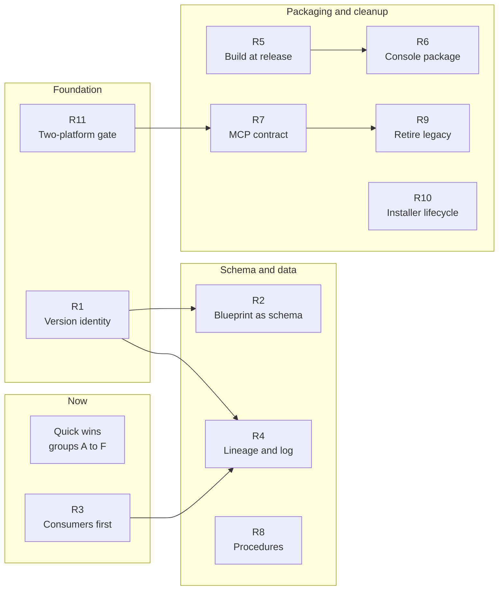

# cogNNitive improvement analysis

Date: 2026-11-12. Analysed commit: `9c6bef60` on `main`.

> This is a Markdown copy of the maintainer's analysis document. Two things differ
> from the original. The clean-up list for the maintainer's own domains (group G)
> is left out, and the sequence diagram is redrawn in Mermaid. The findings by area
> are in [the evidence file](2026-11-12-improvement-analysis-evidence.md).
>
> Line numbers refer to `9c6bef60`. Pull requests #619 to #625 merged afterwards
> (backlog sync, source import guards, metrics scenario compare, markers review,
> console shell actions, console size budget). Re-locate a line before acting on
> it, and treat the backlog items `source-import-guards`,
> `metrics-scenario-compare`, `markers-review`, `console-shell-actions` and
> `console-payload-size` as possibly done.

The specs describe one system and the code implements another: most recurring
defects come from that gap, and it can be closed with 52 isolated fixes and 11
refactorings, starting with a single version identity.

Ids used below: `RC1` to `RC7` are root causes, `QW-<group><n>` are quick wins,
`R1` to `R11` are refactorings.

## Verdict and scope

The conceptual design holds: four levels, three primitives, a self-describing
metaschema and one write path through changesets. What fails is the layer around
it. The normative text, the version fields and several half-finished migrations no
longer match the implementation, so the code is the real schema and the blueprints
trail it.

| Input analysed | Detail |
| --- | --- |
| Repository | `origin/main` at `9c6bef60` (2026-11-12): 2,086 tracked files, 22 blueprints, 185 source files in nn-core, 67 in nn-mcp |
| Real domains | `iNNtake_NN`, `coNNtent_NN`, `LC_programas`, read-only |
| Issue record | 121 issues in cogNNitive/cogNNitive (14 open), 3 in cogNNitive-web, 497 pull requests |
| CI and releases | About 1,500 CI runs and 92 release tags since 2026-10-15 |
| Backlog | `openspec/backlog_NN.md`, 1 active change, 42 archived changes |
| Memory | Engram observations from 2026-11-05 to 2026-11-12 |

Every claim carries one of three confidence levels:

- **Verified**: read in code or spec at the cited path and line.
- **Measured**: counted with a script over the files.
- **Inferred**: reasoned from the code but not reproduced.

Recommendations fall into two classes:

- A **quick win** stays in the light lane defined by `nn-dev-development`: no
  public contract, no stored-data migration, no security surface, no major bump.
  It fits one pull request and has an existing test or a one-command check.
- A **refactoring** is anything that crosses one of those lines or spans several
  pull requests.

Nothing was changed in the repository or in the domains.

## Root causes

Seven structural causes explain almost every finding. The first three are design
problems; the last four are habits that keep recreating them. Each quick win and
refactoring below names the cause it attacks.

| Id | Cause | How it shows | Strongest evidence | Recurring issues |
| --- | --- | --- | --- | --- |
| RC1 | The code is the schema; blueprints trail it | Operations, keys and directories exist only in code. Some blueprint concepts have no writer at all. | `CHANGE_OPS` holds `review_gate`, absent from the `changes` blueprint; a test exempts the gap. Nothing writes `artifacts_NN.md` or `## NN Source:`. "Core" is a hardcoded set in `scripts/blueprint-catalog.mjs:61`. | #491, #558, #612 |
| RC2 | Version identity is spread over fields that mean different things | Skew cannot be detected mechanically, in the repo or in a domain. | 20 of 22 blueprints say `spec_version: V_0-5-0` and `parent_spec.name: iNNfo_V_0-6-0`. 0 of 3 documents in `iNNtake_NN` carry `blueprint_version`. Skew is computed twice with different readers. | #95, #285, #564, #611 |
| RC3 | Migrations stop halfway and leave several channels alive | The old form is banned in one place and required in another. | Three provenance channels still feed lineage. The `[[Name]]` reference form is rejected by the validator and required by the procedure stepper. | #491, #560, #614, #587; #116, #590, #596, #617 |
| RC4 | Contract changes ship before their consumers, with no repair path | A domain that was valid yesterday is blocked today and has no operation to recover. | Distributed storage landed in 20 stacked pull requests; preflight, `init_knowledge` and console addressing were updated afterwards. `LC_programas` cannot apply any changeset to one model (#560). | #561, #563, #564, #606, #611 |
| RC5 | Derived files are committed and guarded instead of built | Every change leaves something stale; guards and regeneration steps keep growing. | `nn-console.bundle.js` (854 KB) had 95 commits in a month. nn-core is mirrored into the console payload and into skills. `scripts/regen.js:80` is a silent no-op. | #123, #231, #321, #611 |
| RC6 | Product code lives in the wrong place and is distributed by copy | Release keys overlap and fixes do not reach users. | The console runtime is an npm package inside `iNNfo/specs/bluepriNNts/console`. Its exporter is a 2,500-line file in `scripts/`. A production session patched the installed coNNtent copy, which the next install overwrites. | #606 to #616 |
| RC7 | Failures are swallowed instead of reported | Tools answer OK on broken input. | `evidence:: unknown` is filled silently (253 times in `iNNtake_NN`). Preflight reported OK on a domain with a V_0-15 engine and V_0-18 documents. An empty `catch {}` hid a caption cache mismatch. | #607, #611, #488 |

The three real domains show the cost. User kNNowledge is about 3% of each domain's
text; the rest is change log, console, sidecars and cached specs. In `iNNtake_NN`
the change log is 6.6 MB against 524 KB of kNNowledge, and 22 changesets across
the three domains were never resolved.

## Quick wins

There are 52 quick wins in five groups, plus two lists: register and setting
actions, and ten small changes that touch a contract. Every one was checked at the
cited line. Effort is S (under one hour) or M (about half a day). One pull request
per group is enough.

### A. Release and CI

| Id | Change | Where | Why it is safe, and the check | Effort |
| --- | --- | --- | --- | --- |
| QW-A1 | Release the merged nn-mcp fixes: bump 0.36.0 to 0.36.1, rebuild the bundle, then `sync:versions`, lockfile and `regen` | `iNNfo/packages/nn-mcp/package.json`, `bin/nn-mcp.bundle.js` | 9 commits under `nn-mcp/src` since `nn-mcp-v0.36.0` are on `main` and unreleased, including the #611 fix. Same steps as every nn-mcp release. Check: auto-tag cuts `nn-mcp-v0.36.1`. | S |
| QW-A2 | Fail the release when the committed bundle does not embed the package version, or build the bundle inside `release.yml` | `scripts/release/run-release.js:94` | The bundle is copied as it is and no guard covers it. Check: a release test with a stale bundle fails. | S |
| QW-A3 | Count `!` as a major bump only for `feat`, `fix`, `refactor` and `perf` | `scripts/release/plan-auto-tags.js:35` and its test | Pure function with a test file. A `docs(skills)!:` commit caused the unintended `skills-v3.0.0`. | S |
| QW-A4 | Set `fail-fast: false` on the release matrix | `.github/workflows/ci.yml:254` | Tags are pushed before the matrix starts. Inferred from the GitHub default: one failed release cancels the others. Check: dry-run dispatch. | S |
| QW-A5 | Run the two Windows-only nn-mcp suites on `windows-latest`, non-blocking at first | `iNNfo/packages/nn-mcp/vitest.config.ts:15`, `ci.yml` | `test/apply-change.test.ts` and `concept-drift-and-gate.test.ts` never run in CI, because all eight jobs are Ubuntu. Additive job. | M |
| QW-A6 | Point the UI smoke test at a console exported in the same job, and add the console sources to its path filter | `test/ui/testlab_smoke.py:34`, `ci.yml:281` | It opens a console exported on 2026-10-13 with that day's runtime. Check: break a renderer and see the job fail. | M |
| QW-A7 | Remove the fixture export from `regen`, or give it the fixture root | `scripts/regen.js:80` | The call has no workspace root, exits with code 2, and the result is ignored. | S |
| QW-A8 | Stop committing two docs copies | `docs/innfo/blueprints/catalog.json`, `docs/update/manifest-next.md`, `scripts/regen.js:66` | The first is byte-identical to its source. `build-docs.mjs` regenerates both before publishing. Check: the site artifact still holds them. | S |
| QW-A9 | Drop `dev` from the push trigger and the dead `--fast` expression | `ci.yml:8`, `ci.yml:59` | `origin/dev` is 0 commits ahead of `main`. Session pushes no longer trigger CI. | S |
| QW-A10 | Remove the line-count guard | `scripts/verify.js:532` | An arbitrary 200-line cap. One listed file, `skills/nn-sources/scripts/provenance.js`, no longer exists and is skipped silently. | S |
| QW-A11 | Add the existing `--check` of the address module to the shared guard list, until R5 removes the file | `scripts/lib/freshness-guards.js:12`, `scripts/export-address-module.mjs` | It is the only generated console input without a guard. | S |
| QW-A12 | Fix mojibake and three stale comments | `scripts/build-docs.mjs:16`, `build-preflight-primitives.mjs:12`, `stage-mcp-bundle.mjs:9`, `verify.js:298` | Text only. | S |

### B. Specs and blueprints

A blueprint edit is never free, so these ship together as one `blueprints` release.
Any change to a `spec_NN.md` needs a higher `blueprint_version`
(`scripts/guard-template-immutability.js:321`) and a regenerated catalog. The seven
core blueprints also need the canonical registry regenerated. The 11 blueprints
with a shipped sample need that sample renamed. Files under `procedures/`,
`samples/` and `assets/` are exempt. R1 removes this cost for prose changes.

| Id | Change | Where | Why it is safe, and the check | Effort |
| --- | --- | --- | --- | --- |
| QW-B1 | Replace `type:: model` with `type:: knowledge` | `bluepriNNts/domaiNN/spec_NN.md:45`, `:101` | The parser already maps `model` to `knowledge`. This removes a deprecation warning. | S |
| QW-B2 | Add `target_blueprint` to three reference fields | `artifacts` `artifact_model`, `sources` `source_model`, `domaiNN` `path` | Additive. It can only add `SUBMODEL_TEMPLATE_MISMATCH` warnings. | S |
| QW-B3 | Rewrite the Template example of `visual-catalog` | `bluepriNNts/visual-catalog/spec_NN.md:222` | The example uses an H1 element heading, `[[<Category>]]` and two `source::` lines. The validator rejects all three. No sample to rename. | S |
| QW-B4 | Drop or define the index entry `[[Business status]]` | `bluepriNNts/business-model/spec_NN.md:63` | It has guidance text at line 2434 and no Concept Definition. | S |
| QW-B5 | Add the missing `description::` lines | `innovation` 53 of 56 fields, `projects` 17 of 20, `organization` 1 of 7 | Additive. Each of the three needs its sample renamed. | M |
| QW-B6 | Add `blueprint_name` to the 19 blueprints without it, and `nature` to `domaiNN`, `sidecar` and `blank` | frontmatter | Optional keys in iNNfo 0.7.0. Only 3 of 22 declare `blueprint_name`; `nature` is in 4 of 7 core blueprints. | S |
| QW-B7 | Correct the sentence that says documents pin `V_0-15-0` | `bluepriNNts/coNNtent/spec_NN.md:768` | The engine compares against the installed version (`episode.mjs:128`), which is `V_0-19-0`. | S |
| QW-B8 | Use "bluepriNNt" in titles and H1 headings | 18 titles that say "App" and the H1 lines that say "Template" | Display text. It changes the catalog `title`. Inferred safe: confirm no code keys on a title. | S |
| QW-B9 | Add the missing terms to the vocabulary: source, citation, evidence, change, changeset, provenance, address, slug, procedure | `iNNfo/specs/vocabulary.json` | Additive. Four consumers: the docs generator and three tests. | S |
| QW-B10 | Declare `review_gate` and the undeclared keys in the `changes` blueprint, then delete the test exemption | `bluepriNNts/changes/spec_NN.md:37`, `nn-core/tests/changeset/changes-blueprint-text.test.ts:45` | Additive options and fields. No sample. Reword "evidence is mandatory on every change", because `review_gate` must not carry evidence. | M |
| QW-B11 | List the nine folders the scaffold creates | `bluepriNNts/domaiNN/spec_NN.md:151`, `nn-core/src/scaffold/domain.ts:13` | The blueprint names two folders; the scaffold creates `sources/`, `artifacts/`, `procedures/`, `changes/`, `staging/` and more. Prose only. | S |

### C. Code: nn-core, nn-mcp and the coNNtent engine

Paths are relative to `iNNfo/packages/` unless they start with another folder. Four
of these change behaviour on purpose: they turn a silent wrong answer into a
reported one.

| Id | Change | Where | Why it is safe, and the check | Effort |
| --- | --- | --- | --- | --- |
| QW-C1 | Import the leaf modules instead of the barrel | `nn-core/src/console/citations.ts:11`, `payload-builder.ts:10` | It removes the only runtime import cycle. Same symbols. Check: nn-core tests. | S |
| QW-C2 | Replace the version fallback `'0.32.0'` | `nn-mcp/src/server.ts:78` | The build injects the version. The fallback only speaks when injection fails, and then it lies. | S |
| QW-C3 | Sort the matches before taking the first | `nn-core/src/resolver.ts:371` | A pinned lookup returns `matches[0]` in directory-read order, which differs by platform. Inferred: this is why two suites flake on Linux. | S |
| QW-C4 | Report an unparseable version as unknown, not equal | `nn-core/src/workspace/integrity/versionStatus.ts:102` | `compareVersions` returns 0 when either side fails to parse, so skew reads as "same". Behaviour change: check its callers. | S |
| QW-C5 | Fail closed when a model cannot be parsed during delete-impact analysis | `nn-mcp/src/tools/apply-change.ts:1695` | The scan skips unparseable models, so `remove_element` can leave dangling references. Behaviour change: a broken model now blocks the delete. | S |
| QW-C6 | Fix the kind and language checks of the coNNtent engine | `iNNfo/specs/bluepriNNts/coNNtent/skills/nn-conntent/scripts/lib/kinds.mjs:108`, `:133` | Both run only when `blueprint_version` equals `V_0-15-0`. The adopted version is `V_0-19-0`, so current documents skip them. Run it against a real coNNtent domain first: existing episodes may start to fail. Needs a coNNtent version bump. | M |
| QW-C7 | Keep one SHA-256 helper | `nn-core/src/writeOnce/fs.ts:54`, `console/files-inventory.ts:135`, `changeset/hasher.ts:104`, `changeset/lineage/plan.ts:159`, `nn-mcp/src/tools/resolver-node.ts:181`, `apply-change.ts:476` | Six wrappers of the same call. Keep the pure-JS one in `validator/crypto.ts` for the browser build. | S |
| QW-C8 | Reuse the core version parser in apply | `nn-mcp/src/tools/apply-change.ts:106` | It re-implements `parseSemVer` with a looser pattern that accepts dots and a missing `V_`. Check: the `bump_version` specs. | S |
| QW-C9 | Delete the orphaned spec-pruning chain | `nn-mcp/src/tools/reachability.ts` (347 lines), `spec-backup.ts` (149 lines), `mutate.ts:22` | Counted: its only production callers are each other, and no tool exposes it. nn-mcp exports only `server.ts`. | M |
| QW-C10 | Build a typed changeset frontmatter instead of casting | `nn-core/src/changeset/parser.ts:103`, `nn-mcp/src/tools/propose-changeset.ts:628` | Five fields are checked and the rest is cast, including items supplied by an agent. | M |
| QW-C11 | Use one exclusion rule in every file walker | `nn-mcp/src/tools/helpers.ts:39`, `validate.ts:62`, `spec.ts:117`, `workspace-sync.ts:36`, `apply-change.ts:151` | The ignore lists disagree: only `isExcludedPath` skips `staging/`. Behaviour change: discovery becomes the same everywhere. | M |
| QW-C12 | Correct four stale comments | `nn-mcp/src/tools/apply-change.ts:2339`, `nn-core/src/validator/knowledge-checks.ts:374`, `changeset/lineage/types.ts:4`, `console/locate-writer.ts:45` | Each describes behaviour the code no longer has. Text only. | S |

### D. Skills and docs

All of these edit body text or scripts. None touches a skill's frontmatter or
triggers, which the dev process treats as a contract.

| Id | Change | Where | Why it is safe, and the check | Effort |
| --- | --- | --- | --- | --- |
| QW-D1 | Stop teaching `sources::` | `skills/nn-preflight/SKILL.md:84`, `skills/nn-sources/citations.md:5` and `:18`, `skills/nn-sources/scripts/index.js:439`, five files under `bluepriNNts/workspace/procedures/` | The validator rejects the field with `SOURCES_FIELD_BANNED`. Procedure files are exempt from the version guard. | S |
| QW-D2 | Replace `INNFO_MODELS_DIR` with `INNFO_DOMAIN_DIR` | `skills/nn-innfo/SKILL.md:200`, `:408` | nn-mcp reads only the new name (`nn-mcp/src/server.ts:65`). | S |
| QW-D3 | Remove the `[[Element Name]]` instruction | `skills/nn-innfo/SKILL.md:1042` | It contradicts lines 636 and 966 of the same file, which call that form `ADDRESS_MALFORMED`. | S |
| QW-D4 | Fix the folder named by the execution protocol | `skills/nn-innfo/SKILL.md:172`, `:860`, `:864` | They say `workspace/procedures/`. The folder is `procedures/` at the domaiNN root. | S |
| QW-D5 | Rewrite the preflight tier list from what the script checks | `skills/nn-preflight/SKILL.md:79` to `:92`, `docs/documentation/content/skills/nn-preflight.md:77` | Four described checks do not exist in `preflight-check.js`, and one cites a removed script. | S |
| QW-D6 | Correct the console skill | `.agents/skills/nn-console-kit/SKILL.md` | It says 12 source files (there are 14), 52 tests, and "Preact + HTM". Maintainer-only skill. | S |
| QW-D7 | Remove the lineage-record definition | `docs/documentation/content/reference/glossary.md:29`, `mental-model.md:47`, `knowledge-lifecycle.md:23`, `documentation_NN.md:93` and `:181`, `docs/use/reviewer-guide.md:52` | The record file was deleted. Lineage is computed from the change log. | S |
| QW-D8 | Replace `/nn-upgrade` and its retired flows | `docs/update/README.md:18`, `docs/documentation/content/skills/nn-update.md:7`, `interaction-flows.md:14` | The alias is deprecated and forwards to `nn-update`. | S |
| QW-D9 | Say "bluepriNNt" in installer output | 24 strings in `scripts/lib/skills-commands.js`, then rebuild the bundle | Strings only. Check: `build-skills-manager-bundle --check`. | S |
| QW-D10 | Make the domain probe see distributed storage | `skills/nn-preflight/scripts/domain-probe.js:29`, `:67` | It counts only `kNNowledge/*.md`, so a coNNtent domain looks empty to the `nn` menu. Reuse `auditDomain` from `domain-audit.js`, which already follows placement rules. | M |
| QW-D11 | Protect locally modified blueprints and embedded skills on install | `scripts/lib/skills-commands.js:575`, `:1566` | Only manifest skills get the modified-locally check. Adds one backward-compatible field to the state file. It prevents a repeat of the patches lost in the coNNtent production session. | M |
| QW-D12 | Align `AGENTS.md` with the four pointer stubs | `AGENTS.md:28` | It says three; `.claude/skills/` holds four. | S |

### E. Console

| Id | Change | Where | Why it is safe, and the check | Effort |
| --- | --- | --- | --- | --- |
| QW-E1 | Derive `CONSOLE_VERSION` from `package.json` when the bundle is built | `bluepriNNts/console/nn-runtime.js:17`, `scripts/lib/console-bundle.js:39` | It says `0.1.0`; the package is 0.36.1. The same value is written into exported changesets (`nn-runtime.js:6671`). | S |
| QW-E2 | Ignore the synthetic `changes` entry when judging freshness | `scripts/export-console.mjs:482` | Reproduced on the testlab fixture: three models fresh, console `stale`, because the embedded list has four entries. Every domain with changesets is affected. | S |
| QW-E3 | Stop writing the dead `runtime` key | `scripts/export-console.mjs:1412`, `nn-runtime.js:155`, two tests | The runtime parses it and never uses it. The shell guard already forbids it. One of its two URLs names the wrong repository. | S |
| QW-E4 | Remove four unused CSP hashes and the unreachable fallback script tag | `bluepriNNts/console/artifact_shell.html:10`, `:435`, `scripts/console-views.mjs:434` | Measured on the fixture: the four hashes match no script. The policy does not allow `raw.githubusercontent.com` as a script source. | M |
| QW-E5 | Store the console version and the bundle hash in the metadata, and compare those instead of file times | `scripts/export-console.mjs:464` | File times are arbitrary after a checkout or a copy. Additive metadata. | M |

### F. Registers and settings, no code

These keep the backlog and the issue tracker telling the same story. All are
maintainer actions.

| Id | Action | Reason |
| --- | --- | --- |
| QW-F1 | Archive the change `openspec/changes/console-catalog-picklist` | Its code merged on 2026-11-10 (commit `0fe11e4e`). It holds only a spec delta. |
| QW-F2 | Re-scope #614 to its part 4 and #612 to its parts 3 and 4 | Pull request #618 fixed the other parts. Both still carry their full titles. |
| QW-F3 | Close or confirm #565 and the backlog item `episode-layout-drift` | Inferred fixed: the blueprint now declares `placement:: "{container}/episodes/{slug}/"` (`coNNtent/spec_NN.md:68`). |
| QW-F4 | Give `remove-banned-l3-field` a batch | Value H. It is the item that unblocks `LC_programas` (#560) and it is in no batch. |
| QW-F5 | Add backlog items for #617 and #587, retire `number-field-changeset`, refresh `console-payload-size` and `coNNtent-procedures` | Two open issues have no item. One item is shipped. Two cite evidence that is now stale. |
| QW-F6 | Require the `verify`, `quality` and `spec-integrity` checks on `main` | `main` has no branch protection and no rulesets, so CI only reports. |
| QW-F7 | Delete the remote branch `dev` after QW-A9 | It is 0 commits ahead of `main`. |

### G. In the three real domains

Left out of this copy: it lists clean-up actions on the maintainer's own data.

### H. Small, but they touch a contract

Each of these is an hour of work. Each also changes the MCP tool surface, an
exported API, a manifest or a published path, so the dev process puts it in the
heavy lane. QW-H1 to QW-H5 belong to R7; QW-H6, QW-H7 and QW-H10 to R9; QW-H8 and
QW-H9 to R10.

| Id | Change | Where | Note |
| --- | --- | --- | --- |
| QW-H1 | Remove the ignored `intent` parameter | `nn-mcp/src/server.ts:159`, `:264`, `:628` | Declared on three tools and never read. |
| QW-H2 | Remove the undeclared legacy parameter aliases | `server.ts:924` to `:1192` | `template_url`, `model_url`, `model_id`, `workspace` and `blueprint_id` are accepted silently and appear in no schema. |
| QW-H3 | Correct `readOnlyHint` on tools that write | `server.ts:569` | `check_domain` self-heals, and `in_place` hydration writes into the domain. |
| QW-H4 | Require `elementId` in `resolve_sources` only when `target` is absent | `server.ts:727`, `:1151` | The `target` branch returns before `elementId` is used. |
| QW-H5 | Set `isError` whenever `success` is false | `server.ts:1005`, `:1085` | `apply_change`, `init_knowledge` and `check_domain` report failure as a normal result. |
| QW-H6 | Delete exports kept alive only by tests | `nn-core/src/resolver.ts:67`, `merge.ts` (184 lines), `mutate.ts:244`, `sourceRef.ts:702` | Counted: zero production callers for each. |
| QW-H7 | Remove the FORMAT-era readers and stop writing the legacy `widget:` key | `nn-core/src/parser/yaml.ts:89`, `:166`, `serializer.ts:232` | No shipped file uses the old keys. Keep the `parent:` reader: 63 files use it. |
| QW-H8 | Drop the two stale `version:` literals from the manifest | `manifest/source.yaml:70`, `:87` | `changes` says `V_0-7-0` (actual `V_0-9-0`); `procedures` says `V_0-3-2` (actual `V_0-5-1`). No other blueprint entry carries one. |
| QW-H9 | Delete the stale copy of the `nn` skill and regenerate the stub descriptions | `.agents/skills/nn/SKILL.md`, `.claude/skills/nn-dev-development/SKILL.md:3` | The copy is one version behind with different triggers. The stub still describes the retired `dev` branch flow. |
| QW-H10 | Delete four unreferenced spec files at the specs root | `iNNfo/specs/business-model_V_0-3-0_NN.md` and the `metrics`, `organization`, `projects` siblings | Zero references in the repository. They are published URLs, hence the heavy lane. |

## Refactorings

Eleven refactorings close the gap for good. Five of them are not in the backlog at
all, and R1 comes first because the others need to know what version a thing is.

| Id | Refactoring | Attacks | Lane | Effort | Already in the backlog |
| --- | --- | --- | --- | --- | --- |
| R1 | One version identity, one living file per spec | RC2, RC1 | heavy | L | No |
| R2 | Blueprints as the executable schema of the core | RC1 | mixed | M | No |
| R3 | Consumers first: repair operations and a consumer matrix | RC4 | heavy | M | Partly: `remove-banned-l3-field` |
| R4 | Finish lineage-as-changes and give the change log a lifecycle | RC3, RC7 | heavy | L | Partly |
| R5 | Build derived files at release; derive every release key from content | RC5 | heavy | L | Partly: `derived-artifacts-consolidation` |
| R6 | The console as one package with blueprint-owned views | RC6 | heavy | L | Partly: size and header only |
| R7 | One MCP contract and a staged apply pipeline | RC7 | mixed | L | No |
| R8 | Procedures: one reference form, an execution contract, a hazard marker | RC3 | heavy | M | Issue #617 only |
| R9 | Retire the legacy layer | RC3 | mixed | L | Partly: `docs-skills-retirement` |
| R10 | Installer lifecycle and skill structure | RC6 | heavy | M | No |
| R11 | One gate on two platforms | RC5, RC7 | light | M | No |

### R1. One version identity, one living file per spec

- **Problem, the fields.** `spec_version` means "adopted Level 1" in code
  (`nn-core/src/parser/serializer.ts:157` defaults it to `V_0-5-0`), while
  `parent_spec` names `iNNfo_V_0-6-0` in 20 of 22 blueprints. Level 3 documents
  rarely carry `blueprint_version`; the version rides inside `parent_spec.name`.
  Skew is checked in five places with different readers:
  `changeset/lineage/plan.ts:68`, `domain/skew.ts:31`, the installer
  (`skills-commands.js:989`), preflight (`lineage-audit.js`) and the coNNtent
  engine (`episode.mjs:128`).
- **Problem, the history.** The repository keeps no history of blueprints: each
  is one `spec_NN.md` edited in place, and the catalog lists a single version for
  21 of them. It does keep nine Level 1 files, two Level 0 files and five legacy
  files. Nothing at run time needs them: the one check that read the Level 1
  version (`l1AtLeast`, `nn-core/src/validator/knowledge-checks.ts:345`) is now
  version-independent. Level 0 still mandates a new file for every bump, which the
  blueprints stopped doing.
- **Problem, the ceremony.** The guard demands a higher `blueprint_version` for
  any content change, a typo included
  (`scripts/guard-template-immutability.js:321`). That triggers the catalog, the
  registry, a sample rename and, for `procedures`, 30 pins. And `parent_spec.url`
  points at `main`, so a domain that loses its cached copy cannot fetch the version
  it pinned.
- **Target.** Four rules.
  - One living file per spec at every level. `defiNNition`, `iNNfo` and each
    blueprint are edited in place, and the release tag is the immutable version.
  - Three fields with one meaning each: `spec_version` for the Level 1 grammar,
    `blueprint_version` mandatory on Level 2 and Level 3, `knowledge_version` for
    the document. `parent_spec.name` carries no version and `parent_spec.url`
    points at the release tag.
  - The domain owns its frozen copy. Hydration already writes
    `specs/bluepriNNts/<name>/<version>/spec_NN.md`
    (`nn-mcp/src/tools/spec.ts:701`), and `nn-update` already takes a backup before
    it repins (`skills/nn-update/scripts/apply-update-plan.js:136`). What is
    missing is a recorded version and content hash that tie the copy to the
    document.
  - The guard asks for a bump only when the schema changes: a Concept, Field or
    Matrix Definition, or frontmatter that validation reads. Prose, examples and
    typos are free. It compares a hash of the canonical form that iNNfo 0.7.0
    already defines for `includes` collisions.
- **Steps.**
  1. Stamp `blueprint_version` and a content hash on every document through
     `add_model` and `repin_blueprint`, and warn when they are missing. This goes
     first: without it a domain copy cannot be matched to a document.
  2. Switch the guard to the schema hash, and drop the version from sample file
     names so the sample mapping is derived.
  3. Pin by tag: the catalog and `parent_spec.url` use the release tag.
  4. Collapse Level 0 and Level 1 into one living file each. Fold in the
     corrections found at lines 221, 229, 314, 360, 436 and 531 of iNNfo 0.7.0,
     and make Level 0 describe the layout the repository uses. Repoint the 22
     blueprints once, in the same release as group B.
  5. Remove the versioned Level 0 and Level 1 files from `main`, and retire or
     re-point the three tests that pin them byte for byte.
  6. Collapse the five skew checkers into one
     `versionStatus(document, installed, catalog)` in nn-core.
- **Retires.** Nine Level 1 files down to one, the `defiNNe` duplicate, the bump
  cascade for prose changes, the sample renames, the second skew reader,
  `upgrade-check.js` and the hard-coded default in the serializer.
- **What it costs.** The `main` URLs of old Level 1 files stop resolving; the tags
  keep them. That needs an exception to the frozen-paths decision of 2026-10-31.
  Domains resolve their cached copy first, and the three real domains cache their
  whole chain, so they keep working. About 16 test files name a specific Level 1
  version.
- **Closes.** The chain #95, #285, #564, #611.

### R2. Blueprints as the executable schema of the core

- **Problem.** `CHANGE_OPS` in `nn-core/src/changeset/types.ts:7` is the real list
  of operations. Seven frontmatter keys (`models`, `author_kind`, `origin`,
  `reviewer`, `workspace_id`, `resolution`, `evidence_sha256`) exist only at
  `types.ts:137`. Nothing writes the `artifacts` catalog or a `Source` element;
  `produce-artifact.ts:99` says no registry is involved. The core set is hardcoded
  twice: `scripts/blueprint-catalog.mjs:61` and `scripts/export-console.mjs:324`.
  Shared fields are redefined: `tags` is byte-identical in 15 blueprints. The same
  name has different shapes: `summary` is `string` or `markdown_inline`, `path` is
  `model`, `knowledge` or `file`, `tool` is `reference` or `string`.
- **Target.** For the seven core blueprints the blueprint is the source. A test
  fails when code reads or writes a key or option the blueprint does not declare,
  with no skip list. `tier: core` is declared in frontmatter and read by both
  scripts. A small `common` blueprint holds the shared definitions and is pulled
  in with `includes`; the collision rule in iNNfo 0.7.0 accepts identical
  duplicates, so the move can be gradual. Dead schema is either deleted or given a
  writer.
- **Steps.** QW-B10 first. Add the parity test for `changes`, then for `sidecar`
  and `domaiNN`. Decide whether an artifact registry exists. Add `tier`. Create
  `common` with `tags`, then `complexity` and `scope`.
- **Retires.** The test exemption, two hardcoded core lists, 15 copies of `tags`.
- **Note.** The archived change `2026-10-26-declarative-blueprint-nature` already
  aimed at the hardcoded set, and the set is still there.

### R3. Consumers first

- **Problem.** `apply_change` validates the whole model, so one banned
  `sources::` blocks every changeset, and no operation removes a field.
  `LC_programas` is in that state today (#560). Distributed storage landed in 20
  pull requests (#495 to #537); afterwards #561, #563, #564, #606 and #611 found
  consumers that did not know the layout. `domain-probe.js:29` still counts only
  `kNNowledge/*.md`. Every one of these was found in real use, on Windows.
- **Target.** Three things. A `remove_field` operation applied through a
  changeset, so the repair is itself recorded. A rule in the dev skill: a change
  that makes existing documents invalid ships with the operation that repairs
  them. A consumer matrix in CI: three fixture domains (compact, distributed with
  series, legacy layout) that every consumer runs against, namely
  `validate_knowledge`, `check_domain`, preflight, `init_knowledge`, the console
  export and the `nn` probe.
- **Steps.** Ship `remove_field` and repair `LC_programas` first; it is
  independent of everything else. Build the fixtures from testlab and a trimmed
  coNNtent domain. Add the matrix. Add the rule to section 2 of
  `nn-dev-development`.
- **Retires.** The class of defect where preflight answers OK on a broken domain.
- **Closes.** #560 and part of #587.

### R4. Finish lineage-as-changes and give the change log a lifecycle

- **Problem.** Three provenance channels still feed
  `nn-core/src/lineage/project.ts`: change `evidence` (line 471), declared
  `sources` in frontmatter and sidecars (lines 154 and 304), and the legacy element
  field read "transitionally" (line 347). The ban checks element fields only
  (`knowledge-checks.ts:398`), so frontmatter `sources` passes. Artifact-to-source
  linkage has three implementations (`project.ts:471`, `project.ts:154`,
  `console/files-inventory.ts:270`). `nn-update` repins with `applyMutation` and
  `writeFileSync` (`skills/nn-update/scripts/apply-update-plan.js:58`, `:158`) and
  records no change, although the `changes` blueprint calls `repin_blueprint` the
  only supported way. The log is append-only and never archived; `latestAppliedAt`
  re-parses every changeset on each apply (`apply-change.ts:485`). The coNNtent
  domain keeps a second ledger in `.cognnitive/video/ledger.jsonl`.
- **Target.** One channel: the evidence of the applied change. Decide once whether
  sidecar `sources` is the declared upstream edge for derived sources
  (`source-package` relies on it) or goes away. One artifact-to-source resolver in
  nn-core, used by lineage and by the console. `nn-update` emits a changeset
  through the existing `buildLineageChangeset`. An evidence policy: `unknown` is
  rejected for agent-authored content changes and stays legal for engine and
  import changes. A lifecycle: a compaction operation folds applied history older
  than a cut into one snapshot changeset per model, using the fold that already
  exists in `changelog/index.ts:142`; `check_domain` reports proposals older than a
  set age; an index lets apply skip re-reading the log.
- **Retires.** The transitional reader, two of the three artifact resolvers, the
  dead citation path in `resolve_sources` (line 94).
- **Closes.** #587 and the rest of #614. Compaction and stale proposals are in no
  backlog item.

### R5. Build derived files at release

- **Problem.** More than 20 derived files are committed. The busiest, counted over
  30 days: the testlab console (138 commits), `catalog.json` (105), the console
  payload mirror (98), the console bundle (95), the nn-sources core mirror (43) and
  the coNNtent one (33). Eleven freshness guards run in three places: pre-commit
  regeneration, pre-push and `verify.js`. The nn-mcp bundle (926 KB) is committed
  with no guard at all. nn-mcp and the console are "authored" release keys, so a
  fix without a version bump is never released. The console sits under
  `iNNfo/specs`, so every console commit also bumps `blueprints`. The result is
  about 92 release tags in four weeks.
- **Target.** `main` holds sources. The release job builds what consumers fetch
  from a tag (bundles, mirrors, the catalog with its `release_tag`) into the
  tagged tree. Every release key is derived from content, as `skills` and
  `blueprints` already are, and the release writes the package versions. The
  console paths are excluded from the `blueprints` key.
- **Steps.** Build the nn-mcp bundle in `release.yml`. Build the console bundle,
  payload, address and slug modules in the release before the distribution copy.
  Build the skill mirrors in the skills and blueprints releases. Add
  `excludePaths` to the release table and let `plan-auto-tags.js` compute a bump
  for all four keys. Delete the guards one at a time as each file leaves the tree.
- **Retires.** Most of `freshness-guards.js`, `pre-commit-regen.js`, most of
  `regen.js`, `sync-versions.mjs` and the manual bump ritual in section 5 of the
  dev skill.
- **Relation to the backlog.** It extends `derived-artifacts-consolidation` (batch
  b4a) with three things that item does not list: the canonical registry, the
  catalogs and the release keys.

### R6. The console as one package

- **Problem.** The runtime is an npm package inside
  `iNNfo/specs/bluepriNNts/console/`. The exporter is `scripts/export-console.mjs`
  (2,515 lines) plus `console-views.mjs`, copied to `~/.agents/console` and
  located at run time by `nn-core/src/console/locate-writer.ts`. The generic code
  knows specific blueprints: coNNtent (`export-console.mjs:54`, `:1752` to `:1933`;
  `nn-core/src/console/schema-resolution.ts:237`; `nn-runtime.js:3775`), metrics
  (`studio.js`, 42 KB in the core bundle with one caller) and procedures
  (`nn-runtime.js:819`, `:3790`). `needs-registry.json` is enforced on the shell
  only, while the export always writes the same seven needs. The output inlines
  the whole model: 5.5 MB of the 7 MB console of `LC_programas`.
- **Target.** One package that holds runtime, exporter and tests, with nn-core as
  a dependency. Blueprint-specific code moves behind the view mechanism that
  already exists (`assets/console-view-<slug>.js` with its `.data.mjs`): the
  coNNtent sanitizer and picklists, the metrics grid, the procedure stepper. A
  blueprint declares its views and needs in frontmatter. The console stamps its
  version and bundle hash.
- **Steps.** QW-E1 to QW-E5 first. Move the exporter next to the runtime as its
  own heavy-lane change, because `iNNfo/specs` is a frozen path and installed
  copies need a migration note. Extract the three blocks of blueprint logic. Then
  take the payload work from the backlog: citation-table compaction and a size
  budget per domain.
- **Retires.** The lookup tiers in `locate-writer.ts`, blueprint names in the
  exporter, and either the needs registry or the hardcoded needs.
- **Relation to the backlog.** `console-payload-size`, `console-shell-actions` and
  `markers-review` cover size, header and resolver. Placement, coupling and
  versioning are in no item.

### R7. One MCP contract and a staged apply pipeline

- **Problem.** The 24 tools report failure in three ways: a plain string,
  `{ok:false, code}`, or `success:false` without `isError`. Payloads use
  `success`, `ok` or `status`. Names alternate between `domain` and `root`, and
  between `id`, `model` and `knowledge_id`; the line that resolves the root is
  repeated 19 times. `executeChangesetApply` is a single function of about 1,890
  lines (`nn-mcp/src/tools/apply-change.ts:520`) with 37 catch sites. Loaders drop
  unparseable changesets and models without a word
  (`nn-core/src/changelog/load.ts:87`, `changeset/history.ts:61`,
  `nn-mcp/src/tools/provenance-strict.ts:99`), so `check_domain`, `read_lineage`
  and the drift report can omit history silently.
- **Target.** One envelope, `{version, ok, code?, message?}` plus the payload,
  with `isError` derived from `ok`. One name for each parameter and a shared root
  resolver. Apply as a pipeline: load, plan, gate, persist, annotate, with the
  pure stages in nn-core. Loaders return what they skipped and emit
  `CHANGESET_UNPARSEABLE` or `MODEL_UNPARSEABLE`.
- **Steps.** QW-H1 to QW-H5 as the first batch. Then the loaders, which only add
  diagnostics. Then the pipeline split, which is light because exports do not
  change. The envelope last, as one major bump.
- **Retires.** The parameter aliases and most silent catches.
- **Closes.** Part D of #491, the `update_field` shape that differs by entry
  point. Inferred: the issue was closed on 2026-11-12 without that part.

### R8. Procedures

- **Problem.** The 30 shipped procedure files hold 835 `[[Name]]` references in
  typed fields, no `@slug` reference and no `slug::` line. The validator rejects
  that form (#617 reports 96 `ADDRESS_MALFORMED` errors), and the stepper
  `render-procedure-stepper.js` requires it. The blueprint's own sample already
  uses 40 `@slug` references. The execution protocol
  (`skills/nn-innfo/SKILL.md:875`) says "read the Work elements" and never says
  whether the body or the fields are the instruction. Nine fields of the blueprint
  have no description. `inputs_required`, `outputs_expected` and `executed_by` are
  typed `string` and described as references. No field marks a step that cannot be
  undone. A bump of the blueprint breaks 30 pins at once.
- **Target.** The address form everywhere, with a stepper that resolves slugs. A
  protocol that states: the body is the instruction, the fields are the contract,
  `next` is an address. An optional field on `Work` for irreversible steps, shown
  by the stepper and turned into a confirmation by the protocol. Typed catalog
  references. Catalog slugs without a version.
- **Steps.** Freeze slugs and rewrite the 30 files with a script. Update the
  stepper. Ship one MINOR of the blueprint with descriptions, the new field and
  typed references, and repin the 30 files once. Update the protocol text.
- **Retires.** #617 and the stepper's dependency on display names.

### R9. Retire the legacy layer

- **Problem.** Deprecated vocabulary is still the working vocabulary of the code.
  Counted in non-test source: "workspace" appears 288 times in nn-core and 188 in
  nn-mcp; "template" 467 and 233. `check-workspace.ts` implements `check_domain`,
  and `resolveBlueprintWithCache` returns `{template}`. Retired identifiers
  survive in shipped files: `models/` 23 times in skills and 30 in specs,
  `innfo-mcp` 36 times in specs, `sources/nn/` 41, `model_version` 16. The
  `retired_identifiers` list in `vocabulary.json` (45 entries) is read only by the
  docs generator, while six overlapping guards and tests of about 1,100 lines
  police old names. The specs root still holds `defiNNe`, iNNfo 0.1 to 0.4 and
  three copies of the frozen `workspace` blueprint, and tests name those files
  literally.
- **Target.** Internals use the canonical vocabulary. `vocabulary.json` becomes
  the single retired-identifier check, with allowed paths and an expiry date on
  each entry. The frozen files that R1 leaves behind, namely the three workspace
  copies and the four legacy root files, are removed too, because release tags
  keep them.
- **Steps.** Rename internals package by package; these are mechanical and light.
  Replace the six guards with the data-driven one. Remove the leftover frozen
  files in the same change as R1. Do QW-H6, QW-H7 and QW-H10 as the heavy-lane
  part.
- **Retires.** Five of six guards, the legacy readers, about 500 lines of code
  kept alive only by tests.
- **Relation to the backlog.** `docs-skills-retirement` (#430) covers
  `docs/skills` only.

### R10. Installer lifecycle and skill structure

- **Problem.** The installer never removes anything. The retired skill
  `nn-video-script` is still installed on the maintainer's machine with the same
  description and triggers as `nn-conntent`, so both compete for every video
  request. Blueprints and embedded skills are replaced without a diff
  (`scripts/lib/skills-commands.js:575`), and an embedded skill exists twice on
  disk, under `~/.agents/bluepriNNts/coNNtent/skills/` and under
  `~/.agents/skills/`. `skills/nn-innfo/SKILL.md` is 1,045 lines and `nn-sources`
  643. The activation gate is restated in nine skill files, and two of them claim
  to own it (`skills/nn/SKILL.md:28` and `skills/nn-preflight/SKILL.md:17`). The
  manifest describes the `nn` menu as `[k] kNNowledge` while the skill says
  `[m] Model`.
- **Target.** A `retired_skills` list in the manifest, so an update offers
  removal. A hash for every installed tree (QW-D11). Embedded skills projected
  once, as a link. Each `SKILL.md` under about 300 lines, with the wizard, the
  tool table and the relationship rules moved to references loaded on demand.
  Gate text generated, as the shared rules already are, with one owner. Manifest
  descriptions derived from the skill frontmatter.
- **Steps.** QW-D11, then the retired list, then the single projection. Split
  `nn-innfo` and `nn-sources`. Do QW-H8 and QW-H9 in the same batch.
- **Retires.** Silent overwrites, trigger collisions between retired and live
  skills, and four copies of the gate protocol.

### R11. One gate on two platforms

- **Problem.** The gate is defined in four places: the steps of `verify.js`, the
  jobs of `ci.yml`, `pre-push-check.js` and `check-integrity.js`. Every CI job
  runs on Ubuntu, while the product is built and used on Windows. Two nn-mcp
  suites run only on Windows, and the coverage thresholds were lowered four times
  to let Linux pass. Never run in CI: the nn-sources integration tests, a real
  coNNtent render, and an end-to-end console export. Session worktrees share
  `node_modules` through a junction, so `@cognnitive/nn-core` points at whichever
  worktree built last; the third incident of damage was recorded on 2026-11-10.
  Since 2026-10-15 the failure rate was 4.7% on `main`, 15% on `dev` and 27% on
  session branches.
- **Target.** `verify.js` owns every check, tagged fast, slow or windows. CI runs
  it on an Ubuntu and Windows matrix. The resolver is deterministic (QW-C3), which
  lets `WINDOWS_ONLY_SUITES` go. nn-core is resolved from source through an alias,
  or each worktree installs its own dependencies, so build order stops mattering.
- **Steps.** QW-A5 and QW-C3 first. Move lint, the vitest suites and the spec URL
  check into `verify.js`. Delete `pre-push-check.js` and the duplicated groups of
  `check-integrity.js`. Then QW-F6 makes the gate binding.
- **Retires.** About 450 lines of gate code and the manual `mklink` step in
  section 1 of the dev skill.

## Sequence

Nothing in the first phase waits for anything: the quick wins and the
`remove_field` half of R3 can start today.

An arrow means the second needs the first. R1 gates R2 and R4, because both
rewrite blueprints and need the version fields settled. R3 gates R4, because the
repair operation must exist before a channel is removed. R11 gates R7, because the
apply suites must run in CI before that function is split. R5 gates R6, because
the console needs its own release key before it moves. R7 gates R9, because the
internal renames touch the same tool code. R10 has no arrow, but it reuses the
version status that R1 introduces.

## What not to do

Eight ideas were evaluated and rejected or deferred. Each one looks cheap and
would add cost or hide the real problem.

| Idea | Why not | Do this instead |
| --- | --- | --- |
| Lint step text with Simplified Technical English (one sentence, 20 words) | Measured: 81 of 242 shipped steps have several sentences and 116 exceed 20 words. In the real domains 85% to 100% do, and 106 of 119 steps in `LC_programas` are in Spanish. STE is an English-only standard. | Take two ideas only: a marker for irreversible steps and a one-term-per-concept check (R8, QW-B9). |
| Add one more freshness guard for each stale generated file | 11 guards already run in three places and the chain #123, #231, #321, #611 kept recurring. | Stop committing the file (R5). |
| Archive old changesets by moving them into an `archive/` folder | `isExcludedPath` drops every path with an `archive` segment (`nn-core/src/naming/contract.ts:194`). History would vanish from lineage. Inferred: the drift check would then flag every unit as unrecorded. | Add a compaction operation that leaves a snapshot record (R4). |
| Make missing evidence a hard error for every author | Engine and reviewer changes carry no file evidence by design. The coNNtent domain holds 258 changes with `evidence:: decision`. | Reject `unknown` only for agent-authored content changes (R4). |
| Fix the contradictions inside `iNNfo_V_0-7-0_NN.md` by editing it | Published `_V_x-y-z_` files are write-once and domains cache them by name. | Carry the corrections into the single living Level 1 file that R1 creates. |
| Relocate `iNNfo/specs`, `skills`, `manifest` or `docs` as part of a cleanup | `openspec/decisions/keep-published-paths-frozen.md` (2026-10-31) freezes those paths because releases and installs address them. | Move or remove only what R1 and R6 name, each as its own heavy-lane change with a migration note. |
| Build an in-place migrator for legacy domains | `nn-update` already defines the recipe: create a new domain and import the old one as a Source. | Add repair operations for the contract changes that block current domains (R3). |
| Rewrite the console on a UI framework | Its defects are placement, coupling and versioning. Preact is used in two places only (`ui-kit.js:3802`, `nn-icons.js:115`), so a rewrite would fix none of them. | Correct the skill text that calls it a Preact app (QW-D6) and do R6. |

One more rule applies to this document itself. Each accepted item should become a
backlog entry or an issue and nothing else: the repository removed proposal,
design and handoff files on 2026-11-10 for good reason.

## Open questions and unverified inferences

Seven decisions belong to the maintainer, and each one blocks a refactoring.

| Decision | Blocks | What is known |
| --- | --- | --- |
| Does an artifact registry exist? | R2 | The `artifacts` blueprint has no writer. `LC_programas` keeps a catalog by hand: 47 entries, 10 files missing, 38 files uncataloged. |
| Is the sidecar `sources` key a declared upstream edge, or a leftover? | R4 | An archived decision removed it. The sidecar template still shows it, `source-package` relies on it, and lineage reads it. |
| Which reference form do procedures use? | R8 | The validator requires addresses. The stepper and 835 shipped references use display names. This document assumes addresses. |
| Is the `changes` blueprint written by hand and checked against the code, or generated from it? | R2 | Today neither: a test exempts the difference. |
| Is Linux a supported platform? | R11 | `nn-mcp/vitest.config.ts` calls it "a platform we do not target", and CI runs nowhere else. |
| May the console leave `iNNfo/specs`? | R6 | The decision of 2026-10-31 freezes that path unless a change documents the migration. |
| May the versioned Level 0 and Level 1 files leave `main`? | R1 | Release tags keep every version and domains resolve their cached copy first. The decision of 2026-10-31 freezes paths under `iNNfo/specs`, so this needs the same exception as the console move. |

Nine statements in this document are inferences. They follow from the code and
were not reproduced.

- A failed release cancels the remaining ones in the matrix (QW-A4). This rests on
  the GitHub default for `fail-fast`.
- Directory-read order is what makes two suites flake on Linux (QW-C3).
- Moving changesets into an `archive/` folder would flood the drift check with
  unrecorded units.
- Issue #565 is already fixed by the placement rule in the coNNtent blueprint
  (QW-F3).
- Part D of #491 was still open when the issue was closed.
- No code keys on a blueprint title (QW-B8).
- One evidence entry that is a model address or a missing file drops hash
  anchoring for the whole change (`nn-mcp/src/tools/apply-change.ts:472`).
- An artifact recorded with `produce_artifact` that declares no `sources` gets a
  lineage edge and no inventory entry; this would always apply to HTML
  (`nn-core/src/lineage/project.ts:409`).
- An export run from `~/.agents/console` skips the coNNtent layout check, because
  the relative path at `scripts/export-console.mjs:55` points nowhere there.

Four areas were left out: the internals of the coNNtent video engine beyond its
version checks, runtime performance, security, and a comparison of status
vocabularies across blueprints.

The repository moved while this was written. Issues #590, #558 and #491 were
closed on 2026-11-12 and the published catalog already names
`blueprints-v0.60.1`, so a few register items in group F may be done.
