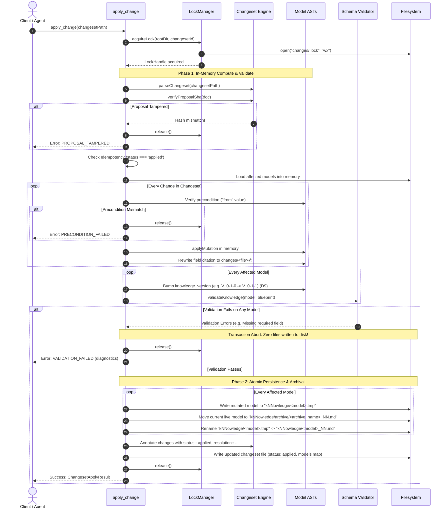
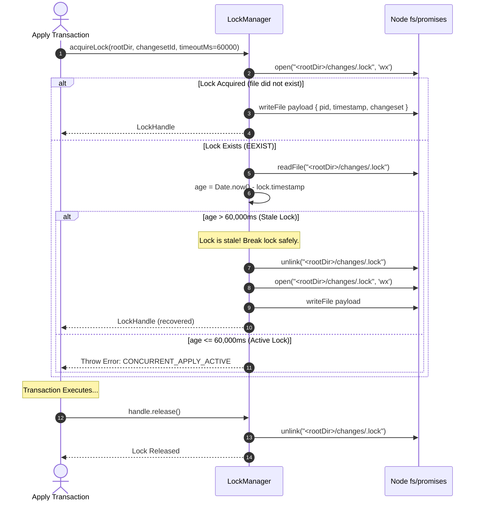
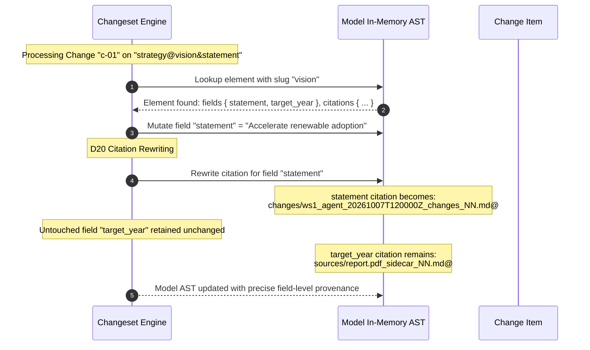
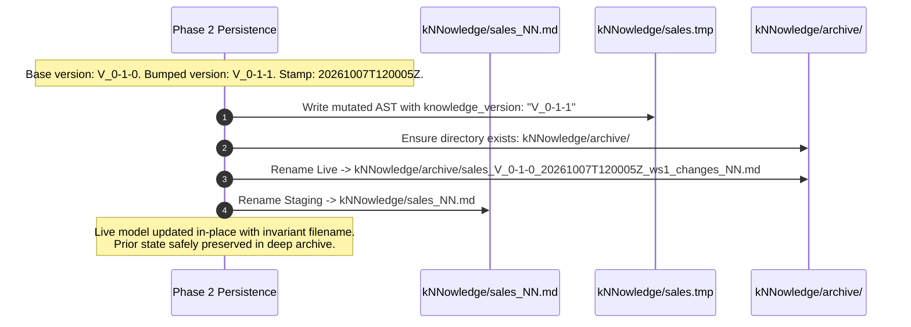
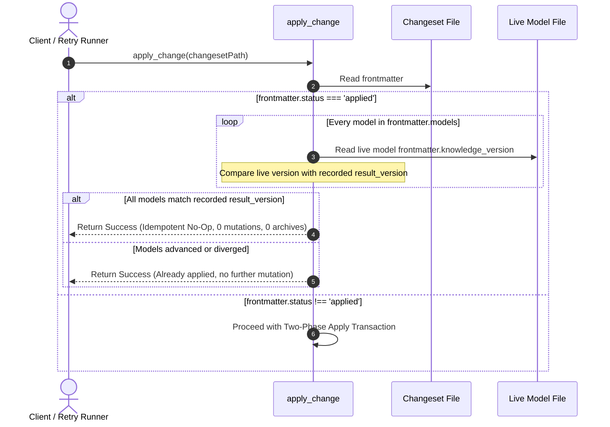

# Technical Design Document: Changeset Apply and Versioning (Slice S2a)

**Change ID**: `2026-10-07-changeset-apply-and-versioning`  
**Status**: `Draft`  
**Author**: `sdd-design subagent`  
**Artifact Mode**: Hybrid (`Engram` + `OpenSpec filesystem`)  
**Target Specification**: `iNNfo_V_0-4-0_NN.md` (Level 1 Normative Meta-bluepriNNt) & `iNNfo/specs/bluepriNNts/changes/spec_NN.md` (Level 2 Normative bluepriNNt)

---

## 1. Executive Summary & Intent

Slice S2a (`changeset-apply-and-versioning`) establishes **changesets** as the single authoritative mutation and provenance medium across the cogNNitive ecosystem. Prior to S2a, graph mutations were fragmented across direct file rewrites, ad-hoc CLI scripts, and uncoordinated MCP calls. Provenance was similarly disjointed: models relied on an informal `## NN Agent Modification` markdown block, a mandatory verbatim-paste rule in LLM chat completions, transcript promotion, and disconnected feedback ledgers.

Slice S2a resolves these structural limitations through five interconnected systems:
1. **Normative `changes` Level-2 BluepriNNt & Document Model (D7)**: Defines a structured mutation document format stored under `<rootDir>/changes/` as `<workspace_id>_<author>_<stamp>_changes_NN.md`. Proposals are cryptographically sealed with a SHA-256 hash (`proposal_sha`), classified under role `'changeset'` to guarantee exclusion from semantic model discovery.
2. **Unified Mutation Medium (D8)**: Every graph mutation routes through changesets. The legacy `## NN Agent Modification` block, verbatim-paste mandate, and session transcript promotion are retired without backwards compatibility shims.
3. **Invariant Live Model Naming with Frontmatter Versioning & Snapshot Archival (D9)**: Live knowledge models retain invariant names under `NN_NAME_INVARIANT` (`kNNowledge/<name>_NN.md`) without embedding versions in live filenames. Applying a changeset bumps frontmatter `knowledge_version` (patch default) and archives the pre-mutation model file into `kNNowledge/archive/`. The path checker `isExcludedPath` is updated to exclude `archive` directories at **any nesting depth**, and `knowledge_version` is decoupled from parent blueprint `spec_version` in `init_knowledge`.
4. **Structured Review Feedback as Comment Operations (D15)**: Review feedback is represented directly as `op: comment` changes (target, author, notes) within changesets, preparing for the deprecation of fragmented feedback ledgers.
5. **Field-Level Current Value Citation Rewriting (D20)**: Applying a change rewrites the `sources::` citation of every touched field to point to that change (`changes/<changeset_file>@## NN Change: <id>`). Untouched fields retain their previous citations. Historical provenance is preserved by traversing backward through archived snapshots and the changeset chain.
6. **Cross-Cutting Single-Writer Safety & Atomic Two-Phase Transaction**: Apply operations acquire a filesystem mutex at `changes/.lock` with stale lock recovery (>60s) and guaranteed release. Mutations execute through a two-phase transaction: Phase 1 evaluates preconditions, applies in-memory mutations, rewrites citations, and validates schemas; Phase 2 atomically writes staging files (`.tmp`), archives snapshots, renames live files, and annotates changeset resolution. Validation failure in Phase 1 causes zero disk mutations.

---

## 2. Requirements & Traceability Matrix

The design maps directly to the proposal and the four capability specifications:

| Spec / Delta | Requirement | Architectural Decision | Implementation Target |
|---|---|---|---|
| `changeset-document-model` | Normative `changes` Level-2 BluepriNNt & Naming Contract | **D7** | `iNNfo/specs/bluepriNNts/changes/spec_NN.md`, `canonical-registry.ts` |
| `changeset-document-model` | Role Classification (`'changeset'`) & Model Discovery Exclusion | **D7** | `innfo-core/src/naming/contract.ts` (`roleOf`, `NON_KNOWLEDGE_BLUEPRINT_RE`) |
| `changeset-document-model` | Changeset Operations (`update_field`, `add_element`, `rename_element`, `rename_concept`, `update_matrix_cell`, `comment`) | **D7**, **D15** | `innfo-core/src/changeset/types.ts`, `innfo-core/src/mutate.ts` |
| `changeset-document-model` | Cryptographic Proposal Sealing (`proposal_sha`) & Tamper Detection | **D7** | `innfo-core/src/changeset/hasher.ts` |
| `changeset-document-model` | Changeset Parsing & Resolution Serialization | **D7** | `innfo-core/src/changeset/parser.ts`, `serializer.ts` |
| `changeset-apply-engine` | Single-Writer Mutex (`changes/.lock`) with Stale Recovery | Cross-cutting safety | `innfo-core/src/changeset/lock.ts` |
| `changeset-apply-engine` | Two-Phase Transaction Lifecycle (Compute & Validate $\to$ Stage, Archive, Commit) | Cross-cutting safety | `innfo-mcp/src/tools/apply-change.ts` |
| `changeset-apply-engine` | Idempotent Replay Handling | Cross-cutting safety | `innfo-mcp/src/tools/apply-change.ts` |
| `changeset-apply-engine` | Retirement of `## NN Agent Modification` and Verbatim-Paste | **D8** | `innfo-mcp/src/tools/apply-change.ts`, `innfo-core/src/mutate.ts` |
| `knowledge-version-and-snapshot`| Invariant Live Model Naming with Frontmatter `knowledge_version` | **D9** | `innfo-mcp/src/tools/apply-change.ts`, `init-knowledge.ts` |
| `knowledge-version-and-snapshot`| Model Version Bumping on Apply (Patch Default) | **D9** | `innfo-mcp/src/tools/apply-change.ts` |
| `knowledge-version-and-snapshot`| Model Snapshot Archival to `kNNowledge/archive/` | **D9** | `innfo-mcp/src/tools/apply-change.ts` |
| `knowledge-version-and-snapshot`| Deep `archive` Directory Exclusion across all path depths | **D9** | `innfo-core/src/naming/contract.ts` (`isExcludedPath`) |
| `knowledge-version-and-snapshot`| Decouple `knowledge_version` from Blueprint `spec_version` | **D9** | `innfo-mcp/src/tools/init-knowledge.ts` |
| `field-citation-provenance` | Field-Level Citation Rewriting on Mutation | **D20** | `innfo-mcp/src/tools/apply-change.ts`, `innfo-core/src/mutate.ts` |
| `field-citation-provenance` | Bidirectional Lineage Resolution (`changes/<file>@## NN Change: <id>`) | **D20** | `innfo-core/src/sourceRef.ts`, `innfo-mcp/src/tools/resolve-sources.ts` |

---

## 3. Architecture Decisions

### Decision D7: Changeset Document Model & Proposal Seal
- **Document Identity & Role**: Changesets are stored in `changes/` at the domain root with filenames following `<workspace_id>_<author>_<stamp>_changes_NN.md`. They are typed to Level-2 blueprint `changes`. `roleOf` classifies them as `'changeset'`, ensuring `isModelCandidate` returns `false`.
- **Proposal Sealing**: The frontmatter property `proposal_sha` seals proposed change items. The SHA-256 hash is computed across a deterministic JSON representation of proposed elements: `id`, `op`, `target`, `from`, `to`, `concept`, `name`, `slug`, `fields`, `author`, `notes`.
- **Execution Annotations**: Annotations added during execution (`status:: applied`, `resolution:: ...`, `resolved_slug:: ...`, and frontmatter `applied_at`, `models`) are strictly excluded from the `proposal_sha` computation. Any post-sealing alteration to proposed fields invalidates the hash and aborts execution with `PROPOSAL_TAMPERED`.

### Decision D8: Unified Graph Mutation Medium
- **All Graph Mutations via Changesets**: Direct file editing, arbitrary mutation calls, and disparate script edits are superseded. The MCP tool `apply_change` accepts a changeset file path. For backward compatibility with programmatic callers passing bare mutation arguments (`op`, `args`), `apply_change` synthesizes and seals a transient in-memory changeset and persists it to `changes/`.
- **Retirement Without Shims**: The `buildAgentModificationBlock` generator, the `modification` markdown string in results, and the mandate for agents to paste modification markdown blocks into chat replies are completely eliminated.

### Decision D9: Invariant Live Model Naming, Snapshot Archival & Deep Exclusion
- **Live Invariant Naming**: Live knowledge models remain named `kNNowledge/<model_stem>_NN.md`. Version strings (`_V_0-1-0_`) are never embedded into live file paths.
- **Frontmatter Versioning**: Live models declare `knowledge_version: "V_0-1-0"`. Applying a changeset increments the patch version (or explicit minor/major) once per affected model.
- **Snapshot Archival**: Prior to updating a live model file, the previous version is moved to:  
  `<rootDir>/kNNowledge/archive/<model_stem>_<base_version>_<stamp>_<changeset_stem>_NN.md`.
- **Deep Archive Exclusion**: `isExcludedPath` is amended so that any path segment named `'archive'` or `'staging'` triggers exclusion:
  ```ts
  export function isExcludedPath(path: string): boolean {
    const segs = segmentsOf(path)
    if (segs.length > 0 && IGNORED_DIRECTORIES.has(segs[0])) return true
    return segs.some((s) => s === 'archive' || s === 'staging' || (s.startsWith('.') && s !== '..'))
  }
  ```
- **Blueprint Spec Decoupling**: In `init-knowledge.ts`, `knowledge_version` defaults to `"V_0-1-0"` independently of the parent blueprint's `spec_version` (`"V_0-4-0"`). The `VERSION_MISMATCH` rejection is removed.

### Decision D15: Review Feedback as Comment Operations
- **Operation `comment`**: Review comments, agent critiques, and human review feedback are captured as `op: comment` items in changesets.
- **Schema**: Requires `target` (canonical D5 address), `author`, `notes`. Does not require or accept `to` or `from` values. Applying a `comment` change does not mutate model ASTs; it annotates the changeset itself with `status:: applied` and `resolution:: Recorded review comment`.

### Decision D20: Field-Level Citation Rewriting
- **Current Value Provenance**: When a field `field_name` on element `element_slug` is modified by change `change_id`, its citation is rewritten to:  
  `changes/<changeset_file>@## NN Change: <change_id>`.
- **Preserved Citations**: Untouched fields on the same element retain their existing citations.
- **Lineage Traversal**: To inspect the historical lineage of a field, tools read the change's `from` value and follow the changeset's `base_version` back to the archived snapshot in `kNNowledge/archive/`.

### Cross-Cutting: Single-Writer Safety via `changes/.lock`
- **Exclusive Lock**: Acquired before any model read or write using `fs.open(lockPath, 'wx')`.
- **Payload**: `{ "pid": number, "timestamp": number, "changeset": string }`.
- **Stale Lock Recovery**: If `changes/.lock` exists, its timestamp is checked. If older than 60,000ms (60 seconds), it is deemed stale, logged, unlinked, and re-acquired.
- **Fast Failure**: Active locks held by live processes fail fast with `CONCURRENT_APPLY_ACTIVE`.
- **Cleanup Guarantee**: Lock release is performed in `finally` blocks across all exit paths.

---

## 4. Data Structures & Schemas

### 4.1 Changeset Interfaces (`innfo-core/src/changeset/types.ts`)

```typescript
export type ChangeOp =
  | 'update_field'
  | 'add_element'
  | 'remove_element'
  | 'rename_element'
  | 'rename_concept'
  | 'update_matrix_cell'
  | 'comment'

export type ChangeStatus = 'proposed' | 'applied' | 'rejected' | 'conflict'

export interface ChangeItem {
  id: string
  op: ChangeOp
  /** Canonical D5 target address: model@element&field or model@matrix&row&col */
  target: string
  from?: string
  to?: string
  concept?: string
  name?: string
  slug?: string
  fields?: Record<string, string>
  author?: string
  notes?: string
  /** Execution / Resolution annotations (excluded from proposal_sha) */
  status?: ChangeStatus
  resolution?: string
  resolved_slug?: string
}

export interface ModelVersionTransition {
  base_version: string
  result_version: string
}

export interface ChangesetFrontmatter {
  spec_version: string
  parent_spec: 'changes'
  blueprint_version: string
  status: ChangeStatus
  /** Deterministic SHA-256 seal computed over canonical proposed changes */
  proposal_sha: string
  applied_at?: string
  /** Map of affected model slugs to base and result versions */
  models?: Record<string, ModelVersionTransition>
  title?: string
  author?: string
  workspace_id?: string
}

export interface ChangesetDocument {
  frontmatter: ChangesetFrontmatter
  changes: ChangeItem[]
  rawContent?: string
}

export interface ChangesetApplyResult {
  success: boolean
  changesetPath: string
  status: ChangeStatus
  models: Record<string, ModelVersionTransition>
  appliedCount: number
  errors?: Array<{ path: string; message: string; code?: string }>
  warnings?: Array<{ path: string; message: string }>
}

export interface SnapshotRecord {
  modelStem: string
  baseVersion: string
  timestamp: string
  changesetStem: string
  archivePath: string
}
```

### 4.2 Single-Writer Lock Interfaces (`innfo-core/src/changeset/lock.ts`)

```typescript
export interface LockPayload {
  pid: number
  timestamp: number
  changeset: string
}

export interface LockHandle {
  lockPath: string
  payload: LockPayload
  release: () => Promise<void>
}
```

### 4.3 Normative Level-2 Blueprint (`iNNfo/specs/bluepriNNts/changes/spec_NN.md`)

```markdown
---
spec_version: "V_0-4-0"
spec_url: "https://raw.githubusercontent.com/cogNNitive/cogNNitive/main/iNNfo/specs/bluepriNNts/changes/spec_NN.md"
level: 2
parent_spec:
  name: "iNNfo_V_0-4-0"
  url: "https://raw.githubusercontent.com/cogNNitive/cogNNitive/main/iNNfo/specs/iNNfo_V_0-4-0_NN.md"
blueprint_name: "changes"
blueprint_version: "0.1.0"
title: "Changeset Blueprint"
description: "Level-2 blueprint defining the normative document model for graph mutations, proposals, reviews, and version transitions in cogNNitive."
---

> [!NOTE]
> This is an **iNNfo document** — a plain-text Markdown file. Open it with any text editor or view and edit it with [cogNNitive](https://cognnitive.com/innfo/app/).

# NN index
* [[Change]]

# NN Concept Definition
## NN Concept Definition: Change
icon:: git-commit
type:: list
color:: blue
weight:: 100

# NN Field Definition
## NN Field Definition: op
concept:: Change
type:: select
options:: [update_field, add_element, remove_element, rename_element, rename_concept, update_matrix_cell, comment]
description:: Mutation or review operation.

## NN Field Definition: target
concept:: Change
type:: string
description:: Canonical D5 target address (model@element&field or model@matrix&row&col).

## NN Field Definition: from
concept:: Change
type:: string
description:: Precondition check value prior to mutation.

## NN Field Definition: to
concept:: Change
type:: string
description:: Proposed target value.

## NN Field Definition: concept
concept:: Change
type:: string
description:: Target concept for add_element operations.

## NN Field Definition: name
concept:: Change
type:: string
description:: Display name for added or renamed entities.

## NN Field Definition: slug
concept:: Change
type:: string
description:: Proposed explicit slug.

## NN Field Definition: fields
concept:: Change
type:: string
description:: Initial field key-values for added elements.

## NN Field Definition: author
concept:: Change
type:: string
description:: Identifier of author, reviewer, or agent.

## NN Field Definition: notes
concept:: Change
type:: string
description:: Rationale, commit note, or review critique.

## NN Field Definition: status
concept:: Change
type:: select
options:: [proposed, applied, rejected, conflict]
description:: Execution status annotation assigned by agent.

## NN Field Definition: resolution
concept:: Change
type:: string
description:: Execution outcome or conflict description.

## NN Field Definition: resolved_slug
concept:: Change
type:: string
description:: Disambiguated slug assigned upon insertion.
```

---

## 5. Component Interaction & Sequence Diagrams

### 5.1 Two-Phase Apply Transaction & Rollback

The apply transaction guarantees all-or-nothing execution. Phase 1 validates the in-memory AST against schemas. If any model validation fails, the lock is released with zero files modified or moved on disk.



---

### 5.2 Single-Writer Lock Acquisition & Stale Recovery Flow



---

### 5.3 Field Citation Rewriting Flow (Decision D20)



---

### 5.4 Model Version Bump and Snapshot Archival Flow (Decision D9)



---

### 5.5 Idempotent Replay Flow



---

## 6. Detailed Component Designs & File Changes Breakdown

### 6.1 Package `iNNfo/packages/innfo-core`

#### `src/naming/contract.ts`
- **Role Union**: Add `'changeset'` to `Role` type union.
- **Blueprint Regex**: Update `NON_KNOWLEDGE_BLUEPRINT_RE`:
  ```typescript
  const NON_KNOWLEDGE_BLUEPRINT_RE =
    /^(cognnitive|workspace|procedures|sources|artifacts|sidecar|changes)(?:_|$)/i
  ```
- **Role Dispatcher**: In `roleOf`:
  ```typescript
  case 'changes':
    return 'changeset'
  ```
- **Deep Archive Exclusion**: Update `isExcludedPath`:
  ```typescript
  export function isExcludedPath(path: string): boolean {
    const segs = segmentsOf(path)
    if (segs.length > 0 && IGNORED_DIRECTORIES.has(segs[0])) return true
    return segs.some(
      (s) => s === 'archive' || s === 'staging' || (s.startsWith('.') && s !== '..')
    )
  }
  ```

#### `src/schema/canonical-registry.ts`
- Register `changes` in `CANONICAL_BLUEPRINTS` with embedded `CHANGES_SPEC_CONTENT` string matching the normative blueprint specification.

#### `src/changeset/types.ts`
- Define `ChangeOp`, `ChangeStatus`, `ChangeItem`, `ChangesetFrontmatter`, `ChangesetDocument`, `ChangesetApplyResult`, `SnapshotRecord`.

#### `src/changeset/hasher.ts`
- `computeProposalSha(changes: ChangeItem[]): string`: Deterministically extracts proposal properties (`id`, `op`, `target`, `from`, `to`, `concept`, `name`, `slug`, `fields`, `author`, `notes`), canonicalizes keys and whitespace, and calculates SHA-256 in lowercase hex.
- `verifyProposalSha(doc: ChangesetDocument): boolean`: Compares `doc.frontmatter.proposal_sha` with `computeProposalSha(doc.changes)`.

#### `src/changeset/parser.ts`
- `parseChangeset(rawContent: string): ChangesetDocument`: Parses frontmatter using YAML parser, extracts `## NN Change: <id>` element headings, parses `key:: value` lines into `ChangeItem` records, including `op`, `target`, `from`, `to`, `author`, `notes`, `status`, `resolution`, `resolved_slug`.

#### `src/changeset/serializer.ts`
- `serializeChangeset(doc: ChangesetDocument): string`: Emits frontmatter block with updated `status`, `applied_at`, and `models` map, followed by `# NN Change` section and `## NN Change: <id>` element blocks with all assigned resolution annotations.

#### `src/changeset/lock.ts`
- Implement `LockManager`:
  - `acquireLock(rootDir: string, changesetName: string, timeoutMs = 60000): Promise<LockHandle>`
  - Uses `open(lockPath, 'wx')`
  - Stale detection: breaks locks older than 60 seconds
  - Deterministic release via `LockHandle.release()` unlinking `<rootDir>/changes/.lock`.

#### `src/changeset/index.ts`
- Export all types, parser, serializer, hasher, and lock functions.

#### `src/mutate.ts`
- **Matrix Cell Mutation**: Add `update_matrix_cell` handler to `MUTATION_HANDLERS`:
  - Accepts `{ matrixName?, matrixSlug?, row, col, value }`.
  - Finds or matches matrix by name or slug.
  - Updates cell value if `{ row, col }` exists; pushes new cell entry `{ row, col, value }` if not present.
- **Slug-Aware Targeting**: Integrate canonical D5 addressing (`model@element&field`, `model@matrix&row&col`) into mutation dispatch.

---

### 6.2 Level-2 Blueprint Specification

#### `iNNfo/specs/bluepriNNts/changes/spec_NN.md`
- Normative Level-2 blueprint specification defining `Change` concept, fields, and RFC 2119 requirements.

---

### 6.3 Package `iNNfo/packages/innfo-mcp`

#### `src/tools/apply-change.ts`
- Refactor `applyChange`:
  1. Route all mutation executions through changesets.
  2. Implement single-writer lock acquisition at `changes/.lock`.
  3. Verify `proposal_sha` and check replay idempotency.
  4. Phase 1: In-memory evaluation of preconditions, AST mutations, citation rewriting per D20, and `knowledge_version` bumps. Full schema validation across all touched models. Abort without file writes on error.
  5. Phase 2: Write `.tmp` files, move live models to `kNNowledge/archive/`, rename `.tmp` to live filenames, annotate changeset resolution, and update frontmatter.
  6. Eliminate `## NN Agent Modification` markdown string generation and verbatim-paste mandate.
  7. Return `ChangesetApplyResult`.

#### `src/tools/init-knowledge.ts`
- Decouple `knowledge_version` from `spec_version`:
  - Initialize new models with `knowledge_version: "V_0-1-0"` regardless of parent blueprint version.
  - Remove `VERSION_MISMATCH` check and rejection.

#### `src/server.ts`
- Update MCP tool registration for `apply_change` to accept `changeset_path` or legacy operation args (which synthesize a transient sealed changeset).

---

## 7. Strict TDD Test Strategy

All implementation adheres to Strict TDD: tests are authored first, verified failing (Red), and then satisfied by implementation (Green).

### 7.1 Unit Tests (`innfo-core`)

1. **Naming Contract & Deep Exclusion (`tests/naming/contract.test.ts`)**:
   - `test('isExcludedPath excludes archive at root and any depth')`:
     - `'kNNowledge/archive/model_NN.md'` $\to$ `true`
     - `'sources/archive/data.csv'` $\to$ `true`
     - `'sub/nested/archive/item_NN.md'` $\to$ `true`
     - `'kNNowledge/pricing_NN.md'` $\to$ `false`
   - `test('roleOf classifies changes blueprint documents as changeset')`:
     - `{ path: 'changes/c1_changes_NN.md', parentSpecName: 'changes' }` $\to$ `'changeset'`
   - `test('isModelCandidate returns false for changeset role documents')`

2. **Changeset Parser & Serializer (`tests/changeset/parser.test.ts`)**:
   - `test('parses changeset header and operations correctly')`
   - `test('parses comment operation without from/to values per D15')`
   - `test('parses update_matrix_cell operation with matrix target')`
   - `test('serializes changeset document preserving formatting and appending resolution annotations')`

3. **Hasher & Proposal Tamper Detection (`tests/changeset/hasher.test.ts`)**:
   - `test('computes deterministic SHA-256 over proposed elements')`
   - `test('proposal_sha ignores execution annotations (status, resolution, resolved_slug)')`
   - `test('verifyProposalSha returns false when proposed to/target values are altered')`

4. **Single-Writer Lock Manager (`tests/changeset/lock.test.ts`)**:
   - `test('acquires exclusive lock at changes/.lock and unlinks on release')`
   - `test('rejects concurrent lock acquisition with CONCURRENT_APPLY_ACTIVE')`
   - `test('recovers from stale lock older than 60 seconds with warning')`
   - `test('releases lock cleanly in finally block when transaction fails')`

5. **Matrix Mutation Handler (`tests/mutate.test.ts`)**:
   - `test('update_matrix_cell updates existing cell value')`
   - `test('update_matrix_cell creates new cell if row/col coordinate does not exist')`

---

### 7.2 Integration Tests (`innfo-mcp`)

1. **Two-Phase Apply Engine (`test/apply-change.test.ts`)**:
   - `test('Phase 1 validation failure aborts transaction with zero files written to disk or archived')`
   - `test('Phase 1 precondition mismatch triggers conflict and aborts')`
   - `test('Phase 2 atomically updates model, bumps version, and archives previous file to kNNowledge/archive/')`
   - `test('rewrites touched field citations to changes/<file>@## NN Change: <id> while preserving untouched field citations (D20)')`
   - `test('re-applying already applied changeset is an idempotent no-op')`
   - `test('does not return ## NN Agent Modification block or require verbatim paste')`

2. **Model Creation Decoupling (`test/init-knowledge.test.ts`)**:
   - `test('initializes model with knowledge_version V_0-1-0 independently of blueprint version V_0-4-0')`
   - `test('does not emit VERSION_MISMATCH when model version differs from blueprint spec_version')`

---

## 8. Rollout, Compatibility & Migration Plan

1. **Retirement of Legacy Provenance Without Shims**:
   - The `## NN Agent Modification` block and verbatim paste requirement are removed immediately. Agents and tools use structured changeset responses.
2. **Backward-Compatible Bare Invocations**:
   - If an automated script calls `apply_change` with legacy bare arguments (`op: 'update_field', args: {...}`), the MCP layer synthesizes a valid, sealed changeset document, writes it to `changes/`, and applies it through the two-phase transaction engine.
3. **Offline Schema Guarantee**:
   - The `changes` blueprint is embedded directly in `CANONICAL_BLUEPRINTS` in `canonical-registry.ts`, guaranteeing offline validation and zero dependency on remote network fetches.
