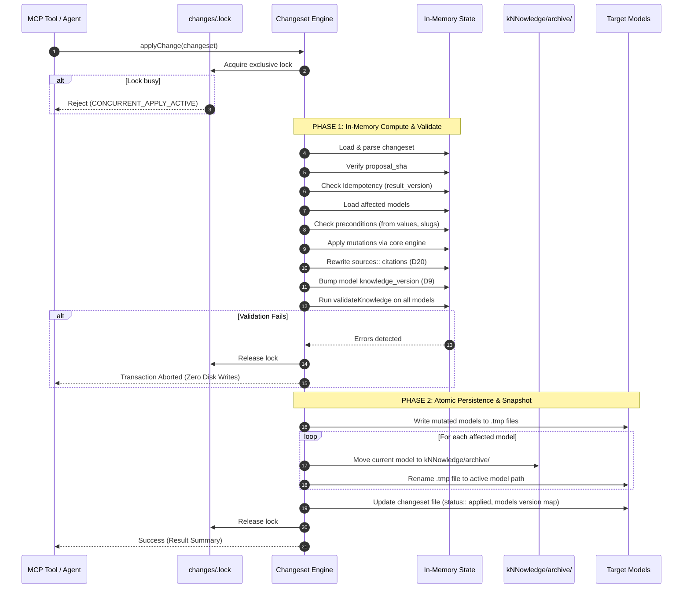

# Exploration Report: Changeset Apply and Versioning (Slice S2a)

**Change Target:** `openspec/changes/2026-10-07-changeset-apply-and-versioning`  
**Slice ID:** `S2a` (`changeset-apply-and-versioning`)  
**Backlog Decisions:** D7, D8, D9, D15, D20 (Cross-cutting: Single Writer Lock, Two-Phase Apply, Idempotency)  
**Status:** Explored & Ready for Proposal  
**Artifact Mode:** Hybrid (`exploration.md` + Engram `sdd/2026-10-07-changeset-apply-and-versioning/explore`)  

---

## 1. Executive Summary

Slice S2a implements the core mutation engine of the `stable-identity-and-changesets` architectural initiative. In cogNNitive, discovery-driven evolution created multiple uncoordinated writers (hand edits, MCP `apply_change`, direct writes from `innfo-editor` via File System Access API, `nn-trannsform` scripts) and disjointed provenance artifacts (`## NN Agent Modification` markdown blocks pasted into chat replies, transcript promotion, `feedback-ledger.jsonl`, editor `editAttribution`, and orphan changelog libraries).

S2a establishes **changesets** as the single source of truth for all graph mutations:
1. **D7 (`changes` BluepriNNt & Naming):** Changesets reside in `changes/` at the domain root as `_NN.md` documents typed to the `changes` bluepriNNt. Naming strictly follows `NN_NAME_INVARIANT` and the UTC timestamp contract (`<workspace_id>_<author>_<stamp>_changes_NN.md`). `roleOf` classifies them as `changeset` so they are never discovered or treated as semantic models. The user's proposed content is sealed by `proposal_sha` in the frontmatter.
2. **D8 (Unified Mutation Pipeline):** Every graph mutation (console proposal, chat request, source import, `cognitivize`) is formulated as a changeset. `apply_change` always executes a changeset (synthesizing and sealing one on-the-fly when called with bare operation arguments). The `## NN Agent Modification` block, verbatim-paste mandate, and transcript promotion as provenance are retired without compatibility shims.
3. **D9 (Model Snapshots & Deep Archive Exclusion):** Live `kNNowledge` files are version-free under `NN_NAME_INVARIANT` (`<name>_NN.md`), with their version tracked in frontmatter (`knowledge_version`). Applying a changeset bumps each affected model once (patch default) and moves the previous content to `kNNowledge/archive/` (retaining version, stamp, and changeset id). `isExcludedPath` is updated to exclude an `archive` segment at **any depth** (fixing the current restriction where only root-level `archive` is ignored).
4. **D15 (Feedback Provenance via `op: comment`):** Review feedback is represented directly as `op: comment` changes (target, author, notes, no `to` value).
5. **D20 (Current Value Citation Rewriting):** A field's `sources::` citation in the model reflects the origin of its *current* value. Applying a change rewrites the citation of every touched field to point to the applied change (`changes/<changeset>_changes_NN.md@## NN Change: <id>`). Untouched fields retain their previous citations. Historical provenance walks backward through archived model snapshots and the changeset chain.
6. **Cross-Cutting Safety & Reliability:**
   - **Single Writer Lock:** A filesystem lock at `changes/.lock` ensures serial execution and prevents race conditions across agent runs and tools.
   - **Two-Phase Apply:** Phase 1 computes mutations in-memory, updates citations, bumps versions, and validates models against blueprints (`validateKnowledge`). If any validation fails, the entire transaction aborts with zero files modified on disk. Phase 2 writes temporary staging files, archives previous snapshots, renames atomically, and annotates the changeset file with resolution metadata (`status:: applied`, `resolution::`, `resolved_slug::`).
   - **Idempotency:** Applying an already-applied changeset is a no-op keyed on model `result_version` and changeset `status: applied`.

---

## 2. Architectural Analysis: Current vs Target State

### 2.1 The Mutation Pipeline

| Dimension | Current State (`innfo-mcp:apply-change.ts`) | Target State (`S2a`) |
|---|---|---|
| **Entry Point** | `apply_change(rootDir, id, op, args)` directly mutates individual files. | `apply_change` accepts either an existing changeset (`changeset: "changes/..."`) or bare args, which are automatically authored into a sealed changeset in `changes/`. |
| **Provenance Record** | Generates an `Agent Modification` string returned to the client to paste into chat (`modification` property). Nothing persistent is stored if unpasted. | Immutable changeset file saved under `changes/`, sealed with `proposal_sha`, updated in-place with per-change resolution status (`status:: applied`). |
| **Model Versioning** | `bumpVersion` renames files to embed `_V_<version>_` (violating `NN_NAME_INVARIANT` on live models). Discards old file content via `rm(filePath)`. | Live files keep invariant `_NN.md` names. `knowledge_version` in frontmatter is bumped. Previous content is **moved** to `kNNowledge/archive/`. |
| **Discovery Scope** | `isExcludedPath` only excludes `archive` if it is the first segment (`segs[0]`). `kNNowledge/archive/` is not excluded. | `isExcludedPath` checks all segments (`segs.some(s => s === 'archive')`), preventing discovery of archived models at any depth. |
| **Concurrency Guard** | No filesystem locking; concurrent agent processes or console exports can interleave mutations. | Single writer lock (`changes/.lock`) with exclusive creation (`wx`), stale lock timeout, and deterministic release in `finally`. |
| **Transaction Safety** | In-place file overwrites with best-effort rollback; partial failure can leave inconsistent files. | Two-phase apply: in-memory calculation and validation $\rightarrow$ staging temp files $\rightarrow$ atomic rename and snapshot archival. |
| **Field Citations (D20)** | Mutations do not update element `sources::` unless explicitly passed in `args.sources`. | Touched fields automatically have `sources::` updated to cite `changes/<changeset>_changes_NN.md@## NN Change: <id>`. |

---

## 3. Detailed Component Investigation

### 3.1 Excluded Paths & Role Classification (`innfo-core/src/naming/contract.ts`)

#### 3.1.1 Deep Archive Exclusion (D9)
In `iNNfo/packages/innfo-core/src/naming/contract.ts`:
```ts
// CURRENT IMPLEMENTATION (contract.ts:149-153)
export function isExcludedPath(path: string): boolean {
  const segs = segmentsOf(path)
  if (segs.length > 0 && IGNORED_DIRECTORIES.has(segs[0])) return true
  return segs.some((s) => s === 'staging' || (s.startsWith('.') && s !== '..'))
}
```
Because `IGNORED_DIRECTORIES` (`backups`, `archive`, `specs`) is only checked on `segs[0]`, an archived model at `kNNowledge/archive/model_NN.md` or `sources/archive/file.csv` is currently **not** excluded. `isModelCandidate` reads `kNNowledge/archive/` and misidentifies snapshots as active models.

**Target Implementation:**
```ts
export function isExcludedPath(path: string): boolean {
  const segs = segmentsOf(path)
  if (segs.length > 0 && IGNORED_DIRECTORIES.has(segs[0])) return true
  return segs.some((s) => s === 'archive' || s === 'staging' || (s.startsWith('.') && s !== '..'))
}
```
Checking `s === 'archive'` across all segments ensures that any nested archive folder at any depth is excluded from model discovery, manifest calculation, and recursive workspace indexing.

#### 3.1.2 Role Classification for Changesets (D7)
In `contract.ts`:
- Extend `Role` type union to include `'changeset'`:
  ```ts
  export type Role =
    | 'entrypoint'
    | 'spec'
    | 'sidecar'
    | 'lineage-record'
    | 'catalog'
    | 'procedure'
    | 'knowledge'
    | 'source'
    | 'artifact'
    | 'changeset'
  ```
- Update `NON_KNOWLEDGE_BLUEPRINT_RE`:
  ```ts
  const NON_KNOWLEDGE_BLUEPRINT_RE = /^(cognnitive|workspace|procedures|sources|artifacts|sidecar|changes)(?:_|$)/i
  ```
- Update `roleOf`:
  ```ts
  case 'changes':
    return 'changeset'
  ```
- Because `isModelCandidate` checks `roleOf === 'knowledge'`, changeset documents in `changes/` will never be classified or discovered as models.

---

### 3.2 The `changes` BluepriNNt (`iNNfo/specs/bluepriNNts/changes/spec_NN.md`)

Changesets are valid iNNfo Level-3 documents instantiating the Level-2 `changes` blueprint.

#### 3.2.1 Level-2 Blueprint Definition
Location: `iNNfo/specs/bluepriNNts/changes/spec_NN.md`
Frontmatter:
```yaml
---
spec_version: "V_0-4-0"
spec_url: "https://raw.githubusercontent.com/cogNNitive/cogNNitive-web/main/iNNfo/specs/bluepriNNts/changes/spec_NN.md"
level: 2
parent_spec:
  name: "iNNfo_V_0-4-0"
  url: "https://raw.githubusercontent.com/cogNNitive/cogNNitive-web/main/iNNfo/specs/iNNfo_V_0-4-0_NN.md"
blueprint_version: "V_0-1-0"
title: "Changes App"
relationship_types:
  hierarchy:
    enabled: true
    via: "index block"
  evaluable_matrix:
    enabled: false
  graph_edge:
    enabled: false
  sequence:
    enabled: true
---
```
Sections:
```markdown
# NN index

* [[Change]]

# NN Concept Definition

## NN Concept Definition: Change
icon:: git-commit
type:: list
color:: blue
weight:: 100

# NN Field Definition

## NN Field Definition: op
concept:: Change
type:: select
options:: [update_field, add_element, remove_element, rename_element, rename_concept, update_matrix_cell, comment]
description:: Operation type to apply against the target model.

## NN Field Definition: target
concept:: Change
type:: string
description:: Canonical D5 address of the target entity (e.g. model_slug@element-slug&field_name).

## NN Field Definition: from
concept:: Change
type:: string
description:: Precondition value expected prior to mutation. Used for conflict detection.

## NN Field Definition: to
concept:: Change
type:: string
description:: Proposed new value for the field, element, or matrix cell.

## NN Field Definition: concept
concept:: Change
type:: string
description:: Target concept name for add_element operations.

## NN Field Definition: name
concept:: Change
type:: string
description:: Display name for element creation or renaming.

## NN Field Definition: slug
concept:: Change
type:: string
description:: Console-proposed slug for newly created elements.

## NN Field Definition: fields
concept:: Change
type:: string
description:: Serialized initial fields for element creation.

## NN Field Definition: author
concept:: Change
type:: string
description:: Contributor or agent who proposed the change.

## NN Field Definition: notes
concept:: Change
type:: string
description:: Review comments, rationale, or contextual explanation.

## NN Field Definition: status
concept:: Change
type:: select
options:: [proposed, applied, rejected, conflict]
description:: Execution status recorded by the apply engine.

## NN Field Definition: resolution
concept:: Change
type:: string
description:: Notes or justification recorded upon application or conflict.

## NN Field Definition: resolved_slug
concept:: Change
type:: string
description:: Actual assigned slug if suffixed or disambiguated during application.
```

#### 3.2.2 Canonical Registry Integration
Register `changes` in `iNNfo/packages/innfo-core/src/schema/canonical-registry.ts` under `CANONICAL_BLUEPRINTS` so that `resolveBlueprintForKnowledge` can resolve it offline without network calls.

---

### 3.3 Changeset Lifecycle & Document Format (D7, D8, D15)

#### 3.3.1 Naming Contract
Changeset files are stored in `changes/` at the workspace root:
- Format: `<workspace_id>_<author>_<stamp>_changes_NN.md`
- Stem conforms to `NN_NAME_INVARIANT` (ends with `_changes`).
- Timestamp: UTC `YYYYMMDDTHHmmssZ` via `formatUtcStamp(new Date())`.

#### 3.3.2 Proposal Sealing (`proposal_sha`)
The proposed changes are sealed upon creation:
1. When proposed by console or chat, the changeset contains frontmatter with `status: proposed` and `proposal_sha: "<hex>"`.
2. `proposal_sha` is the SHA-256 hash of the canonical serialized proposed change elements (excluding mutable agent resolution fields like `status::`, `resolution::`, and `resolved_slug::`).
3. During apply, `proposal_sha` is verified. If the proposal body was tampered with or corrupted, apply fails with `PROPOSAL_TAMPERED`.
4. After application, the changeset frontmatter records `status: applied`, `applied_at`, and the `models` version transition map:
   ```yaml
   models:
     business-model:
       base_version: "V_0-1-0"
       result_version: "V_0-1-1"
   ```

---

### 3.4 Two-Phase Apply & Single Writer Lock Mechanics

#### 3.4.1 Single Writer Lock (`changes/.lock`)
- Path: `<rootDir>/changes/.lock`.
- Acquisition: Exclusive file creation using `fs.open(lockPath, 'wx')`.
- Payload: JSON containing `{ pid: process.pid, timestamp: Date.now(), changeset: "<name>" }`.
- Stale Lock Recovery: If lock file exists but is older than 60 seconds (or process is dead), break lock with warning.
- Release: Unlink lock file in a `try ... finally` block.

#### 3.4.2 Two-Phase Apply Transaction



---

### 3.5 Model Archival & Snapshot Naming (D9)

#### 3.5.1 The Archival Move
When a model is bumped from `base_version` (e.g. `V_0-1-0`) to `result_version` (e.g. `V_0-1-1`), the previous content on disk is **moved** to `kNNowledge/archive/`.
- Directory: `<rootDir>/kNNowledge/archive/` (created recursively if missing).
- Snapshot Basename:
  `<model_stem>_<base_version>_<stamp>_<changeset_stem>_NN.md`
  Example:
  `Acme_business_V_0-1-0_20261007T143000Z_acme_lucas_20261007T143000Z_changes_NN.md`
- The snapshot preserves the exact state of the model before this changeset was applied.
- Because `isExcludedPath` checks all path segments for `archive`, this file is completely invisible to model discovery, catalogs, and active validators.

#### 3.5.2 Version Bumping Semantics
- Model versions live exclusively in frontmatter (`knowledge_version: "V_0-1-1"`).
- The file name of the active model remains strictly invariant: `kNNowledge/Acme_business_NN.md`.
- Default bump step: `patch`. If requested by caller, `minor` or `major`.
- Multiple changes touching the same model in a single changeset bump the model **once**.

---

### 3.6 Field Citation Rewriting (D20)

#### 3.6.1 Origin of Current Value
Per decision D20:
> "A field's `sources::` citation in the model names the origin of its CURRENT value. When a change is applied, the writer rewrites the citation of every touched field to point at that change (e.g. `changes/<changeset>_changes_NN.md@## NN Change: <id>`); untouched fields keep their citation."

#### 3.6.2 Citation Format
When a change `## NN Change: chg-1` in `changes/workspace_alice_20261007T120000Z_changes_NN.md` modifies field `summary` on element `vision`:
1. The field value in the model is updated.
2. The element's `sources::` field is updated (or appended/replaced for that field's provenance) to:
   `changes/workspace_alice_20261007T120000Z_changes_NN.md@## NN Change: chg-1`
3. If an element has dedicated field-level citation conventions or the element-level `sources::` citation list:
   - For element mutations, the change reference is added to `sources::`.
   - Previous origins remain traceable by following the citation back to the changeset, and from the changeset to the archived snapshot (`base_version`).
4. Lineage remains clean:
   $$\text{Artifact} \longrightarrow \text{Model} \longrightarrow \text{Changeset} \longrightarrow \text{Archived Snapshot} \longrightarrow \text{Primary Source}$$

---

### 3.7 Matrix Cell Mutation in `mutate.ts`

`mutate.ts` currently lacks a dedicated matrix-cell mutation handler.
In S2a, we add `update_matrix_cell`:
```ts
interface UpdateMatrixCellArgs {
  matrixName?: string
  matrixSlug?: string
  row: string
  col: string
  value: string
}
```
Mechanics:
1. Locate target matrix in `model.matrices` by `name` or `slug`.
2. Find cell matching `cell.row === row && cell.col === col` (matching slugs or names).
3. If cell exists, update `cell.value = value`.
4. If cell does not exist, insert `{ row, col, value }`.
5. Support D5 target address grammar: when `target` is provided (e.g. `model@matrix-slug&row-slug&col-slug`), parse into matrix, row, col, and value from `to`.

---

## 4. Retiring Legacy Provenance (D8, D15)

In S2a, the following legacy mechanisms are retired:
1. **Agent Modification Block:**
   - Remove `modification` generation in `applyChange`.
   - MCP tool responses no longer return `## NN Agent Modification` markdown strings for chat replies.
   - Retires the verbatim-paste mandate.
2. **Transcript Promotion:**
   - Session transcripts are no longer promoted as graph provenance.
   - Changesets in `changes/` are the sole and complete record of graph alterations.
3. **Feedback Ledger & Tools:**
   - Review feedback is submitted as `op: comment` changes within changesets.
   - Sets the stage for complete deprecation of `evaluate_feedback_items` and `record_feedback_verdict` in S2c.

---

## 5. File Surface & Impact Analysis

| Component / File | Nature of Change | Purpose |
|---|---|---|
| `innfo-core/src/naming/contract.ts` | **Modify** | Extend `Role` to include `'changeset'`, add `changes` to `NON_KNOWLEDGE_BLUEPRINT_RE`, update `roleOf`, and update `isExcludedPath` to exclude `archive` at ANY depth. |
| `innfo-core/src/schema/canonical-registry.ts` | **Modify** | Register `changes` blueprint in `CANONICAL_BLUEPRINTS` with embedded schema content. |
| `iNNfo/specs/bluepriNNts/changes/spec_NN.md` | **Create** | Level-2 normative blueprint definition for `changes`. |
| `innfo-core/src/mutate.ts` | **Modify** | Add `update_matrix_cell` mutation handler; support slug/address-based lookups for `update_field`. |
| `innfo-core/src/changeset/` | **Create** | New changeset module: types (`ChangeItem`, `ChangesetDocument`), parser, proposal hasher (`proposal_sha`), citation builder, and lock manager. |
| `innfo-mcp/src/tools/apply-change.ts` | **Refactor** | Re-architect to execute changesets, acquire `changes/.lock`, implement two-phase apply, snapshot previous models to `kNNowledge/archive/`, rewrite citations (D20), and retire `Agent Modification`. |
| `innfo-mcp/src/tools/init-knowledge.ts` | **Modify** | Decouple `knowledge_version` from parent blueprint `spec_version` to prevent `VERSION_MISMATCH` on bumped models. |
| `innfo-mcp/src/server.ts` | **Modify** | Update `apply_change` schema to accept `changeset` / `changeset_path` while retaining transparent wrapping for single-op calls. |
| `innfo-core/tests/naming/roles.test.ts` | **Modify** | Update test expectations to verify that `archive` segments at any depth (e.g. `kNNowledge/archive/...`, `sources/archive/...`) are excluded. |
| `innfo-mcp/test/apply-change.test.ts` | **Modify / Add** | Update existing tests to reflect invariant model naming and archival move; add tests for changeset execution, locking, and two-phase apply. |

---

## 6. Verification & Test Strategy

1. **Naming & Exclusion Unit Tests:**
   - Verify `isExcludedPath('kNNowledge/archive/model_NN.md') === true`.
   - Verify `isExcludedPath('sources/archive/file.csv') === true`.
   - Verify `roleOf({ path: 'changes/workspace_user_20261007T120000Z_changes_NN.md', parentSpecName: 'changes' }) === 'changeset'`.
   - Verify `isModelCandidate` returns `false` for changeset documents.
2. **Changeset Engine Unit Tests:**
   - Parse changesets containing `update_field`, `add_element`, `update_matrix_cell`, and `comment`.
   - Verify `proposal_sha` verification succeeds on untampered proposals and fails if content was altered.
   - Verify citation rewriting: touched fields get `sources:: [changes/...@## NN Change: <id>]`.
3. **Locking & Concurrency Tests:**
   - Verify `changes/.lock` prevents concurrent apply attempts.
   - Verify stale lock detection and cleanup.
   - Verify lock release on failure / exception.
4. **Two-Phase Apply Transaction Tests:**
   - Failure test: Invalid mutation causes Phase 1 validation failure $\rightarrow$ zero disk writes, no archive move, active file unchanged.
   - Success test: Valid mutation $\rightarrow$ active model updated in-place with bumped `knowledge_version`, previous content moved to `kNNowledge/archive/`, changeset updated with `status:: applied`.
   - Idempotency test: Re-applying an applied changeset detects matching `result_version` and exits without re-bumping or duplicating archives.
