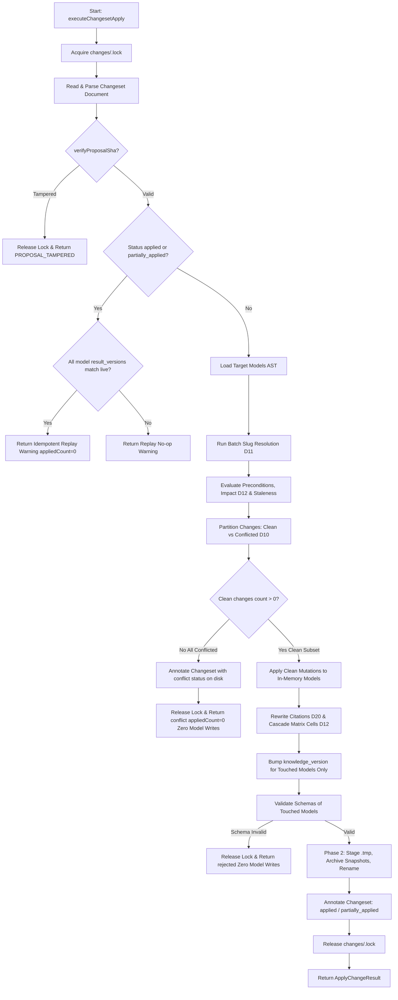
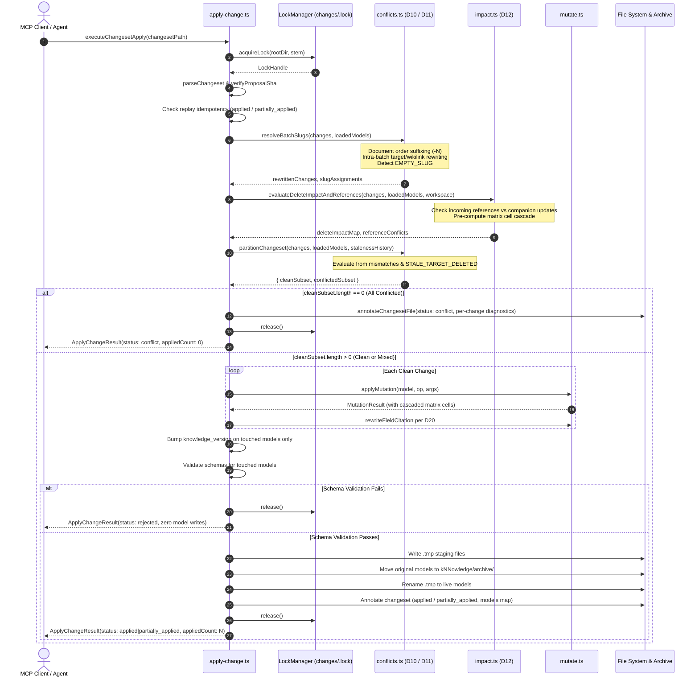

# Technical Design Document: Changeset Conflicts and Deletes (Slice S2b)

**Change ID**: `2026-10-07-changeset-conflicts-and-deletes`  
**Status**: `Draft`  
**Author**: `sdd-design subagent`  
**Artifact Mode**: Hybrid (`Engram` + `OpenSpec filesystem`)  
**Target Specification**: `iNNfo_V_0-4-0_NN.md` (Level 1 Normative Meta-bluepriNNt) & `iNNfo/specs/bluepriNNts/changes/spec_NN.md` (Level 2 Normative bluepriNNt)

---

## 1. Executive Summary & Intent

Slice S2a (`2026-10-07-changeset-apply-and-versioning`) established changesets as the authoritative mutation medium, introducing single-writer locking at `changes/.lock`, cryptographic proposal sealing (`proposal_sha`), invariant live model naming with frontmatter versioning, snapshot archival to `kNNowledge/archive/`, and field citation rewriting (D20). However, S2a treated conflict handling as an all-or-nothing abort, assigned element slugs with silent server-side suffixing without batch coordination, and implemented element deletion as bare removal without impact computation or dangling reference prevention.

Slice S2b (`changeset-conflicts-and-deletes`) delivers the engine-level conflict and lifecycle semantics required by Decisions **D10**, **D11**, and **D12**:
1. **Per-Change Conflict Partitioning (D10)**: A precondition mismatch or conflict in one change item MUST NOT abort the entire changeset. The engine partitions the batch into clean and conflicted subsets. The clean subset is committed atomically to live models in Phase 2, while conflicted changes are skipped without mutations. A mixed outcome sets changeset frontmatter `status: partially_applied`. Replay of a `partially_applied` changeset is an idempotent no-op keyed on model `result_version`; conflicted changes can only be resolved by authoring and submitting a **new** changeset.
2. **Batch Slug Collision Resolution & Document-Order Priority (D11)**: Element slugs proposed by `add_element` operations are resolved in strict changeset document order against live models and earlier additions within the same batch. On collision, the engine automatically suffixes (`-1`, `-2`, ..., `-N`), records the final slug in `resolved_slug::`, and rewrites all subsequent intra-batch targets (`target::`) and values (field references and `[[wikilinks]]`). Non-Latin element names that produce an empty slug require an explicit `slug::`; omitting it produces an immediate `EMPTY_SLUG` conflict diagnostic without halting clean companion changes.
3. **Delete Impact Analysis, Cascading & Staleness Guard (D12)**: Before executing `remove_element`, the engine pre-computes impact: matrix cells referencing the element on row or column are automatically cascade-deleted in-batch with the count recorded in `resolution::`. Incoming references across workspace models (reference fields, wikilinks, cross-model addresses) are scanned; if dangling references remain and are not resolved by companion changes within the same batch, the deletion is marked as a conflict (`REFERENCED_BY`). Deleted slugs may be reused in subsequent changesets (restarting lifecycle history), and mutations against targets deleted after the pending changeset's `base_version` are rejected via a reverse scan of `changes/` (capped at 50 changesets).

---

## 2. Requirements & Traceability Matrix

| Spec / Capability | Requirement | Architectural Decision | Implementation Target |
|---|---|---|---|
| `changeset-conflicts` | Per-Change Conflict Partitioning (Clean Subset Atomic) | **D10** | `innfo-core/src/changeset/conflicts.ts`, `innfo-mcp/src/tools/apply-change.ts` |
| `changeset-conflicts` | Status Semantics: `partially_applied`, `applied`, `conflict` | **D10** | `innfo-core/src/changeset/types.ts`, `innfo-mcp/src/tools/apply-change.ts` |
| `changeset-conflicts` | Zero Disk Writes & Zero Snapshot on All-Conflicted Batch | **D10** | `innfo-mcp/src/tools/apply-change.ts` |
| `changeset-conflicts` | Version Bump & Snapshot Scoped Strictly to Touched Models | **D10** | `innfo-mcp/src/tools/apply-change.ts` |
| `changeset-conflicts` | Idempotent Replay for `applied` and `partially_applied` | **D10** | `innfo-mcp/src/tools/apply-change.ts` |
| `batch-slug-resolution` | Document-Order Slug Claiming & Collision Detection | **D11** | `innfo-core/src/changeset/conflicts.ts`, `innfo-core/src/mutate.ts` |
| `batch-slug-resolution` | Deterministic Auto-Suffixing (`-N`) and `resolved_slug::` Annotation | **D11** | `innfo-core/src/changeset/conflicts.ts`, `innfo-mcp/src/tools/apply-change.ts` |
| `batch-slug-resolution` | Intra-Batch Reference Rewriting (`target::`, `to`, `[[slug]]`) | **D11** | `innfo-core/src/changeset/conflicts.ts` |
| `batch-slug-resolution` | Empty-Slug Handling (`EMPTY_SLUG` Diagnostic Conflict) | **D11** | `innfo-core/src/changeset/conflicts.ts` |
| `delete-impact-and-lifecycle` | Pre-Computed Delete Impact & In-Batch Matrix Cell Cascade | **D12** | `innfo-core/src/changeset/impact.ts`, `innfo-core/src/mutate.ts` |
| `delete-impact-and-lifecycle` | Workspace Reference Scanning & Conflict Surfacing (`REFERENCED_BY`) | **D12** | `innfo-core/src/changeset/impact.ts` |
| `delete-impact-and-lifecycle` | In-Batch Companion Update Satisfaction Check | **D12** | `innfo-core/src/changeset/impact.ts` |
| `delete-impact-and-lifecycle` | Reverse `changes/` History Scan Staleness Guard (`STALE_TARGET_DELETED`) | **D12** | `innfo-core/src/changeset/conflicts.ts` |
| `delete-impact-and-lifecycle` | Slug Reuse Lifecycle Restart at Last `add_element` | **D12** | `innfo-core/src/changeset/conflicts.ts` |

---

## 3. Architecture Decisions & Tradeoffs

### Decision D10: Per-Change Conflict Partitioning & Mixed-Batch `partially_applied` Semantics

- **Problem**: In S2a, any precondition failure (e.g., outdated `from` value or missing element) triggers an immediate whole-batch abort. In multi-agent or multi-model workflows, a single stale change blocks completely valid, orthogonal edits across other models or concepts.
- **Options Evaluated**:
  1. *Whole-changeset abort (Status Quo S2a)*: Preserves binary all-or-nothing semantics, but creates high coordination friction and head-of-line blocking.
  2. *Interactive resolution prompt*: Prompts the calling client/agent during apply execution. Infeasible for headless MCP agents and violates the lock timeout constraint (holding `changes/.lock` open indefinitely).
  3. *Skip-and-continue partitioning with atomic clean subset and frontmatter `partially_applied`*: Evaluate preconditions per item. Partition into clean and conflicted subsets. Apply clean subset atomically in Phase 1 & 2; skip conflicted subset with `status:: conflict` and diagnostic `resolution::`. Mark changeset frontmatter `status: partially_applied`.
- **Decision & Rationale**: Adopt Option 3. Clean changes proceed without blocking; transaction atomicity is preserved across the clean subset; disk writes and snapshots occur strictly for touched models; idempotent replay guarantees safe retries; and conflicted changes are quarantined until a new changeset is authored.

### Decision D11: Batch Slug Collision Resolution & Document-Order Priority

- **Problem**: In S2a, `add_element` relies on server-side silent suffixing when `slug` is omitted, but rejects colliding explicit `slug::` arguments outright. Furthermore, within a multi-change batch, two `add_element` operations proposing the same slug are not evaluated together, and subsequent changes targeting newly created elements with suffixed slugs fail due to mismatched targets.
- **Options Evaluated**:
  1. *Abort on intra-batch or live collision*: Forces caller to query live state, generate unique slugs, and resubmit. Highly prone to race conditions.
  2. *Generate synthetic UUIDs / surrogate keys*: Eliminates collisions, but violates stable human-readable element identity and Markdown readability.
  3. *Document-order candidate claiming, automatic suffixing, intra-batch rewrite, and empty-slug diagnostics*:
     - First operation in document order claims the base slug (`slug` or `slugifyHeading(name)`).
     - Colliding operations automatically append `-1`, `-2`, ..., `-N`.
     - Final slug recorded in `resolved_slug::` for all `add_element` operations.
     - All subsequent changes in the batch targeting or referencing the proposed slug are rewritten in-memory before evaluation.
     - Non-Latin names yielding an empty slug (`slugifyHeading('') === ''`) without an explicit `slug::` are flagged as `status:: conflict` with diagnostic `EMPTY_SLUG`.
- **Decision & Rationale**: Adopt Option 3. It provides deterministic, predictable slug assignment, ensures internal batch referential consistency, and maintains stable human-readable identity without synthetic IDs.

### Decision D12: Delete Impact Pre-Computation, Cascading & Staleness History Guard

- **Problem**: In S2a, `remove_element` simply filters elements from the concept array. It leaves dangling matrix cells in the same model, leaves dangling references in other models, and does not check whether an element was deleted concurrently or after the changeset's `base_version`.
- **Options Evaluated**:
  1. *Bare delete (Status Quo S2a)*: Fast, but corrupts workspace integrity with dangling references and broken matrix views.
  2. *Persistent global reverse-index database (e.g. SQLite)*: Fast lookups, but introduces state synchronization overhead, cache invalidation bugs, and secondary stores outside Markdown files.
  3. *In-memory impact pre-computation, matrix cell cascade, workspace incoming reference scan, and bounded reverse changeset scan*:
     - Pre-computes matrix cell dependencies within the model and cascades them automatically in-batch, annotating the count in `resolution::`.
     - Scans workspace models for reference fields, wikilinks, and cross-model targets pointing to the target slug. If incoming references exist without companion updates in the same batch, marks `remove_element` as `status:: conflict` (`REFERENCED_BY`).
     - Checks staleness via reverse scan of `<rootDir>/changes/` (capped at 50 changesets). If a `remove_element` for the target occurred after the changeset's `base_version`, flags `status:: conflict` (`STALE_TARGET_DELETED`). If `add_element` is encountered, history restarts (allowing slug reuse).
- **Decision & Rationale**: Adopt Option 3. It maintains Markdown files as the sole source of truth, prevents workspace corruption, cascade-deletes matrix cells cleanly, and provides a bounded, efficient staleness guard.

### Architecture Decisions Summary Table

| Option | Tradeoff | Decision |
|---|---|---|
| **D10 Conflict Handling** | | |
| *Option A: Whole-batch abort* | Strict binary state; high coordination friction, blocks independent edits | Rejected |
| *Option B: Interactive prompt* | Flexible; breaks headless agents, risks holding `changes/.lock` past timeout | Rejected |
| *Option C: Partition & `partially_applied`* | Requires partial state handling; non-blocking clean subset, atomic commit, clean annotations | **Selected (D10)** |
| **D11 Batch Slug Resolution** | | |
| *Option A: Reject on collision* | Simple engine; high client roundtrips, race prone | Rejected |
| *Option B: Synthetic UUIDs* | Zero collisions; unreadable Markdown, breaks stable element identity | Rejected |
| *Option C: Document order auto-suffix + intra-batch rewrite* | Requires in-batch AST rewriting; deterministic, retains human-readable identity, self-consistent | **Selected (D11)** |
| **D12 Delete Impact & Lifecycle** | | |
| *Option A: Bare delete* | Minimal code; leaves dangling references and orphan matrix cells | Rejected |
| *Option B: Persistent SQLite index* | O(1) queries; secondary store out of sync with git/Markdown source of truth | Rejected |
| *Option C: Pre-computed cascade + bounded reverse scan* | Requires workspace scan and bounded change scan; 100% Markdown-native, zero dangling refs, safe reuse | **Selected (D12)** |

---

## 4. Data Flow & Transaction Lifecycle

### 4.1 Changeset Execution Flow with Conflict Partitioning



### 4.2 Sequence Diagram: Partitioned Apply Lifecycle



---

## 5. Interfaces & Data Structures

### 5.1 Type Definitions (`iNNfo/packages/innfo-core/src/changeset/types.ts`)

```typescript
export type ChangeOp =
  | 'update_field'
  | 'add_element'
  | 'remove_element'
  | 'rename_element'
  | 'rename_concept'
  | 'update_matrix_cell'
  | 'comment'

/**
 * ChangeStatus represents individual operation status or overall changeset status.
 * 'partially_applied' is valid for changeset-level status when mixed outcomes occur.
 */
export type ChangeStatus =
  | 'proposed'
  | 'applied'
  | 'partially_applied'
  | 'rejected'
  | 'conflict'

export interface ChangeItem {
  id: string
  op: ChangeOp
  /** Canonical D5 target address: model@element&field or model@matrix&row&col or model@concept */
  target: string
  from?: string
  to?: string
  concept?: string
  name?: string
  slug?: string
  fields?: Record<string, string>
  author?: string
  notes?: string
  /** Execution / Resolution annotations (excluded from proposal_sha) */
  status?: ChangeStatus
  resolution?: string
  resolved_slug?: string
}

export interface ModelVersionTransition {
  base_version: string
  result_version: string
}

export interface ChangesetFrontmatter {
  spec_version: string
  parent_spec: 'changes' | string
  blueprint_version: string
  status: ChangeStatus
  /** Deterministic SHA-256 seal computed over canonical proposed changes */
  proposal_sha: string
  applied_at?: string
  /** Map of affected model slugs to base and result versions */
  models?: Record<string, ModelVersionTransition>
  title?: string
  author?: string
  workspace_id?: string
  [key: string]: unknown
}

export interface ChangesetDocument {
  frontmatter: ChangesetFrontmatter
  changes: ChangeItem[]
  rawContent?: string
}

export interface ChangesetApplyResult {
  success: boolean
  changesetPath: string
  changeset?: string
  status: ChangeStatus
  models: Record<string, ModelVersionTransition>
  appliedCount: number
  conflictedCount?: number
  errors?: Array<{ path: string; message: string; code?: string }>
  warnings?: Array<{ path: string; message: string }>
}
```

### 5.2 Conflict Partitioning & Slug Resolution Interface (`innfo-core/src/changeset/conflicts.ts`)

```typescript
import type { ChangeItem, ChangesetDocument } from './types.js'
import type { ParsedKnowledge } from '../types/index.js'

export interface SlugResolutionResult {
  changes: ChangeItem[]
  assignedSlugs: Map<string, string> // proposed -> resolved
  conflictedChanges: Map<string, string> // change.id -> reason
}

export interface PartitionResult {
  cleanSubset: ChangeItem[]
  conflictedSubset: ChangeItem[]
  conflictDiagnostics: Map<string, { code: string; message: string }>
}

export interface StalenessCheckResult {
  stale: boolean
  code?: 'STALE_TARGET_DELETED'
  message?: string
}

/**
 * Resolves proposed slugs for add_element operations in strict document order.
 * - Detects collisions against live model slugs and earlier additions in this batch.
 * - Auto-suffixes colliding slugs with -1, -2, ..., -N.
 * - Flags non-Latin names producing empty slug without explicit slug:: as EMPTY_SLUG conflict.
 * - Rewrites subsequent change targets and [[wikilink]] / reference values within the batch.
 */
export function resolveBatchSlugs(
  changes: ChangeItem[],
  loadedModels: Map<string, ParsedKnowledge>,
): SlugResolutionResult

/**
 * Checks applied changeset history in reverse chronological order (max 50)
 * to verify if the target element was deleted after the pending changeset's base_version.
 * Stops if an add_element for that slug is encountered (lifecycle restart).
 */
export async function checkStaleTarget(
  changesDir: string,
  modelSlug: string,
  elementSlug: string,
  baseVersion: string,
  maxScan?: number,
): Promise<StalenessCheckResult>

/**
 * Evaluates preconditions for each change item individually:
 * - from value mismatches
 * - missing target elements
 * - staleness via checkStaleTarget
 * - reference conflicts from impact analysis
 * Partitions items into clean and conflicted subsets.
 */
export async function partitionChangeset(
  changes: ChangeItem[],
  loadedModels: Map<string, ParsedKnowledge>,
  changesDir: string,
  modelBaseVersions: Map<string, string>,
  referenceConflicts: Map<string, string>,
): Promise<PartitionResult>
```

### 5.3 Delete Impact Analysis Interface (`innfo-core/src/changeset/impact.ts`)

```typescript
import type { ChangeItem } from './types.js'
import type { ParsedKnowledge } from '../types/index.js'

export interface CascadedMatrixCell {
  matrixName: string
  row: string
  col: string
}

export interface IncomingReferenceHit {
  referencingModelSlug: string
  referencingElementIdent: string
  field: string
  referenceType: 'field' | 'wikilink' | 'cross-model'
  rawReference: string
}

export interface DeleteImpact {
  cascadedCells: CascadedMatrixCell[]
  unresolvedReferences: IncomingReferenceHit[]
}

/**
 * Scans matrices in target model for cells whose row or column matches target element.
 */
export function computeMatrixCascade(
  model: ParsedKnowledge,
  elementSlug: string,
  elementName: string,
): CascadedMatrixCell[]

/**
 * Scans all workspace models for active incoming references to target element:
 * 1. Fields declared as reference/knowledge type
 * 2. Prose wikilinks [[slug]], [[name]], [[slug|alias]]
 * 3. Cross-model addresses model@slug
 * Filters out references that are satisfied by companion updates/deletes in the same batch.
 */
export function scanIncomingReferences(
  workspaceModels: Map<string, ParsedKnowledge>,
  targetModelSlug: string,
  targetElementSlug: string,
  targetElementName: string,
  batchChanges: ChangeItem[],
): IncomingReferenceHit[]

/**
 * Evaluates impact for all remove_element operations in the changeset batch.
 * Returns map of change ID to matrix cascade cells and map of change ID to blocking reference conflict message.
 */
export function evaluateBatchDeleteImpact(
  changes: ChangeItem[],
  loadedModels: Map<string, ParsedKnowledge>,
  workspaceModels: Map<string, ParsedKnowledge>,
): {
  matrixCascades: Map<string, CascadedMatrixCell[]>
  referenceConflicts: Map<string, string>
}
```

---

## 6. Concrete File Changes & Module Architecture

### 6.1 Package `innfo-core`

#### `src/changeset/types.ts`
- Extend `ChangeStatus` to include `'partially_applied'`.
- Update `ChangesetApplyResult` to support `status: ChangeStatus`, `appliedCount: number`, and optional `conflictedCount: number`.

#### `src/changeset/conflicts.ts` (NEW)
- Implements:
  - `resolveBatchSlugs`:
    - Iterates in document order through `changes`.
    - For `add_element`, derives candidate slug via `change.slug || slugifyHeading(change.name)`.
    - If `slugifyHeading(change.name)` is empty and no valid `change.slug` is provided, sets diagnostic: `EMPTY_SLUG: Element name produces an empty slug; explicit slug:: required` and records in `conflictedChanges`.
    - Tracks claimed slugs per model: initialized with live element slugs from `loadedModels.get(modelSlug)`.
    - If candidate exists in claimed set, increments counter `-1`, `-2`, ..., `-N` until available.
    - Records final slug in `change.resolved_slug`.
    - If candidate was auto-suffixed, rewrites all subsequent change items in `changes`:
      - `target::` rewriting: `${modelSlug}@${proposedSlug}&${field}` $\to$ `${modelSlug}@${resolvedSlug}&${field}`, and `${modelSlug}@${proposedSlug}` $\to$ `${modelSlug}@${resolvedSlug}`.
      - `to` / `fields` value rewriting: rewrites `[[proposedSlug]]` to `[[resolvedSlug]]`, `[[proposedSlug|Alias]]` to `[[resolvedSlug|Alias]]`, and standalone references.
  - `checkStaleTarget`:
    - Reads directory `<rootDir>/changes/`.
    - Sorts applied changeset filenames descending by timestamp.
    - Caps scan at 50 changesets.
    - Parses each changeset using `parseChangeset`.
    - If `add_element` matching `targetSlug` in `modelSlug` is found, breaks scan (slug reuse lifecycle reset).
    - If `remove_element` matching `targetSlug` in `modelSlug` is found, compares changeset's timestamp or applied version with `baseVersion`. If delete occurred after `baseVersion`, returns `{ stale: true, code: 'STALE_TARGET_DELETED', message: 'Target element was deleted after base_version' }`.
  - `partitionChangeset`:
    - Evaluates each change item:
      - Checks if marked conflicted during `resolveBatchSlugs`.
      - Checks if marked conflicted in `referenceConflicts`.
      - Checks staleness via `checkStaleTarget`.
      - Checks `from` preconditions against live model AST (`update_field`, `update_matrix_cell`).
      - Checks missing target elements (`update_field`, `remove_element`, `rename_element`).
    - Segregates items into `cleanSubset` and `conflictedSubset`.

#### `src/changeset/impact.ts` (NEW)
- Implements:
  - `computeMatrixCascade`:
    - Searches `model.matrices`.
    - Identifies any cell where `c.row.toLowerCase() === targetSlug` or `c.col.toLowerCase() === targetSlug` (or matching `targetName`).
    - Returns array of `CascadedMatrixCell`.
  - `scanIncomingReferences`:
    - Iterates over all models in `workspaceModels`.
    - For each model, inspects element fields and descriptions.
    - Identifies references matching `targetElementSlug` or `targetElementName` or `${targetModelSlug}@${targetElementSlug}`.
    - Cross-references companion changes in `batchChanges`:
      - If another change item in the batch updates or removes the referencing field (e.g., `update_field` repointing the field to another value), the reference is satisfied and excluded.
    - Returns remaining active hits. If non-empty, constructs diagnostic string: `REFERENCED_BY: <model>@<element>&<field>, ...`.
  - `evaluateBatchDeleteImpact`:
    - Coordinates matrix cascade and reference scanning for all `remove_element` operations in the batch.

#### `src/changeset/index.ts`
- Re-exports new modules with NodeNext `.js` specifiers:
  ```typescript
  export * from './types.js'
  export * from './hasher.js'
  export * from './parser.js'
  export * from './serializer.js'
  export * from './lock.js'
  export * from './conflicts.js'
  export * from './impact.js'
  ```

#### `src/mutate.ts`
- Update `removeElement`:
  - When removing an element, cascade-deletes matching matrix cells within `model.matrices`:
    ```typescript
    const targetIdent = elementName.toLowerCase()
    let cascadedCells = 0
    for (const matrix of model.matrices) {
      const initialCount = matrix.cells.length
      matrix.cells = matrix.cells.filter(
        (c) => c.row.toLowerCase() !== targetIdent && c.col.toLowerCase() !== targetIdent
      )
      cascadedCells += (initialCount - matrix.cells.length)
    }
    ```
  - Returns `cascadedMatrixCells: cascadedCells` in `MutationResult`.
- Update `addElement`:
  - Accepts pre-resolved `slug` assigned during batch slug resolution.

---

### 6.2 Package `innfo-mcp`

#### `src/tools/apply-change.ts`
- Refactor `executeChangesetApply`:
  1. **Lock & Verify**: Acquire `changes/.lock`; read changeset; verify `proposal_sha`.
  2. **Replay Check**: If `status === 'applied' || status === 'partially_applied'`:
     - Validate live versions of all models recorded in `frontmatter.models`.
     - If all match `result_version`, return success with existing status, `appliedCount: 0`, and idempotent replay warning.
     - Conflicted changes are not re-attempted.
  3. **Model Loading**: Load target models for all change items. In addition, load workspace models if any `remove_element` operations exist.
  4. **Batch Slug Resolution (D11)**:
     - Invoke `resolveBatchSlugs`. Apply auto-suffixing and rewrite subsequent change targets/wikilinks.
  5. **Delete Impact Analysis (D12)**:
     - Invoke `evaluateBatchDeleteImpact`. Determine matrix cascades and flag incoming reference conflicts.
  6. **Precondition Partitioning (D10)**:
     - Invoke `partitionChangeset`.
     - Partition into `cleanSubset` and `conflictedSubset`.
  7. **All-Conflicted Exit Guard**:
     - If `cleanSubset.length === 0`:
       - Annotate changeset document: mark each change with `status:: conflict` and diagnostic `resolution::`.
       - Set frontmatter `status: 'conflict'`.
       - Write updated changeset to disk.
       - Release lock and return `{ success: false, status: 'conflict', appliedCount: 0, errors: [...] }`.
       - **Zero model writes, zero temporary files, zero snapshots**.
  8. **In-Memory Apply for Clean Subset**:
     - Apply only `cleanSubset` operations to in-memory model ASTs.
     - Rewrite field citations per D20.
     - For `remove_element`, record cascaded cell count in `resolution::` (e.g., `Removed element and cascaded N matrix cell(s)`).
     - Flag `mutated = true` ONLY for models with at least one applied clean change.
  9. **Version Bump & Validation Scoped to Touched Models**:
     - For models with `mutated === true`: bump `knowledge_version` (patch default).
     - Models with `mutated === false` retain their original version and are excluded from schema validation and disk writes.
     - Validate schemas for touched models. If validation fails, release lock and abort (status `rejected`, zero model writes).
  10. **Phase 2 Persistence & Archival**:
      - For touched models only: write `.tmp`, archive pre-mutation snapshot to `kNNowledge/archive/`, and rename `.tmp` to live file.
      - Build `modelsTransitionMap` containing only touched models.
  11. **Changeset Annotation Epilogue**:
      - Clean changes: `change.status = 'applied'`, `change.resolution = change.resolution || 'Applied successfully'`. Set `resolved_slug` on `add_element`.
      - Conflicted changes: `change.status = 'conflict'`, `change.resolution = diagnosticMessage`.
      - Frontmatter:
        - `status`: `cleanSubset.length === csDoc.changes.filter(c => c.op !== 'comment').length ? 'applied' : 'partially_applied'`.
        - `applied_at`: ISO timestamp.
        - `models`: `modelsTransitionMap`.
      - Serialize and write changeset file to disk.
  12. **Return Result**: Return `ApplyChangeResult` with `status: 'applied' | 'partially_applied'`, `appliedCount: cleanSubset.length`, `conflictedCount: conflictedSubset.length`.

---

## 7. Strict TDD Testing Strategy

All test cases must follow Strict TDD (Red $\to$ Green $\to$ Refactor).

### 7.1 Unit Tests (`innfo-core`)

#### `tests/changeset/conflicts.test.ts` (NEW)
1. `test('partitionChangeset isolates from mismatches and preserves clean operations')`:
   - Changeset with clean `update_field` and mismatched `from` `update_field`.
   - Result partitions into 1 clean and 1 conflicted.
2. `test('partitionChangeset flags missing target element as conflict')`:
   - `update_field` targeting non-existent element in live model.
   - Flagged as conflict with `PRECONDITION_FAILED: Target element not found`.
3. `test('checkStaleTarget flags STALE_TARGET_DELETED when element deleted after base_version')`:
   - Applied changeset 01 deletes element `cache` when model at `V_0-1-1`.
   - Pending change targets `cache` with base_version `V_0-1-0`.
   - Flagged with `STALE_TARGET_DELETED`.
4. `test('checkStaleTarget resets lifecycle history upon encountering add_element')`:
   - Element `cache` deleted in changeset 01, re-added in changeset 02.
   - Pending change with base_version matching changeset 02 succeeds without staleness error.
5. `test('checkStaleTarget bounds scan to 50 changesets')`:
   - 60 mock changesets; verify scan halts at 50 entries.

#### `tests/changeset/slugs.test.ts` (NEW)
1. `test('resolveBatchSlugs assigns base slug to first add_element in document order')`:
   - Two `add_element` operations named `Feature` for same model.
   - First receives `feature`, second receives `feature-1`.
2. `test('resolveBatchSlugs auto-suffixes colliding slug against live model')`:
   - Live model already contains element `auth`.
   - Changeset proposes `add_element` with name `Auth`.
   - Assigned `auth-1` and recorded in `resolved_slug`.
3. `test('resolveBatchSlugs rewrites subsequent targets and wikilinks within batch')`:
   - Change 1: `add_element` named `Service` suffixed to `service-1`.
   - Change 2: `update_field` targeting `model@service&port`.
   - Change 3: `update_field` with value containing `[[service]]`.
   - Change 2 target rewritten to `model@service-1&port`.
   - Change 3 value rewritten to `[[service-1]]`.
4. `test('resolveBatchSlugs flags non-Latin element without explicit slug as EMPTY_SLUG conflict')`:
   - `add_element` with name `日本語` and no `slug::`.
   - Marked `status: conflict` with `EMPTY_SLUG` diagnostic.
5. `test('resolveBatchSlugs accepts non-Latin element with explicit slug')`:
   - `add_element` with name `日本語` and `slug: japanese-core`.
   - Marked clean, assigned `japanese-core`.

#### `tests/changeset/impact.test.ts` (NEW)
1. `test('computeMatrixCascade finds cells matching target element on row or col')`:
   - Matrix with rows `[auth, billing]` and cols `[read, write]`.
   - Element `auth` deleted $\to$ cascades cells `(auth, read)` and `(auth, write)`.
2. `test('scanIncomingReferences detects active reference field in workspace model')`:
   - Model A has element referencing Model B element `core`.
   - Deleting `core` produces `REFERENCED_BY: ModelA@element&field`.
3. `test('scanIncomingReferences detects active wikilinks')`:
   - Model A description contains `[[core]]`.
   - Deleting `core` produces wikilink reference conflict.
4. `test('scanIncomingReferences allows deletion when companion change updates reference in same batch')`:
   - Batch contains `remove_element` for `core` AND `update_field` updating Model A reference away from `core`.
   - Reference satisfied; deletion proceeds cleanly.

---

### 7.2 Integration Tests (`innfo-mcp`)

#### `test/apply-change.test.ts` (Updates & New Tests)
1. `test('mixed batch applies clean subset and annotates partially_applied')`:
   - Changeset with 1 clean change and 1 precondition mismatch.
   - Model file updated on disk with clean mutation.
   - Changeset frontmatter has `status: partially_applied`.
   - Change 1 marked `status:: applied`; Change 2 marked `status:: conflict`.
   - Result reports `status: 'partially_applied'`, `appliedCount: 1`.
2. `test('all-conflicted batch makes zero disk writes and emits zero snapshots')`:
   - Changeset with all changes failing preconditions.
   - No `.tmp` files, no changes to live models, no files added to `kNNowledge/archive/`.
   - Changeset file annotated on disk with `status: conflict`.
3. `test('untouched models in mixed batch emit no version bump and no snapshot')`:
   - Changeset targeting Model A (clean) and Model B (conflicted).
   - Model A version bumped to `V_0-1-1` with snapshot in archive.
   - Model B retains `V_0-1-0`, no snapshot created.
   - Frontmatter `models` map contains entry for Model A only.
4. `test('idempotent replay of partially_applied changeset is safe no-op')`:
   - Changeset already marked `partially_applied` with matching `result_version` on disk.
   - Re-running `applyChange` returns `success: true`, `status: partially_applied`, `appliedCount: 0`.
   - Conflicted change is not re-executed.
5. `test('batch slug collision auto-suffixes and permits intra-batch field update')`:
   - Changeset adds element colliding with existing slug, then updates a field on it.
   - Both operations succeed; element created with `-1` suffix; field updated correctly.
6. `test('remove_element cascades matrix cells and records count in resolution')`:
   - Deleting element removes corresponding matrix cells in live model.
   - `resolution::` records `Removed element and cascaded 2 matrix cell(s)`.
7. `test('remove_element blocked by active reference records conflict')`:
   - Deleting element with unhandled workspace reference fails with `REFERENCED_BY`.
   - Element remains in live model.

---

## 8. Rollout, Compatibility & Migration Plan

1. **No Blueprint Version Bump**:
   - `iNNfo/specs/bluepriNNts/changes/spec_NN.md` (V_0-4-0 / 0.1.0) already declares `status`, `resolution`, `resolved_slug`, and all 7 operations including `remove_element`.
   - Annotations are excluded from `proposal_sha`.
   - No schema or blueprint bump is required.
2. **NodeNext Module Resolution Contract**:
   - Every internal import within `innfo-core` and `innfo-mcp` strictly uses relative paths ending in `.js` (e.g. `import { resolveBatchSlugs } from './conflicts.js'`).
3. **Decoupled Engine Contract for Console S3**:
   - S2b implements full engine semantics (skip-and-continue, auto-suffixing, impact conflict surfacing).
   - The interactive modal UI and writer confirmation flow will layer directly on top of these machine-readable statuses in Slice S3 without further engine modifications.
4. **Rollback Safety**:
   - Reverting S2b commits cleanly restores S2a whole-batch abort semantics. Existing applied changesets and archived models remain fully compatible.
