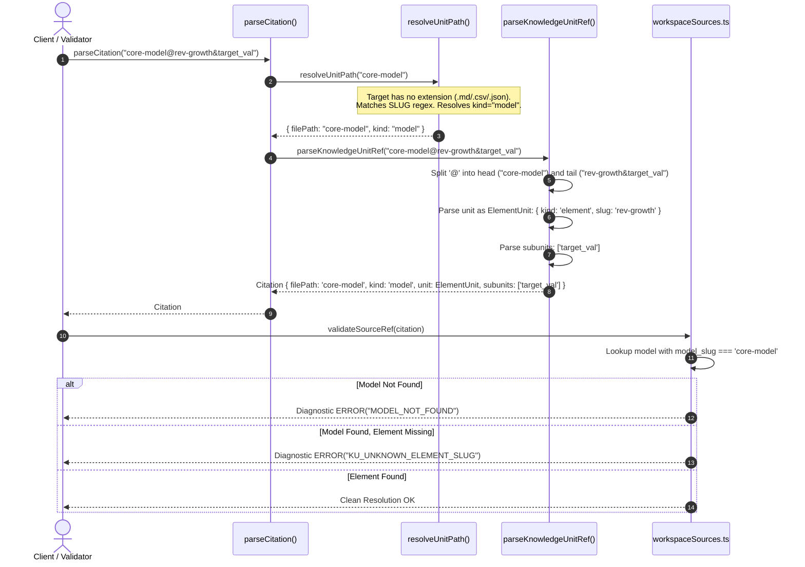
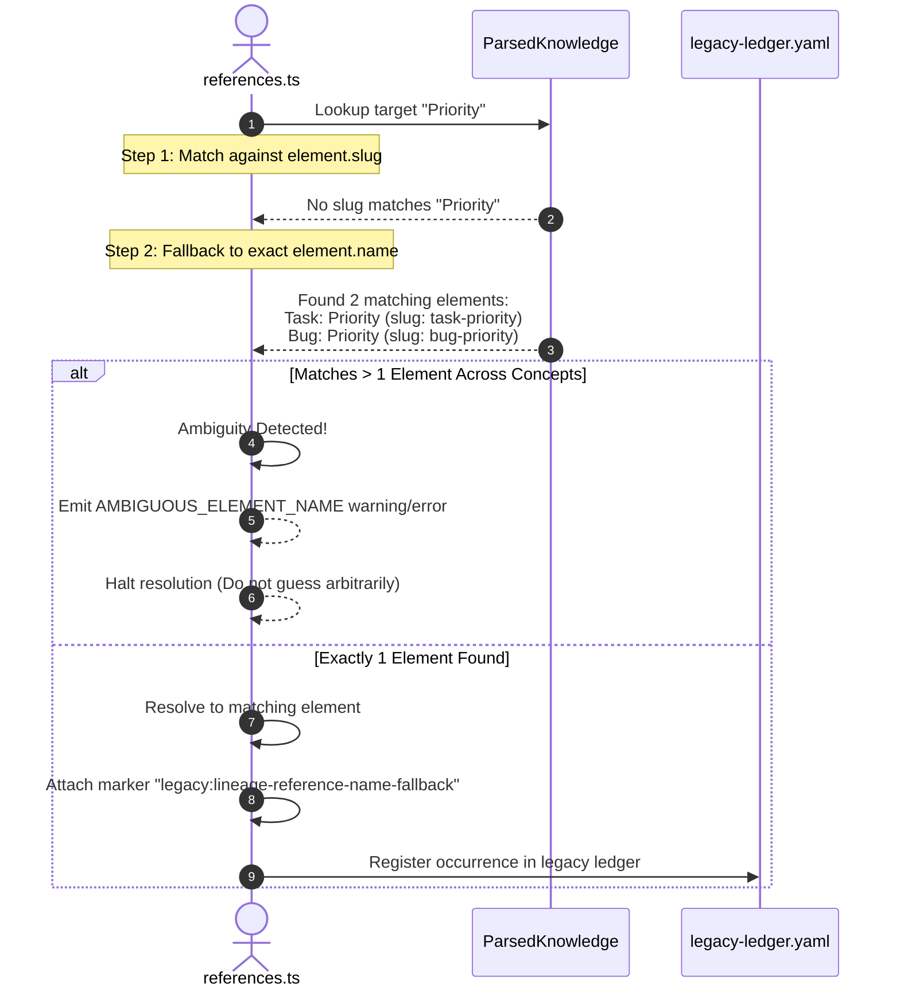
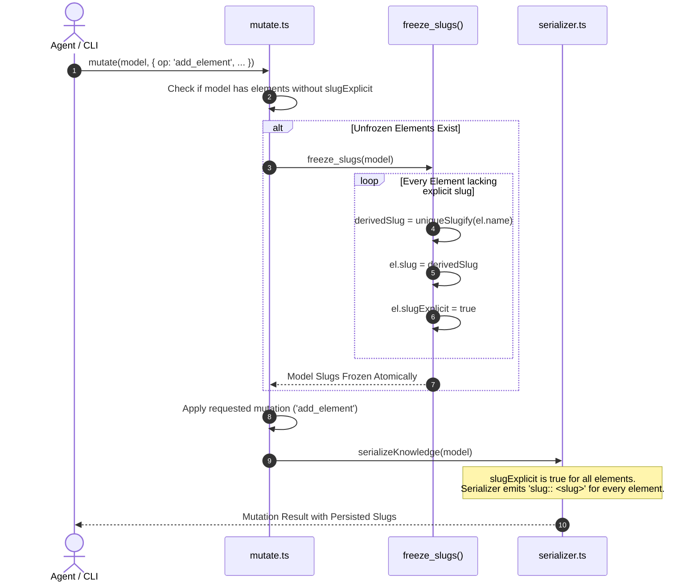
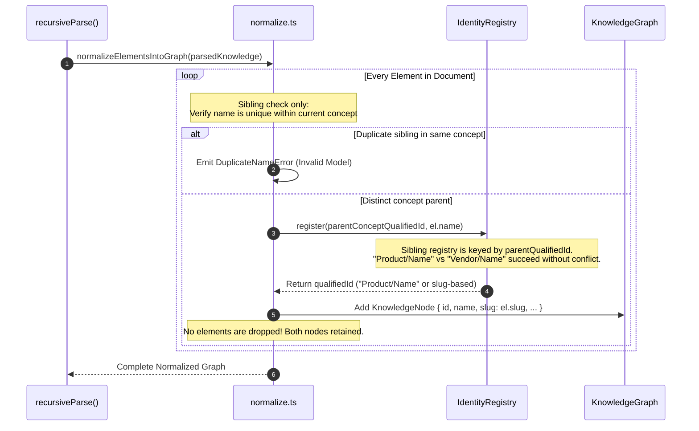

# Technical Design Document: Stable Element Identity (Slice S1)

**Change ID**: `2026-10-07-stable-element-identity`  
**Status**: `Draft`  
**Author**: `sdd-design subagent`  
**Artifact Mode**: Hybrid (`Engram` + `OpenSpec filesystem`)  
**Target Specification**: `iNNfo_V_0-4-0_NN.md` (Level 1 Normative Meta-bluepriNNt)

---

## 1. Executive Summary & Intent

Slice S1 (`stable-element-identity`) is the foundational milestone of the `stable-identity-and-changesets` architectural initiative. In prior versions of cogNNitive, element identity was conflated with display name (`One name, one identity`). This caused structural brittleness:
1. Renaming an element broke incoming citations, wikilinks, and matrix coordinates.
2. Normalization enforced a destructive model-wide display name uniqueness rule (R-IE-02), silently dropping valid domain elements if their names collided across different concepts.
3. Citations across models were forced to point to versioned file paths (`models/strategy_V_0-1-0_NN.md@## Vision`), requiring widespread cascading edits upon any minor version bump.
4. Level 3 kNNowledge documents in the Vue editor risked accidental ad-hoc mutations that bypassed graph changeset semantics.

Slice S1 resolves these issues by:
- Introducing **immutable, explicit slugs** (`slug::`) for elements, concepts, and matrices.
- Decoupling node identity from display names, allowing cross-concept duplicate display names and reversing R-IE-02 node dropping.
- Establishing extension-less `model_slug` identities in frontmatter and extending the `@` citation grammar to address model elements, fields, and matrix cells (`model_slug@element-slug`, `model_slug@matrix&row&col`).
- Implementing atomic slug freezing (`freeze_slugs`) on mutation and domain-wide upgrades.
- Enforcing a read-only guard in `innfo-editor` for Level 3 kNNowledge models (D18).
- Resolving references slug-first with tracked legacy name fallback (D6, D16).

---

## 2. Requirements & Traceability Matrix

The design maps directly to the four OpenSpec deltas and proposal:

| Spec / Delta | Requirement | Architectural Decision | Implementation Target |
|---|---|---|---|
| `stable-element-identity` | Explicit & Immutable Slug Declarations | **D1** | `parser/serializer.ts`, `recursiveParser/normalize.ts`, `types/parser.ts` |
| `stable-element-identity` | Cross-Concept Same-Name Coexistence (Reversing R-IE-02) | **D3** | `recursiveParser/normalize.ts`, `identity.ts` |
| `stable-element-identity` | Model Frontmatter Identity Allow-List | **D4** | `types/parser.ts`, `parser/serializer.ts` |
| `typed-source-references` | Single shared source-reference parser (`@` grammar) | **D5** | `sourceRef.ts`, `unitResolve.ts`, `console/citations.ts` |
| `typed-source-references` | Exhaustive `KnowledgeUnit` dispatch | **D5** | `exhaustiveUnitKind.test.ts`, `ok.ts`, `missing-case.ts`, `FilePreviewModal.vue` |
| `typed-source-references` | Semantic Model Citation Target Resolution | **D5** | `validator/workspaceSources.ts` |
| `model-mutation-references`| Slug-First Structural and Wikilink Reference Resolution | **D6** | `validator/references.ts` |
| `model-mutation-references`| Cross-Model Reference Cascading Invariance on Bump | **D4**, **D5** | `WorkspacePersistenceService.ts`, `bump_version` |
| `model-mutation-references`| Legacy Reference Fallback Ledger | **D16** | `validator/references.ts`, `legacy-ledger.yaml` |
| `editor-lineage-ui` | Read-Only Guard for Level 3 kNNowledge Models | **D18** | `workspaceStore.ts`, editor toolbar/header |
| `stable-element-identity` | Slug Freezing Operation (`freeze_slugs`) & Diagnostics | **D19** | `mutate.ts`, `validator/knowledge-checks.ts`, `skills/nn-upgrade` |

---

## 3. Architecture Decisions

### Decision D1: Immutable, Explicit Slug Identity
- **Rule**: Every element carries an explicit, immutable `slug::` property conforming to `^[a-z0-9]+(?:-[a-z0-9]+)*$`. Concepts and matrices in Level-2 bluepriNNts also carry explicit `slug` declarations.
- **Rename Invariant**: Renaming an element (`rename_element`) updates `element.name` but **MUST NEVER** alter or clear `element.slug`. The code `element.slug = undefined` in `mutate.ts` line 578 is eliminated.
- **Serialization**: `slug:: <slug>` is emitted by `serializeKnowledge` whenever `slugExplicit === true` or when the model is in a frozen state.

### Decision D3: Slug-Based Model Uniqueness & Reversing R-IE-02
- **Rule**: Slug uniqueness is enforced per model. Sibling display names under the same concept must be unique. However, elements under *different* concepts within the same model **MAY** share identical display names.
- **Destructive Dropping Reversed**: The R-IE-02 check in `normalize.ts` that dropped elements when `modelWideElementNames.has(el.name)` is eliminated.
- **Graph Qualified ID**: In `IdentityRegistry`, qualified IDs follow `ParentQualifiedId/ElementName` or are keyed by slug. Because distinct concepts form distinct ancestor paths, duplicate element names across concepts produce distinct qualified IDs without collision.

### Decision D4: Extension-Less Model Identity in Frontmatter
- **Rule**: Models carry `model_slug: string` and optional `workspace_id: string` in frontmatter. `model_slug` is extension-less, lowercase kebab-case, and path-free, unique per domain.
- **Allow-List Preservation**: `serializeKnowledge` reconstructed frontmatter allow-list is updated to emit `model_slug` and `workspace_id`. Even with `useRawFrontmatter: false`, these fields are never dropped.

### Decision D5: Universal Addressing Grammar (`<doc>@<unit>&<subunit>`)
- **Rule**: The `@` citation grammar is extended to support semantic model targets without file extensions.
- **Grammar Formats**:
  * Element: `model_slug@element-slug` (`kind: 'element'`, `slug: string`)
  * Element Field: `model_slug@element-slug&field_name` (`kind: 'element'`, `subunits: [field_name]`)
  * Matrix: `model_slug@matrix-slug` (`kind: 'matrix'`, `matrixSlug: string`)
  * Matrix Cell: `model_slug@matrix-slug&row-slug&col-slug` (`kind: 'matrix'`, `matrixSlug`, `rowSlug`, `colSlug`)
- **Exhaustive Dispatch**: `KnowledgeUnit` union adds `ElementUnit` and `MatrixUnit`. All 5 unit kinds (`header`, `row`, `pointer`, `element`, `matrix`) must be handled exhaustively in every switch across the codebase, terminating in `assertNever`.

### Decision D6 & D16: Slug-First Resolution & Legacy Ledger
- **Rule**: Structural references (fields, matrix headers, cross-model citations) and prose wikilinks (`[[target]]`) resolve slug-first:
  1. Exact slug match (`element.slug`).
  2. Exact name match (legacy fallback).
  3. Normalized name match with hyphen/dash tolerance (legacy fallback).
- **Ambiguity Detection**: If a name-based reference resolves to more than one element across different concepts, emit `AMBIGUOUS_ELEMENT_NAME` (severity `warning` or `error` if strict) and refuse to guess.
- **Legacy Ledger (D16)**: When resolving via name fallback, tag evaluation with `legacy:lineage-reference-name-fallback` and register the instance in `legacy-ledger.yaml`.

### Decision D18: Vue Editor Read-Only Guard for Level 3 Models
- **Rule**: Level 3 kNNowledge models (`role === 'knowledge'` or `level === 3`) are read-only in `innfo-editor`.
- **Enforcement**: `saveActiveFile`, `saveActiveFileWithVersionBump`, and mutation execution in `workspaceStore.ts` reject Level 3 writes with:  
  `"kNNowledge models are read-only in the Vue editor per architectural decision D18. Please use agent-assisted changesets."`
- **UI Indication**: The editor renders a read-only badge/banner and disables editing controls for Level 3 documents. Level 1 (specs) and Level 2 (bluepriNNts) remain editable.

### Decision D19: Slug Freezing Lifecycle (`freeze_slugs`)
- **Rule**: Slugs are frozen per model.
  * Level 3 models with missing `slug::` declarations trigger validator warning `UNFROZEN_MODEL`. Unfrozen models remain readable.
  * The first mutation on an unfrozen model automatically executes `freeze_slugs` before applying changes.
  * `freeze_slugs` derives deterministic slugs via `uniqueSlugify(element.name)`, assigns them to `element.slug`, and sets `element.slugExplicit = true`.
  * Workspace upgrade command in `skills/nn-upgrade` migrates all Level 3 models domain-wide.

---

## 4. Data Structures & Schemas

### 4.1 Parser & Metamodel Interfaces (`iNNfo/packages/innfo-core/src/types/parser.ts`)

```typescript
export interface SpecFrontmatter {
  spec_version: string
  spec_url: string
  level: SpecLevel
  /** Domain-wide immutable, extension-less model slug (D4). */
  model_slug?: string
  /** Stable workspace identity GUID or token. */
  workspace_id?: string
  parent?: string | ParentRef
  parent_spec?: ParentRef
  // ... other existing fields
}

export interface Concept {
  name: string
  /** Explicit blueprint-level slug for the concept (D1). */
  slug?: string
  parent?: string
  icon?: string
  type: ConceptType
  color?: string
  weight?: number
  fields?: ConceptField[]
  tags?: string[]
}

export interface MatrixDecl {
  name: string
  /** Explicit blueprint-level slug for the matrix (D1). */
  slug?: string
  source: string
  target: string
  params: string
  values?: string[]
  widgetType?: string
  widgetConfig?: Record<string, unknown>
  description?: string
  label?: string
  min_color?: string
  max_color?: string
}
```

### 4.2 Graph Node (`iNNfo/packages/innfo-core/src/types/graph.ts`)

```typescript
export interface KnowledgeNode {
  id: string // Qualified ID: "Concept/ElementName" or slug-based
  name: string // Display name (unique among sibling elements of the same concept)
  parentId: string | null
  childIds: string[]
  type: string
  /** Immutable element slug (D1). */
  slug?: string
  fields: Record<string, FieldValue>
  markers: Record<string, number | string>
  tags?: string[]
  relationships: ModelRelationship[]
  sources?: SourceRef[]
  rawSections: Record<string, string>
  source: { path: string }
  kind?: 'root' | 'concept' | 'element'
}
```

### 4.3 KnowledgeUnit & Source Addressing (`iNNfo/packages/innfo-core/src/sourceRef.ts`)

```typescript
export interface HeaderUnit {
  kind: 'header'
  level: 1 | 2 | 3 | 4 | 5 | 6
  text: string
  slug: string
}

export interface RowUnit {
  kind: 'row'
  id: string
}

export interface PointerUnit {
  kind: 'pointer'
  pointer: string
}

export interface ElementUnit {
  /** Semantic model element unit kind (D5). */
  kind: 'element'
  /** Immutable element slug within the model. */
  slug: string
}

export interface MatrixUnit {
  /** Semantic model matrix unit kind (D5). */
  kind: 'matrix'
  matrixSlug: string
  rowSlug?: string
  colSlug?: string
}

/** 5-way exhaustive union representing all addressable knowledge units in cogNNitive. */
export type KnowledgeUnit = HeaderUnit | RowUnit | PointerUnit | ElementUnit | MatrixUnit

export interface SourceRef {
  /** Workspace-relative file path or extension-less model_slug. */
  filePath: string
  fileName: string
  slug?: string
  /** 'model' when target is a model slug or knowledge role; 'source' for sources. */
  kind: 'source' | 'model'
  raw: string
  unit?: KnowledgeUnit
  /** Subunits: element field name or additional matrix coordinates. */
  subunits?: string[]
}
```

---

## 5. Component Interaction & Sequence Diagrams

### 5.1 Addressing Parser and Resolver Flow (`parseCitation` / `resolveUnitPath`)

The address parser inspects the citation prefix before `@`. If it matches an extension-less slug pattern `^[a-z0-9]+(?:-[a-z0-9]+)*$`, it routes to model unit parsing rather than file system path resolution.



---

### 5.2 Slug-First Reference Resolver and Ambiguous Diagnostic Flow

References and wikilinks first attempt to match element slugs. Only when no slug matches does the resolver fall back to display names, checking for multi-concept ambiguity.



---

### 5.3 Slug Freezing on Mutation Flow (`freeze_slugs`)

When any mutation is applied to a model, the mutation controller checks whether the model is already frozen. If any elements lack an explicit `slug::`, it atomically runs `freeze_slugs` first.



---

### 5.4 Normalization Flow Reversing R-IE-02 Dropping

Previously, `normalize.ts` dropped any element whose display name had been seen anywhere else in the model. In S1, elements are grouped under their concept parents in `IdentityRegistry`, permitting identical names across distinct concepts.



---

## 6. Detailed Component Designs & File Changes Breakdown

### 6.1 Package `iNNfo/packages/innfo-core`

#### `src/types/parser.ts`
- Add `model_slug?: string` and `workspace_id?: string` to `SpecFrontmatter`.
- Add `slug?: string` to `Concept` and `MatrixDecl`.
- Ensure `ElementNode.slugExplicit?: boolean` is well-typed.

#### `src/parser/serializer.ts`
- In `serializeKnowledge` (lines 171–215):
  ```typescript
  if (fm.model_slug) lines.push(`model_slug: "${fm.model_slug}"`)
  if (fm.workspace_id) lines.push(`workspace_id: "${fm.workspace_id}"`)
  ```
- In element serialization (line 350):
  Ensure `node.slugExplicit && node.slug` outputs `slug:: ${node.slug}`.

#### `src/sourceRef.ts`
- Add `ElementUnit` and `MatrixUnit` to `KnowledgeUnit` union:
  ```typescript
  export interface ElementUnit {
    kind: 'element'
    slug: string
  }

  export interface MatrixUnit {
    kind: 'matrix'
    matrixSlug: string
    rowSlug?: string
    colSlug?: string
  }

  export type KnowledgeUnit = HeaderUnit | RowUnit | PointerUnit | ElementUnit | MatrixUnit
  ```
- Update `resolveUnitPath(rawPath)`:
  Allow bare `model_slug` strings conforming to `^[a-z0-9]+(?:-[a-z0-9]+)*$` when no file extension is present. Assign `kind: 'model'`.
- Update `parseKnowledgeUnitRef(input)`:
  - If target is a model slug:
    - If tail matches matrix pattern `matrix_slug&row&col` or `matrix_slug`: produce `MatrixUnit`.
    - Otherwise, produce `ElementUnit` with first segment as element slug and subsequent segment as element field subunit.
- Update `serializeKnowledgeUnitRef`:
  Add `case 'element':` and `case 'matrix':` handling before `assertNever`.
- Update `unitLabel`:
  Add `case 'element':` and `case 'matrix':` handling before `assertNever`.

#### `src/recursiveParser/normalize.ts`
- Delete `modelWideElementNames = new Set<string>()` and lines 187–191.
- Update `qualifiedIdByElementName`: change from global element name map to a map keyed by concept or slug, or look up via `parentQualifiedId + '/' + el.name`.
- Ensure elements sharing display names across distinct concepts are retained in `ctx.nodes` without emitting error diagnostics or dropping nodes.

#### `src/identity.ts`
- Confirm `IdentityRegistry.register(parentQualifiedId, name)` behavior allows identical names under differing `parentQualifiedId`.
- Add optional slug-based lookup helpers if needed by node consumers.

#### `src/mutate.ts`
- In `rename_element`:
  - **Remove line 578**: `element.slug = undefined`. Element slug remains unchanged.
  - **Remove lines 561–569**: model-wide display name uniqueness check. Replace with sibling uniqueness check within the target concept.
- In `add_element`:
  - Replace model-wide display name check (lines 296–303) with sibling check within `conceptName`.
  - Validate that `args.slug` (if provided) is unique within the model.
- Implement `freeze_slugs(model: ParsedKnowledge)`:
  ```typescript
  export function freeze_slugs(model: ParsedKnowledge): MutationResult {
    const existingSlugs = new Set<string>()
    // Collect existing explicit slugs
    for (const elements of model.elements.values()) {
      for (const el of elements) {
        if (el.slug) existingSlugs.add(el.slug.toLowerCase())
      }
    }
    for (const elements of model.elements.values()) {
      for (const el of elements) {
        if (!el.slug || !el.slugExplicit) {
          const baseSlug = el.slug || slugifyHeading(el.name)
          let candidate = baseSlug
          let counter = 1
          while (existingSlugs.has(candidate.toLowerCase())) {
            candidate = `${baseSlug}-${counter++}`
          }
          el.slug = candidate
          el.slugExplicit = true
          existingSlugs.add(candidate.toLowerCase())
        }
      }
    }
    return { success: true }
  }
  ```
- In the top-level mutation dispatcher in `mutate.ts`:
  Before executing any mutation operation, inspect whether the target model contains elements where `!el.slugExplicit`. If so, automatically invoke `freeze_slugs(model)`.

#### `src/validator/knowledge-checks.ts`
- Check element slugs for duplicates:
  Emit diagnostic with `code: 'DUPLICATE_SLUG'`, severity: `'error'` when two elements share a slug.
- Check for unfrozen Level-3 models:
  Emit diagnostic with `code: 'UNFROZEN_MODEL'`, severity: `'warning'` if `model.frontmatter.level === 3` and any element has `!el.slugExplicit`.

#### `src/validator/references.ts`
- In `resolveElementName` / `validateElementFieldReferences`:
  Implement 3-tier precedence:
  1. Exact slug match (`el.slug === target`).
  2. Exact display name match (`el.name.toLowerCase() === target.toLowerCase()`).
  3. Normalized separator name match (`normalizeSeparators(el.name) === normalizeSeparators(target)`).
- When resolving via display name fallback:
  - Check if multiple elements in different concepts share that name. If `matches.length > 1`, emit `AMBIGUOUS_ELEMENT_NAME` (severity `warning`).
  - Attach legacy marker metadata: `legacy:lineage-reference-name-fallback`.

#### Exhaustive Unit Kind Switches across `innfo-core`
- `src/unitResolve.ts`: Handle `element` and `matrix` cases.
- `src/console/citations.ts`: Handle `element` and `matrix` cases.
- `src/validator/workspaceSources.ts`: Handle `element` and `matrix` cases, resolving model slugs against workspace model registry.
- `tests/exhaustiveUnitKind.test.ts` & `tests/fixtures/exhaustive/`:
  Update `ok.ts` to switch on all 5 kinds. Update `missing-case.ts`.

---

### 6.2 Package `iNNfo/apps/innfo-editor`

#### `src/stores/workspaceStore.ts`
- In `saveActiveFile` and `saveActiveFileWithVersionBump`:
  Inspect the active node or model frontmatter:
  ```typescript
  const rootNode = knowledgeStore.getNode(rootId)
  const isLevel3Knowledge = rootNode?.type === 'knowledge' || rootNode?.rawContent?.includes('level: 3')
  if (isLevel3Knowledge) {
    throw new Error(
      'kNNowledge models are read-only in the Vue editor per architectural decision D18. Please use agent-assisted changesets.'
    )
  }
  ```
- Expose `isReadOnlyActiveDocument: computed(() => ...)` so the editor layout can render a read-only banner/badge and disable direct text editing controls.

#### `src/components/editor/FilePreviewModal.vue`
- Update exhaustive switch over `unit.kind` to handle `element` and `matrix` kinds.

---

### 6.3 Tooling & Upgrades `skills/nn-upgrade`

#### `scripts/migrate-domain.js`
- Add command/flow `freeze-domain-slugs`:
  Traverses all `.md` models in `models/` with `level: 3`, runs `freeze_slugs`, serializes changes, and reports migration summary.

---

### 6.4 Specification & MCP

#### `iNNfo/specs/iNNfo_V_0-4-0_NN.md`
- Create new normative specification for `V_0-4-0`.
- Update Principle 5 from "One name, one identity" to:
  > **Stable identity via immutable slugs**: Entities carry immutable, explicit slug identities (`slug::`). Display names are decoupled from identity, enabling non-destructive renames, cross-concept duplicate names, and stable `@` addressing.
- Specify `model_slug`, explicit concept and matrix slugs, and the `@` address grammar.

#### `iNNfo/packages/innfo-mcp/src/tools/init-knowledge.ts`
- Repin to `iNNfo_V_0-4-0_NN.md` and default generated frontmatter to `spec_version: "V_0-4-0"`.

#### `legacy-ledger.yaml`
- Add ledger entry:
  ```yaml
  - id: lineage-reference-name-fallback
    what: Fallback resolution of structural references and wikilinks by display name rather than immutable slug
    paths:
      - iNNfo/packages/innfo-core/src/validator/references.ts
    why: Preserves backwards compatibility for existing models with name-based references and wikilinks while migrating to slug-first references
    removal: all-models-migrated-to-slugs + maintainer-sign-off
    owner: 2026-10-07-stable-element-identity
  ```

---

## 7. Strict TDD Test Strategy

All implementation will follow Strict TDD: tests written and asserted red before writing production code.

### 7.1 Unit Tests in Vitest (`innfo-core`)

1. **Explicit Slugs & Serialization (`parser/serializer.spec.ts`)**:
   - `test('parses explicit slug and marks slugExplicit true')`
   - `test('serializer emits slug:: line when slugExplicit is true')`
   - `test('serializer preserves model_slug and workspace_id in frontmatter')`
   - `test('retains slug on element rename without resetting to undefined')`

2. **Decoupled Identity & R-IE-02 Reversal (`recursiveParser/normalize.spec.ts`)**:
   - `test('permits identical element names across different concepts without dropping nodes')`
   - `test('enforces sibling name uniqueness within the same concept')`
   - `test('verifies both cross-concept nodes exist in normalized graph with distinct qualified IDs')`

3. **Universal Addressing Grammar (`sourceRef.spec.ts`)**:
   - `test('parses extension-less model_slug@element-slug into ElementUnit')`
   - `test('parses model_slug@element-slug&field into ElementUnit with subunits')`
   - `test('parses model_slug@matrix&row&col into MatrixUnit')`
   - `test('serializes ElementUnit and MatrixUnit back to canonical @ syntax')`
   - `test('preserves backwards compatibility for markdown headings, CSV rows, and JSON pointers')`

4. **Exhaustive Dispatch Typecheck (`exhaustiveUnitKind.test.ts`)**:
   - `test('compiles ok.ts fixture with all 5 unit kinds')`
   - `test('fails compilation when ElementUnit or MatrixUnit is omitted from switch')`

5. **Reference Resolution & Diagnostics (`validator/references.spec.ts` & `knowledge-checks.spec.ts`)**:
   - `test('resolves wikilinks to element slugs before display names')`
   - `test('emits AMBIGUOUS_ELEMENT_NAME warning when display name matches across multiple concepts')`
   - `test('emits DUPLICATE_SLUG error when two elements declare identical slugs')`
   - `test('emits UNFROZEN_MODEL warning for Level 3 model with missing slugs')`

6. **Slug Freezing Lifecycle (`mutate.spec.ts`)**:
   - `test('freeze_slugs assigns deterministic unique slugs to all unfrozen elements')`
   - `test('first mutation on unfrozen model automatically executes freeze_slugs')`
   - `test('subsequent serialization of frozen model emits slug:: lines for all elements')`

### 7.2 Editor Guard Tests (`innfo-editor`)

1. **Read-Only Guard (`workspaceStore.spec.ts`)**:
   - `test('saveActiveFile rejects Level 3 model with D18 error message')`
   - `test('saveActiveFileWithVersionBump rejects Level 3 model with D18 error message')`
   - `test('allows saving Level 1 specs and Level 2 templates without error')`

---

## 8. Rollout, Compatibility & Migration Plan

1. **Zero Downtime / Phased Adoption**:
   - Existing Level 3 models lacking `slug::` remain 100% valid for read, validation, and query operations (only triggering the non-fatal `UNFROZEN_MODEL` warning).
   - Once edited by an agent changeset or migrated via `nn-upgrade`, models become frozen permanently with explicit `slug::` lines.
2. **Backwards Compatibility**:
   - Existing `.md`, `.csv`, `.json` file-based source references continue to resolve without changes.
   - Legacy name-based references continue to resolve tolerantly via Step 2 fallback, logging occurrences in `legacy-ledger.yaml`.
3. **Recovery & Reversion**:
   - Slugs are purely additive text lines in Markdown (`slug:: <slug>`). Reverting to name-only resolution does not corrupt model ASTs.
